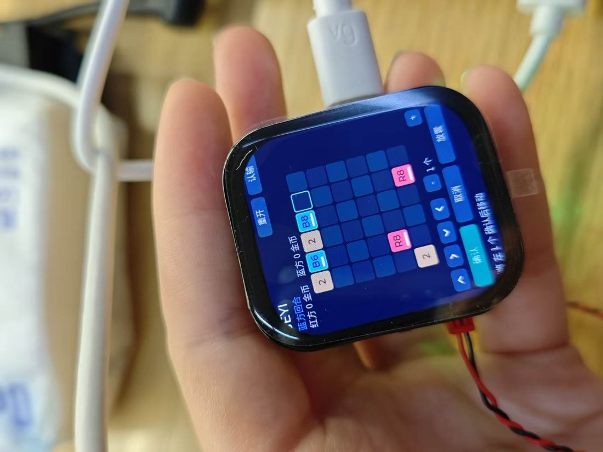
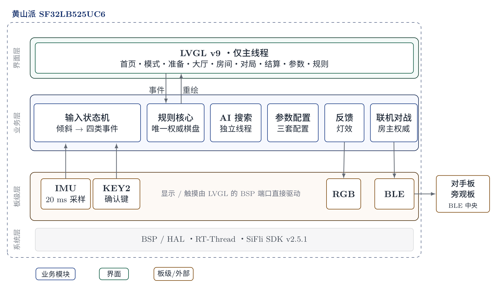
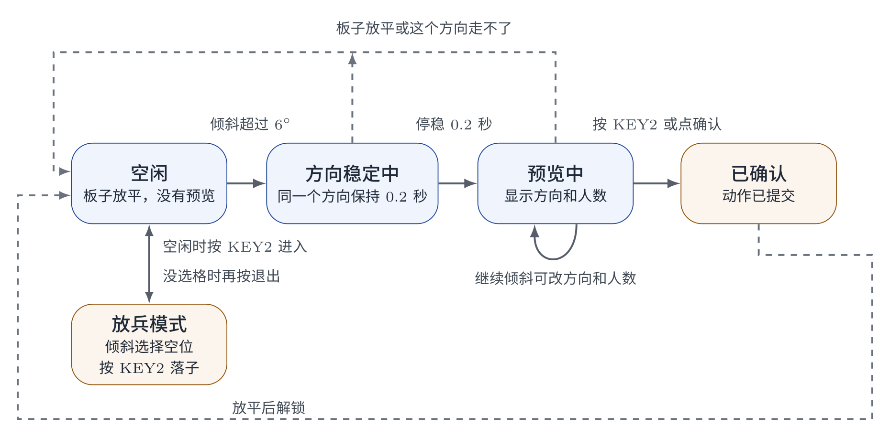
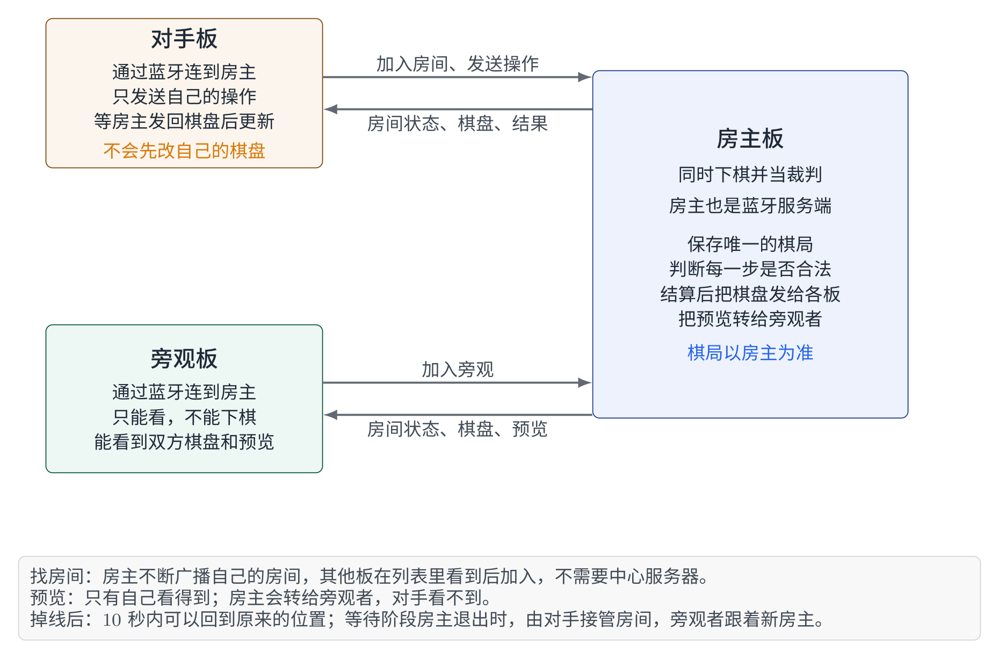

# 格弈（geyi）

> 在黄山派 SF32LB52 上，用倾斜和实体按键玩的合成攻防棋。



格弈把「2048 式合并」「战棋式士兵伤害」和「金币放兵」组合成一局约 3~10 分钟的对战。
玩家倾斜板子选择方向与士兵数量，屏幕实时给出方向、数量和受影响格子的预览，按 **KEY2**
确认后落子；手指不需要遮挡棋盘。产品支持同板双人、人机对战、参数自定义，以及基于 BLE
的联机、旁观和断线重连。

## 功能

| 模式 / 能力 | 说明 |
|---|---|
| 同板双人 | 4~8 阶棋盘，数字合并、士兵移动/攻击、金币放兵、胜负与平局 |
| 人机对战 | negamax + Alpha-Beta，独立 AI 线程；先后手准备页；AI 先预览约 500 ms 再落子 |
| 参数自定义 | 棋盘大小、生成间隔、血量、攻击、金币、AI 搜索深度、缓冲阈值等 10 项 |
| 体感输入 | 倾斜选方向/数量，KEY2 确认；触摸用于菜单与辅助操作 |
| BLE 联机 | 房主权威 + 全量快照；大厅、房间、换座、旁观、10 s 断线重连 |
| 历史/计时 | 最近 10 局，NOR + FlashDB 持久化；联机房主/房客各记一条 |
| 反馈 | RGB 灯效：有效行动短闪绿，终局按胜方红/蓝、平局黄 |

完整需求、设计与测试记录见 [`docs/`](docs/README.md)；逐条验收状态见
[`docs/08-验收矩阵.md`](docs/08-验收矩阵.md)。

## 怎么玩

1. 首页选择「开始游戏」「自定义参数」或「历史记录」。
2. 开始游戏后选择单机、人机或联机；人机在准备页选择执红/执蓝。
3. 对局中把板子向目标方向倾斜：方向决定移动方向，倾斜幅度决定士兵数量。
4. 屏幕显示预览后，按 **KEY2** 确认；板子放平可取消预览。
5. 空闲时按 **KEY2** 进入放兵模式，倾斜选择空位，再按 **KEY2** 落兵。

## 架构



界面层只在主线程调用 LVGL；规则、输入、参数、AI 和联机房间逻辑都是不依赖硬件的纯 C 模块，
因此大部分回归可以在 PC 上完成。板级层负责 IMU、KEY2、RGB 与 BLE。





联机采用房主权威：房主持有唯一棋盘并广播全量快照，客户端只发送操作意图；旁观者只读，
预览只转发给旁观者。详细设计见 [`docs/02-方案设计说明.md`](docs/02-方案设计说明.md)。

## 构建与烧录

**环境**：SiFli SDK v2.5.1、RT-Thread、LVGL v9，板型 `sf32lb52-lchspi-ulp`。
先按课程指导手册附录 F 安装 SDK，并在终端执行 `export.ps1` / `export.sh`。

```bash
python scripts/check_env.py          # 检查 SDK / scons / ARM 编译器
python scripts/build_firmware.py     # 编译固件
# 产物：project/build_sf32lb52-lchspi-ulp_hcpu/main.bin
```

烧录二选一：

- VS Code + SiFli-SDK-CodeKit：打开 `project/`，选择板型后点“烧录”。
- 命令行：`python tools/flash_and_capture.py --check` 预检，
  `python tools/flash_and_capture.py` 烧录并采集 120 s 串口。

启动后串口应出现 `core/input/ai/param/paramui/net/light=PASS` 和
`[geyi:lcd] READY 390 x 450`。可烧录固件与校验和另见 [`firmware/README.md`](firmware/README.md)。

## 测试

```bash
python tools/run_host.py              # 主机断言：规则/输入/倾斜/参数/AI/联机/历史/平衡
python tools/coverage.py --min 70     # 核心模块行覆盖率
python tools/verify_all.py --coverage # 文档检查 + 主机测试 + 覆盖率
python scripts/check_all.py --final   # 提交规范/开发日志/追踪/manifest/固件编译
```

当前结果：

| 套件 | 结果 |
|---|---|
| 规则核心 | 24,576 断言 PASS |
| 输入 / 倾斜 | 105 + 283 断言 PASS |
| 参数 / 参数页 | 2,517 + 85 断言 PASS |
| AI | 116 断言 PASS |
| 联机协议 / 应用 | 428 + 453 checks PASS |
| 历史 / 时长 | 84 断言 PASS |
| 平衡扫描 | 10 断言 PASS |
| 主机行覆盖率 | 76.5%–100%（门槛 70%） |

板端主流程由学生在真机上确认；串口、照片与联机日志在 [`evidence/`](evidence/)。

## 项目结构

```text
.
├── docs/           需求、设计、测试、风险、验收矩阵、ADR、开发日志、研制总结
├── evidence/       板端照片、串口日志、联机与量化证据
├── firmware/       可烧录固件与 SHA-256（随归档 zip 交付，不进入源码历史）
├── project/        SiFli SDK 工程（SConstruct / Kconfig / proj.conf）
├── scripts/        课程检查、编译、开发日志脚本
├── src/            应用源码（规则、输入、AI、参数、联机、UI、历史）
├── tests/          主机单元测试
└── tools/          主机/桌面/联机测试与烧录工具
```

## 文档

| 文档 | 内容 |
|---|---|
| [需求规格说明](docs/01-需求规格说明.md) | L1–L4 需求、用户交互、REQ-xxx |
| [方案设计说明](docs/02-方案设计说明.md) | 架构、数据流、状态机、联机/历史设计 |
| [测试计划](docs/03-测试计划.md) / [测试报告](docs/04-测试报告.md) | TC-xxx 与执行结果 |
| [研制总结](docs/05-研制总结.docx) | 项目过程、结果与不足（Word） |
| [风险与问题台账](docs/06-风险与问题台账.md) | 风险、缺陷与处理状态 |
| [量化测量报告](docs/07-量化测量报告.md) | 倾斜输入与 AI 搜索的主机数据 |
| [验收矩阵](docs/08-验收矩阵.md) | 需求 → 设计 → TC → 证据的一页索引 |
| [归档清单](docs/09-归档清单.md) | 封版、打包与个人验收清单 |

## 已知限制

- 参数存 RAM，重启回默认；历史记录持久化在 NOR Flash，保留最近 10 局。
- 无 WiFi：联机只走 BLE；互联网联机、BT PAN 不在本期范围。
- 无音频与震动马达，反馈只用板载 RGB。
- 满旁观容量、多旁观者、24 h soak、新用户试玩、帧率/延迟/AI 耗时仪器量化为扩展项，
  不在本期验收基线。

## 团队

| 成员 | 负责 |
|---|---|
| 蔡融汉 | 产品方向、联机/BLE、集成与文档、最终提交 |
| 殷白玉 | 单机规则、输入、LVGL、板端接入 |
| 郑瑞杭 | 人机 AI、预览、准备页、移动顺序 |
| 吴周锦 | 参数子系统、平衡扫描、量化测量 |
| 赵志浩 | 历史记录与单局计时 |

## 第三方与许可

固件使用 [SiFli SDK](https://github.com/OpenSiFli/SiFli-SDK)（Apache-2.0）、
[LVGL v9](https://lvgl.io/)（MIT）、思源黑体子集（OFL-1.1）；
设计图使用 Noto Sans SC（OFL-1.1）。来源与许可全文见
[`docs/refs/third-party.md`](docs/refs/third-party.md)。

---

本仓库基于课程脚手架 `course_starter` 开发，`project/` 与 `src/` 遵循 SiFli SDK 工程结构。
