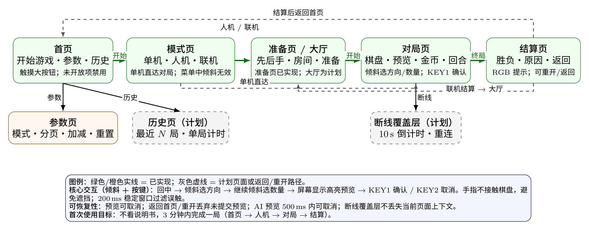

# 需求规格说明（格弈 / geyi）

| 项 | 内容 |
|---|---|
| 项目 | 格弈（geyi） |
| 版本 / 状态 | v1.0 / 开发中（L1–L4 与用户交互专章已补；联机 REQ-501~513、历史/计时 REQ-601~606 为设计基线，均未实现） |
| 负责人 / 日期 | 蔡融汉 / 2026-11-08 |

## 修订记录

| 版本 | 日期 | 修改人 | 修改内容 | AI参与 |
|---|---|---|---|---|
| v0.1 | 2026-10-15 | 蔡融汉 | 创建；记录仓库协作需求 | 是(Claude Code) |
| v0.2 | 2026-10-17 | 殷白玉、郑瑞杭、吴周锦 | 补充单机、人机、参数需求 | 是(Claude Code) |
| v0.3 | 2026-10-28 | 蔡融汉 | 集成修正；统一产品名“格弈”；补充硬件约束与需求状态 | 是(Claude Code) |
| v0.4 | 2026-10-28 | 蔡融汉 | 按 10-17 人机视频与 10-18 移动顺序照片统一状态口径，修复需求状态与验收标准不一致 | 是(Claude Code) |
| v0.5 | 2026-10-28 | 蔡融汉 | 参数页软件实现（REQ-408）；补参数到棋盘/AI/输入的接线状态，明确桌面/板端未验证 | 是(Claude Code) |
| v0.6 | 2026-10-28 | 蔡融汉 | 参数页桌面 LVGL 与固件 844,176 B 编译通过；板端仍未烧录 | 是(Claude Code) |
| v0.7 | 2026-10-28 | 蔡融汉 | 固件 844,200 B 烧录；连续 5 次启动 param/paramui=PASS；参数页 UI 待学生确认 | 是(Claude Code) |
| v0.8 | 2026-10-28 | 蔡融汉 | 中文参数名/SPAWN 减一/末行布局修复；最终中文第 1 页板端照片确认；平衡扫描完成 | 是(Claude Code) |
| v0.9 | 2026-11-08 | 蔡融汉 | 新增联机对战需求基线 REQ-501~REQ-513（房主权威、BLE 拓扑、大厅/房间、全量快照、预览私密、断线重连）；状态为未实现，待实现与双板验证 | 是(Claude Code / deepseek-v4-flash；按学生 2026-11-08 方案起草) |
| v1.0 | 2026-11-08 | 蔡融汉 | 补 L1 用户故事、L2 功能需求映射、L3 非功能需求、L4 约束与用户交互专章；新增历史/计时 REQ-601~REQ-606；明确联机/历史均未实现 | 是(Claude Code / deepseek-v4-flash；按学生口述的用户故事与交互要点整理，未改产品范围) |

## 用户与场景（2026-11-08）

### 1. 需求分析：传统棋类游戏的问题

| 问题 | 具体表现 | 对本产品的要求 |
|---|---|---|
| 线下对战受地点与人数限制 | 必须两人同地，还要带棋盘、棋子、找场地；缺一人就玩不了 | 同板双人、人机、联机三种模式；开机即玩，不依赖额外棋盘 |
| 线上棋类在小屏上难操作 | 棋盘大、格子小，手指点选容易误触；手指还会遮挡棋盘 | 6×6 小棋盘；倾斜选方向/数量、实体按键确认；手指不接触棋盘 |
| 传统棋类节奏慢、门槛高 | 规则记忆负担、等待时间长、缺少即时反馈 | 2048 合并 + 战棋伤害的混合规则；预览、金币、血条、灯效即时反馈 |
| 操作与规则脱节 | 纯点击/拖动，体感与棋局规则没有关系 | 倾斜方向决定移动方向，倾斜角度决定移动多少士兵，体感与规则深度耦合 |
| 单人练习孤独 | 只能等真人对手 | 人机 AI（negamax + Alpha-Beta）；联机大厅、房间、旁观 |
| 误操作/断线挫败 | 一次误触或瞬断可能毁掉整局 | 预览可取消、200 ms 稳定窗口、10 s 重连窗口、二次确认 |

### 2. 目标用户

- **主要用户**：对传统棋类感到无聊，想随时随地、便捷地体验“新颖 + 体感”棋类游戏的学生、桌游爱好者和 2048 类数字合并游戏玩家。
- **次要用户**：想单人练习的玩家（人机）、想围观的朋友（旁观）、想调整规则的玩家（参数页）。
- **非目标**：追求专业棋类段位、在线排位、跨平台账号体系的竞技用户；本产品不承诺竞技级平衡或专业棋力。

### 3. 典型使用场景

| 场景 | 用户 | 使用方式 | 成功判据 |
|---|---|---|---|
| 课间/宿舍同板对战 | 两名玩家 | 一块板，单机模式轮流操作 | 一局可完整结束，换手与胜负正确 |
| 单人练习 | 一名玩家 | 人机模式，选择执红/执蓝 | AI 合法落子，人类可完整对局 |
| 两人远程对战 | 两名玩家 + 两块板 | 一块房主、一块对手，BLE 连接 | 双方棋盘/金币/回合同步，断线可恢复 |
| 朋友旁观 | 第三块板/手机 | 以旁观者加入房间，只读 | 能看到双方棋盘与预览，不影响对局 |
| 自定义玩法 | 一名玩家 | 参数页调整棋盘/血量/生成间隔/缓冲 | 新开一局按新参数执行，局中不改 |
| 复盘 | 一名玩家 | 历史页查看最近对局与单局时长 | 记录字段完整，重启后按约定清空 |

### 4. 价值主张与产品边界

- **价值主张**：小屏可玩、手不遮屏、体感与规则耦合、低门槛但有策略深度。
- **产品边界**：不采集、不上传个人数据；联机只走板载 BLE，不做互联网匹配或云服务；不承诺专业棋力/平衡；本轮反馈只用 RGB，不做震动/音频；硬件无马达、无电池、无 TF 卡座。

## 需求分层总览（L1–L4，2026-11-08）

> 课程要求需求至少覆盖四个层次：L1 用户故事回答“为什么”，L2 功能需求回答“做什么”，
> L3 非功能需求回答“做得好不好”，L4 约束回答“能不能做”。本节是总览，详细验收判据在
> 各 REQ 条目与 `docs/03` 的 TC 中。

### L1 用户故事

| 编号 | 用户故事（作为…我希望…以便…） | 关联 L2 需求 | 优先级 |
|---|---|---|---|
| US-01 | 作为第一次接触的玩家，我希望开机看到清晰首页和大按钮，以便不看说明书也能开始 | REQ-313, NFR-UX-01 | P0 |
| US-02 | 作为玩家，我希望选择单机/人机/联机，以便按场景选择玩法 | REQ-313, REQ-315, REQ-501 | P0 |
| US-03 | 作为人机玩家，我希望选择执红或执蓝，以便按自己的习惯开局 | REQ-317 | P0 |
| US-04 | 作为玩家，我希望倾斜选择方向和数量，并在确认前看到预览，以便不误操作、不遮挡屏幕 | REQ-309, REQ-310, REQ-311 | P0 |
| US-05 | 作为玩家，我希望金币足够时选择底线列放兵，以便扭转局势 | REQ-305, REQ-311 | P0 |
| US-06 | 作为玩家，我希望看到金币、血量、回合、胜负和灯效，以便理解当前局面 | REQ-306, REQ-314 | P0 |
| US-07 | 作为玩家，我希望调整棋盘/血量/生成间隔/缓冲阈值，并在新局生效，以便对比不同玩法 | REQ-401~REQ-411 | P0 |
| US-08 | 作为玩家，我希望查看最近对局和单局时长，以便复盘 | REQ-601~REQ-606 | P1 |
| US-09 | 作为两名远程玩家，我希望通过 BLE 连接对战，以便不在同一地点也能玩 | REQ-501~REQ-506 | P1 |
| US-10 | 作为组织者/朋友，我希望看到多个房间并旁观，以便组局和观战 | REQ-502, REQ-503, REQ-505, REQ-507 | P1 |
| US-11 | 作为联机玩家，我希望短暂断线后能重连继续，以便不因瞬断输掉 | REQ-508~REQ-511 | P1 |
| US-12 | 作为玩家，我希望取消预览、返回或重开，以便误操作不毁掉对局 | REQ-302, REQ-307, REQ-313, REQ-316 | P0 |

### L2 功能需求编号规则

| 区间 | 范围 | 说明 |
|---|---|---|
| 2xx | 仓库协作 | REQ-201~REQ-202 |
| 3xx | 单机核心、输入、界面、AI | REQ-301~REQ-317 |
| 4xx | 参数配置与平衡性测试 | REQ-401~REQ-411 |
| 5xx | 联机对战、BLE、多房间、旁观、重连 | REQ-501~REQ-513 |
| 6xx | 历史记录与单局计时 | REQ-601~REQ-606 |

### L3 非功能需求

> 目标值按“产品需要 + 当前可测量手段”给出；未测项明确写“未测”，不得用目标值冒充实测。
> 主机测量方法见 `docs/07-量化测量报告.md`，板端测量方法见 `docs/03` 的非功能用例。

| 编号 | 类别 | 指标 | 目标/判据 | 测量方法 | 当前状态 |
|---|---|---|---|---|---|
| NFR-01 | 启动 | 冷启动到首页 | ≤ 2 s | 串口时间戳/录屏 | 未测 |
| NFR-02 | 输入延迟 | 倾斜到预览出现 | ≤ 250 ms（含 20 ms 采样 + 200 ms 稳定窗口） | 主机 `geyi_input_bench`；板端串口计时 | 主机 201–220 ms（`docs/07`）；板端未测 |
| NFR-03 | AI 延迟 | 单步思考 | ≤ 300 ms（设计上限） | 板端 `[geyi:perf]` 日志 | 主机深度 3–5 为 0.2–3.2 ms（`docs/07`）；板端未测 |
| NFR-04 | 帧率 | 390×450 对局渲染 | ≥ 30 fps | 板端帧计数/录屏 | 未测 |
| NFR-05 | 资源 | 固件、AI 栈、动态分配 | 固件 ≤ 1 MiB；AI 栈约 16 KiB；核心不用动态分配 | 构建产物/Map/栈水位 | 固件 847,344–847,944 B；栈水位未测 |
| NFR-06 | 可靠性 | 连续对局与长时运行 | 100 局无崩溃；24 h 无重启/内存持续下降 | 板端 soak 日志 | 未测（课程建议 72–168 h，本轮按风险缩短并记录理由） |
| NFR-07 | 输入鲁棒性 | 误触率、最小有效保持 | 三类噪声 0/10000；最小有效保持 200–220 ms | 主机 `measure.py`；板端人工动作 | 主机通过（`docs/07`）；板端正确率未测 |
| NFR-08 | 状态安全 | 无效/过期操作 | 不改变棋盘/revision；旧 seq/旧 AI 结果丢弃 | 主机断言 + 桌面测试 | 核心 26920 断言、AI 62 断言 PASS |
| NFR-09 | 可恢复性 | 取消/返回/重开/断线 | 预览可取消；返回/重开不残留；联机 10 s 窗口 | 桌面测试 + 双板 | 单机/人机桌面通过；联机未实现 |
| NFR-10 | 可用性 | 首次完成一局 | 不看说明书 3 分钟内完成 | 3–5 名新用户试玩 | 未测 |
| NFR-11 | 可维护性 | 模块边界、自动化、覆盖率 | 核心模块主机可测；CI 跑主机测试；核心行覆盖率 ≥ 70% | `run_host.py`、CI、gcov | 6 组主机断言 PASS；主机覆盖率 76.2%–100%（2026-11-08，`coverage.py --min 70` PASS）；CI 已接入、远端 run 待确认；板端不适用 |
| NFR-12 | 安全/隐私 | 数据与密钥 | 不采集/不上传；仓库无密钥；联机 token/席位校验 | 代码审查 + 仓库扫描 | 未发现密钥；联机未实现 |
| NFR-13 | 环境适应性 | 使用环境 | 室内 0–40 °C；不宣称工业级 | 使用说明 | 不适用高低温/跌落/ESD（桌面产品，无此验收要求） |
| NFR-14 | 联机恢复 | 断线判定与重连 | 1 s 心跳；10 s 判断连；10 s 窗口内可重连 | 主机模拟时钟 + 双板 | 未实现/未测 |

### L4 约束

| 编号 | 约束 | 对设计/验收的影响 |
|---|---|---|
| C-01 | SiFli SDK v2.5.1，板型 `sf32lb52-lchspi-ulp`，RT-Thread，LVGL v9 | 不升级 SDK；API 以本地头文件/例程为准 |
| C-02 | 390×450 屏幕、触摸 + 倾斜 + 两个按键 | 页面与按钮按小屏设计；棋盘 4~8 |
| C-03 | 板载无 WiFi，联网只能走 BLE | 联机只做 BLE；互联网联机列为拓展，不承诺 |
| C-04 | 无震动马达、无电池、无 TF 卡座 | 反馈只用 RGB；参数/历史 v1 存 RAM；不做掉电保持 |
| C-05 | 16 MB NOR 与固件共享 | 固件 ≤ 1 MiB；不做大容量历史/音频存储 |
| C-06 | 5 人团队、第 11–12 周交付 | 优先闭环、测试、文档与答辩，不随意拼接功能 |
| C-07 | 成本上限 0（使用课程板卡与外设） | 不采购云服务/外接模块；联机需两块板同时在线 |
| C-08 | 不采集/不上传用户数据 | 无账号、无云端、无遥测 |
| C-09 | 中文界面，字体使用思源黑体子集（OFL-1.1） | 新增文字必须重新生成子集并做覆盖检查 |
| C-10 | 交付需完整 Git 历史、固件、构建/使用说明、测试证据 | 归档清单见 `docs/09-归档清单.md`；个人最低能力验收同表 |
| C-11 | 联机关键 TC 需两块板同时在线 | 无双板时只能完成主机/桌面段，板端标“未执行” |
| C-12 | 课程要求“真实板端闭环验收”，视频/编译不能单独替代 | 最终必须现场演示实物 |

## 用户交互专章（2026-11-08）

### 1. 设计原则

1. **页面简洁**：首页只保留“开始游戏 / 自定义参数 / 历史记录”，模式页只保留三种模式；未开放项明确标注并禁用。
2. **按钮足够大**：菜单与确认按钮按小屏触摸设计，避免误触；关键操作有二次确认。
3. **倾斜 + 按键是核心**：倾斜选方向、继续倾斜选数量，KEY1 确认、KEY2 取消/进入放兵；手指不接触棋盘，避免遮挡。
4. **体感与规则耦合**：倾斜方向就是移动方向，倾斜角度对应移动士兵数量；不是“为了体感而体感”。
5. **即时反馈**：选择阶段显示高亮预览、方向、数量和受影响格子；确认后显示金币/血条/回合变化；终局用 RGB 灯提示胜负。
6. **可恢复**：预览可取消；返回首页/重开丢弃未提交预览；AI 预览 500 ms 内可取消；联机断线有 10 s 重连窗口。
7. **一致性**：同一操作在单机/人机/联机中使用同一套输入状态机与预览语义；联机只把“确认后的动作”发给房主。

### 2. 页面流转



> 图源：`docs/img/src/fig-page-flow.tex`（XeLaTeX + TikZ，编译脚本 `docs/img/src/build_figures.py`）。
> 首次使用主路径为“首页 → 模式页 →（单机直达对局 / 人机准备页 / 联机大厅）→ 对局 → 结算”；参数页、历史页、
> 断线覆盖层是分支页面。

### 3. 页面与交互明细

| 页面 | 主要元素 | 输入方式 | 反馈 | 异常/恢复 |
|---|---|---|---|---|
| 首页 | 开始游戏、自定义参数、历史记录 | 触摸大按钮 | 按下高亮；未开放项标注 | 禁用项点击无动作；返回无 |
| 模式页 | 单机、人机、联机、返回 | 触摸 | 选中高亮 | 菜单中倾斜/按键不改变棋盘 |
| 人机准备页 | 左红先手/右蓝后手方框、玩家/AI 标签、取消/开始 | 触摸方框交换 | 标签互换、颜色不变 | 取消返回模式页；默认恢复玩家执红 |
| 联机大厅 | 房间号、人数、阶段、观战数、返回/创建房间 | 触摸 | 列表 3 s TTL 更新；满员提示 | 无房间显示空状态；创建即转房主 |
| 房间等待页 | 玩家1/玩家2、准备状态、观战人数、准备/取消/退出 | 触摸 | 准备状态变化；双方准备后 3 s 倒计时 | 倒计时中取消回 WAIT；房主退出转移/关房 |
| 对局页 | 棋盘、预览高亮、方向/数量、金币、血条、回合、退出 | 倾斜 + KEY1/KEY2 + 触摸辅助 | 预览、落子、灯效、胜负 | 预览可取消；返回/重开丢弃未提交预览；无效确认不闪灯 |
| 结算页 | 胜负、原因、重开、返回 | 触摸 | RGB 灯按胜方颜色闪 3 次 | 单机/人机返回首页；联机结算后保留约 10 s 回大厅，房主解散后回首页 |
| 参数页 | 模式、分页、参数名/值、加减、重置、返回 | 触摸 | 数值变化、边界警示 | 越界钳位并提示；重置只影响当前模式 |
| 历史页 | 最近 N 局列表、结果/步数/时长/时间 | 触摸 | 列表/详情/空状态 | 清空需二次确认；损坏记录跳过 |
| 断线覆盖层 | “重连中 10…9…”、取消/退出 | 触摸 | 倒计时；重连成功回对局 | 超时判负/释放席位；不丢失页面上下文 |

### 4. 核心倾斜 + 按键流程

```text
回中 CENTER
  → 倾斜：方向稳定 200 ms（方向/角度滞回）
  → 继续倾斜：数量 1..可行动士兵数（数量滞回）
  → 屏幕预览：方向、数量、受影响格子高亮
  → KEY1 短按：确认并提交一次
  → KEY2：取消预览 / 空闲时进入放兵模式
  → 提交后必须回中，防止跨回合连发
```

关键约束：

- 倾斜方向与屏幕方向一致；双人面对面时在联机 UI 提示屏幕朝向（L-05），镜像开关是否做待定。
- 倾斜角度 10°–60° 分段映射数量；数量不超过当前方向可行动士兵数。
- 200 ms 稳定窗口是误触防护的主要机制，也是操作延迟的主要来源；主机实测 201–220 ms（`docs/07`）。
- 预览不展示未来随机生成的数字块；联机预览只发给房主/旁观，不发给对手。

### 5. 人机、联机与多人交互

- **人机**：准备页选择先后手；AI 回合显示“AI 思考中”，人类输入屏蔽；AI 决策先预览约 500 ms 再自动确认一次；返回首页/重开可取消。
- **联机**：大厅显示房间号/人数/阶段/观战数；0–1 人以玩家加入，2 人以旁观加入（等待阶段 2/2 也只读）；创建房间即成为房主并广播。
- **多房间**：多台房主各自广播，大厅按 `roomId` 维护列表，3 s TTL 移除；不做中心服务器。
- **旁观**：只读棋盘、双方信息与双方预览；只有“退出旁观”；旁观掉线不冻结对局。
- **断线重连**：客方 10 s 窗口，冻结对局并显示倒计时；`REJOIN(token,last_seq)` 校验后回全量快照；超时由在场方判缺席方负；房主掉线由客方 10 s 重试后显示本地终局提示（非权威 RESULT）。

### 6. 异常、空状态与恢复

| 情形 | 界面反馈 | 系统行为 | 恢复路径 |
|---|---|---|---|
| 倾斜无有效样本 >100 ms | 清除旧预览 | 输入状态机回中 | 重新倾斜 |
| 无效确认/金币不足 | 不闪灯、不换手 | 不修改棋盘/revision | 重新选择 |
| AI 思考中返回首页 | 取消提示 | 丢弃过期结果 | 重新进入 |
| 参数越界 | 该项警示色 + 钳位 | 写入合法值 | 调整到范围内 |
| 联机断线 | “重连中 10…9…” | 冻结对局，不判负 | 10 s 内重连；超时判负 |
| 房间满员 | “观战已满” | 拒绝 JOIN | 返回大厅 |
| 历史为空 | 空状态文案 | 不显示假记录 | 完成一局后出现 |
| 历史记录损坏 | 跳过该条 | 不崩溃 | 清空/继续 |

### 7. 交互验收指标

| 编号 | 判据 | 测量方法 | 状态 |
|---|---|---|---|
| NFR-UX-01 | 新用户不看说明书 3 分钟内完成一局 | 3–5 名新用户试玩并记录卡点 | 未测 |
| NFR-UX-02 | 关键按钮可点击区域 ≥ 44×44 px（390×450 屏） | 桌面渲染测量 + 板端触摸 | 桌面已检查；板端未测 |
| NFR-UX-03 | 倾斜操作时手指不遮挡棋盘 | 板端录屏/照片 | 有 10-15/10-17 照片/视频；未逐帧量化 |
| NFR-UX-04 | 取消/返回/重开不残留预览或灯效 | 桌面 TC + 板端 | 桌面通过；板端部分 |
| NFR-UX-05 | 联机对手看不到远程预览、旁观看得到 | 双板 + 旁观设备 | 未实现/未测 |

## 历史记录与计时 REQ-601~REQ-606（2026-11-08 需求基线）

> 本节是历史/计时模块的**需求基线**，代码尚未提交，状态为“未实现”。
> 设计见 `docs/02` 的“历史记录与计时设计”，测试见 `docs/03` 的 TC-601~TC-606。
> v1 只做 RAM 内最近 N 局 + 单局计时，不做 Flash/TF 持久化；重启清空。
> 若后续要做持久化，先评估 16 MB NOR 与固件共享的占用、掉电写入与寿命，另立 ADR。

| 编号 | 需求 | 验收标准 |
|---|---|---|
| REQ-601 | 历史入口与页面：首页“历史记录”由禁用改为可用；进入后按时间倒序显示最近对局；空状态有明确文案；可返回首页 | 首页入口可点；列表倒序；空状态不显示假记录；返回后首页状态正常；主机/桌面测试通过，板端由物理验证确认 |
| REQ-602 | 记录字段：每局结束/认输时写入一条记录，包含模式（单机/人机/联机）、棋盘大小、结果、胜方、总步数、时长 ms、时间戳；同一局只写一次 | 固定对局结束后字段逐项断言；重进结算页/返回不重复写入；认输也记录；非法/缺失字段不写入 |
| REQ-603 | 容量与淘汰：v1 固定 N=10 条环形缓冲；满后淘汰最旧；不使用动态分配；重启清空 | 写入 11 局后只剩最近 10 局且顺序正确；无 malloc；重启后为空；主机断言 |
| REQ-604 | 单局计时：新开一局开始计时，终局/认输停止；对局页显示 mm:ss；使用单调 tick，处理 uint32 回绕；不做暂停 | 固定 tick 序列下显示正确；回绕不出现负数/跳变；终局后不再增长；主机测试通过，板端观感由物理验证确认 |
| REQ-605 | 历史详情：点击列表项显示结果、胜方、步数、时长、时间；可返回列表 | 详情字段与记录一致；返回列表不丢选中；空/损坏记录给出提示；桌面测试通过 |
| REQ-606 | 清空与异常：历史页提供“清空”，二次确认后清空；损坏/越界记录跳过；清空/空状态不崩溃 | 清空后为空；取消清空不改变；损坏记录不导致崩溃；主机/桌面测试通过 |

**范围边界**：不做云端同步、不做跨设备历史、不做导出/分享、不做按模式筛选（列为拓展）；历史记录不参与胜负/金币计算，不影响对局。

## 状态口径（2026-10-28 统一）

同一功能在不同文档中只使用以下状态，不能把“主机通过”或“学生视频确认”写成“板端全部通过”：

| 状态 | 含义 | 不能写成 |
|---|---|---|
| 主机/桌面通过 | 有可重复执行的命令和日志，未接触开发板 | 板端通过 |
| 板端学生确认 | 学生本人在真实硬件操作并回传照片/视频/串口；agent 未独立解码/测量时必须注明 | agent 目测、仪器实测 |
| 板端部分确认 | 只覆盖列出的用例，其他不推定 | 全部通过 |
| 未执行 | 已有 TC，但未烧录/未运行 | 通过 |
| 未实现 | 代码、界面或工具尚不存在 | 待验证（会暗示已有实现） |

当前证据级别：

- 2026-10-15：单机板端照片/串口日志（`evidence/board/`，学生提供）。
- 2026-10-17：人机与准备页视频（`evidence/ai/BaiduNetDisk.md`，学生提供；说明为“选择先后手+人机对战”，agent 未访问/解码）。
- 2026-10-18：移动顺序板端照片（`evidence/move-order/`，仅覆盖 TC-304-05）。
- 2026-10-28：主机测试 26920/60/2517/85/62 断言 PASS；桌面 LVGL `--test` PASS（含参数页 size=7、SPAWN 减一、第 2 页末行）；固件 `main.bin` 847,344 B 已烧录，最终版本连续 3 次启动 `param/paramui=PASS`；学生已确认进入/返回 10 次，发现英文参数名/SPAWN 减一问题；修复后回传最终中文第 1 页照片并确认 SPAWN 减一/末行布局。参数生效待验证。
- 视频/照片是学生证据，不代表 agent 独立测量，也不代表当前 HEAD 已上板。

## 棋子移动顺序与可移动数量修正（REQ-303/REQ-304，2026-10-18）

发现单机核心的移动顺序错误：`apply_move` 先让所有数字块移动/合并/伤害，再移动
选中的士兵，且选中的士兵集合基于移动前的旧棋盘。结果是数字块看到的是士兵的旧
位置，被数字临时挡住的士兵也无法在数字让开后移动。

用户确认的修正规则（B1 + D1）：

- 按倾斜方向，从最靠近目的边的那一列/行开始，向另一端逐格处理；数字块和选中士兵
  在同一次遍历中交错处理。轮到某格时，用**当时已经更新过的棋盘**判断能否移动/攻击。
- `gy_eligible_count(direction)` 用同一套前到后遍历模拟“所有己方士兵都选中”时的
  情况，返回最多会有多少士兵移动或攻击。玩家实际选择 N 个时，仍按初始位置到
  指示点的距离取最近的 N 个；N 不能超过模拟可行动数。
- 数字块移动/合并仍按 2048 规则，每块每回合最多合并一次；伤害在所有棋子移动结束后，
  按数字块**移动方向前方**的相邻士兵结算（D1）；可伤害己方士兵。
- 士兵仍是一步一动作：前方为空则前进一格，前方是存活敌兵则造成固定攻击伤害并原地
  不动；无反击、不进入敌方格子。死亡单位直到整个移动结束后才由 `finish()` 移除，
  同一回合内仍占用格子、阻挡后方单位。
- 预览、实际落子、AI 搜索和输入层的可行动数量都使用同一套核心逻辑；不新增 UI 逻辑。

固定验收局面：

1. 数字2在 (1,1)，红士兵在 (3,1)，向右、选 1 个士兵：数字应到 (3,1)，士兵到
   (4,1)，而不是数字停在 (2,1)。
2. 一行 `N2 B8 N2 . B8 .`，蓝方向右、选 2 个士兵：结果应为
   `. N2 B6 . N2 B6`，即两个士兵都移动，数字分别补到其后方并各造成 2 伤害；
   `gy_eligible_count(RIGHT)` 应为 2，而不是 1。

这些是规则修正，不是平衡性调整；现有 TC-303/304/307 的期望和 AI 相关回归需要同步
复核，不能为了让测试通过而放宽判据。

## 人机对战准备页 REQ-317（2026-10-17）

用户要求把人机入口从“模式页直接选择我执红/我执蓝”改为
“首页 → 开始游戏 → 人机对战 → 先后手准备页”。准备页只实现想法稿中
非联机模式的上半部分：左右两个方框，下方“取消”和“开始游戏”按钮，不显示
房间、旁观者或联机控件。

左侧方框为红色、表示先手，默认显示“玩家”；右侧方框为蓝色、表示后手，默认
显示“AI”。点击任一方框都在“玩家/AI”之间互换先后手：人类执红时
AI 执蓝，人类执蓝时 AI 执红。方框颜色固定表示红/蓝方，不随玩家/AI 互换而改变。
“取消”返回游戏模式选择界面；“开始游戏”按当前选择初始化新局并进入游戏，
AI 执红时由 AI 先手。进入准备页时恢复默认“玩家执红”，避免沿用上次选择。
AI 回合继续使用 REQ-316 的预览延迟；本需求不新增联机、旁观或房间逻辑。

### 2026-11-07 视觉细化

用户要求准备页更清晰：红框上方居中显示“先手”，蓝框上方居中显示“后手”；
框内中部居中显示人物/机器人图标，图标下方居中标明“玩家”/“AI”；
“人机对战”“选择先后手”“点击方框交换先后手”等准备页文字改为居中。
点击方框仍只交换玩家/AI，图标和文字随之互换，红蓝底色不变；取消/开始行为不变。
图标使用 LVGL 基础图形自绘，不引入图片资源或新字库字符。

| 需求编号 | 需求 | 验收标准 |
|---|---|---|
| REQ-317 | 人机对战准备页与先后手交换 | 模式页单个人机入口进入准备页；左红先手默认玩家、右蓝后手默认 AI；点击方框互换；取消返回模式页；开始按选择进入游戏，AI 执红时先手；桌面测试通过；2026-10-17 学生视频确认准备页选择与对局，agent 未解码；取消/布局裁切细节未逐帧核验 |

## AI 决策预览 REQ-316（2026-10-17）

用户要求 AI 决定动作后不要立即改动棋盘：先按与人类倾斜相同的预览方式显示 AI 选择的
方向、数量和受影响的格子；如果 AI 选择放兵，则显示己方底线选中的列。预览保持约
500ms，然后自动执行确认（类似用户点击“确认”），只提交一次。预览期间仍属于 AI
回合，人类的倾斜、确认、放兵和格子点击不得改变棋盘；返回首页或重开应在延迟结束前
取消，离开后不得落子，也不得重复提交。500ms 为默认值，使用界面 tick 非阻塞等待；
真实屏幕上的观感、实际延迟和是否只落子一次由学生在板端验证。

| 需求编号 | 需求 | 验收标准 |
|---|---|---|
| REQ-316 | AI 决策先预览再延迟落子 | AI 决策先显示与人类倾斜一致的预览，约 500ms 后自动确认一次；预览期间人类输入无效；首页/重开取消后不落子；桌面测试通过；学生视频确认人机流程，但 500ms/只落子一次/取消细节未逐帧核验；串口与计时待补 |

## 人机对战 REQ-315（2026-10-17）

> 后续变更（2026-10-17）：入口改为模式页单个“人机对战”按钮 + REQ-317 准备页；
> 原“我执红/我执蓝”两个按钮方案不再作为最终入口，AI 搜索与预览行为不变。

项目负责人要求在现有单机原型上增加人机对战。AI 采用含 Alpha-Beta 剪枝的
Minimax（实现上用等价的 negamax 形式），不改变现有棋盘、移动、伤害、金币和
胜负规则。最终入口为模式页单个“人机对战”按钮，经 REQ-317 准备页选择先后手
（最初曾计划两个按钮，见上方变更说明）：选择后初始化新局；人类执红时先手，
人类执蓝时 AI（红方）先手。

AI 只能选择当前规则下的合法动作（方向 + 士兵数量，或金币足够时的放兵列），
不得修改棋盘或随机数。搜索模拟不读取真实 RNG、不生成新数字块，避免“偷看”
下一步随机结果；真实落子仍由 `gy_preview`/`gy_commit`/`gy_place` 和游戏自身
RNG 执行。AI 在开发板上运行于独立线程，不得阻塞 LVGL 主循环；默认迭代加深，
最多 6 层、单次思考 300ms 上限和节点数上限，超时使用上一层已完成的最佳着法。
AI 回合显示“AI 思考中”，期间人类不能走子；返回首页或重开可取消搜索，过期
结果不得落子。AI 落子后正常换手、触发既有灯效与胜负结算。

必须提供“有剪枝/无剪枝”的节点数与耗时统计，用于答辩时对比同一局面、同一
评估函数、同一深度下的性能；同一局面、同一深度和同一配置下 AI 决策应可复现。
搜索深度已在参数页开放（仅人机模式显示/生效），由 AI 线程启动时读取；单机/联机
模式不显示该项。士兵合并等想法稿进阶功能不在本轮范围。

| 需求编号 | 需求 | 验收标准 |
|---|---|---|
| REQ-315 | 人机对战与 Minimax + Alpha-Beta AI | 模式页人机入口可用，经 REQ-317 准备页选择先后手；AI 只走合法动作；独立线程不阻塞 UI；300ms/6 层上限；不偷看 RNG；首页/重开可取消；主机测试、剪枝对比和 SDK 编译通过；2026-10-17 学生视频确认人机对战流程（选择先后手+人机对战，agent 未解码）；串口 `ai=PASS`、板端耗时/线程栈未测 |
## 参数配置与平衡性测试 REQ-401~411

按组长分配的模块，把《想法》稿「自定义游戏参数/平衡性测试」一节的 **10 项参数**做成可校验、
可分类、可重置的子系统。现状核对：`GyConfig` 只有 6 项（`size/hp/attack/cost/merge_reward/kill_reward`），
缺**生成间隔、AI 搜索深度、倾斜方向缓冲、倾斜角度缓冲**共 4 项；且现有实现中
「每次有效移动生成一个数字」（`geyi_game.c`）与「方向/数量各 10% 滞回」（`geyi_input.c`）
均为**硬编码**，同时没有任何范围校验、三类独立配置与重置能力。

本轮只补上述缺口，**不改动**移动、合并、攻击、金币、胜负的结算逻辑，也**不改动**四向判定算法本身；
把两处硬编码改为读取参数即可。

范围边界：

- v1 **不做**参数持久化到 Flash/TF 卡：参数存 RAM，重启回默认；持久化需先评估存储占用与掉电写入，
  列为后续可选项，不影响任何验收判据。
- **不实现** AI 搜索与联机；仅提供 `search_depth` 的参数通道，并约定「联机参数只有房主可改，
  加入他人房间时使用房主的参数」。
- 三项 AI/倾斜类参数若需改他人文件（`geyi_game.c`、`geyi_input.c`），按最小改动提交并在 PR 说明，
  与殷白玉确认后再动。

| 编号 | 需求 | 验收标准 |
|---|---|---|
| REQ-401 | 参数模型覆盖 10 项，每项有名称、单位与范围宏；提供主机自检 | 头文件可查到 10 个范围宏，无数值魔法数散落在逻辑里；`gy_config_selftest()` 在主机返回 0 且断言默认值均在范围内 |
| REQ-402 | 参数越界按边界钳位并提示，不静默接受 | 输入 0/负数/999 时生效值分别为下限/下限/上限，界面该项显示警示；`TC-402` 覆盖 0、1、下限−1、上限、上限+1 |
| REQ-403 | 单机/人机/联机三类配置互相独立；`search_depth` 仅人机模式生效 | 修改单机配置后人机与联机仍为原值；单机与联机模式下 `search_depth` 不参与计算且界面不显示该项 |
| REQ-404 | 每种模式提供「重置为官方默认」 | 重置后逐字段等于 `gy_config_default_for(mode)`；`TC-404` 逐项断言 |
| REQ-405 | 棋盘大小限 4~8；AI 搜索深度限 1~6 | 越界被拒绝；以非法值初始化返回错误码而非崩溃 |
| REQ-406 | 生成间隔必须为奇数且 1~9 | 偶数输入被拒绝或钳到最近奇数并提示；`TC-405` 覆盖 2/3/4 |
| REQ-407 | 参数改动在「新开一局」时生效，局中不生效 | 局中修改参数后当前对局行为不变；重开后按新参数执行（`TC-406`，板端） |
| REQ-408 | 初始页「自定义游戏参数」由禁用改为可用，并能返回初始页 | 进入/返回各 10 次无崩溃，界面状态正确复位；未实现的参数项要如实标注（`TC-407`：主机/桌面已通过，板端待执行） |
| REQ-409 | 倾斜方向/角度缓冲阈值参数化（0~50%），替代现有硬编码 10% | 设 0% 时切换无滞回、设 50% 时滞回明显；`TC-402` 覆盖 0/10/50/51 |
| REQ-410 | 生成间隔参数生效，替代现有「每次移动生成一个」 | 设为 3 时每 3 次有效移动生成一次；放置士兵不触发计数（`TC-406`，板端） |
| REQ-411 | 平衡性扫描可对参数组合批量对局并输出统计 | 输出 CSV（参数、局数、红/蓝胜率、平均步数）；同一 seed 集合结果可复现（`TC-408`） |

**官方默认值**沿用现有原型值：棋盘 6、血量 8、攻击 2、放置费 4、合并奖励 1、击杀奖励 2；
新增 4 项暂定：生成间隔 1、搜索深度 3、倾斜方向缓冲 10%、倾斜角度缓冲 10%
（与现有硬编码 10% 一致，改造后行为不变，便于回归对照）。

**暂定取值范围**（《想法》稿只要求"设限制"，未给数值，以下为本模块建议值，待组长确认后定稿）：
棋盘 4~8、搜索深度 1~6、生成间隔奇数 1~9、两项缓冲阈值 0~50%；
金币类与血量攻击类的上下限在实现时按"不破坏现有平衡"的原则给出并写入 `docs/02`。

本模块新增参数编号使用 **4xx** 区间，避开已占用的 2xx（仓库协作）与 3xx（单机核心）。

## 联机对战 REQ-501~REQ-513（2026-11-08 需求基线）

> 本节依据蔡融汉 2026-11-08 给出的联机方案起草，只立需求与验收判据，**不代表已实现**。
> 代码、BLE 配置、消息协议和双板验证均尚未开始；所有联机 TC 在 `docs/03` 标为未执行。
> 联机编号使用 **5xx**，避开已占用的 2xx（仓库协作）、3xx（单机核心）、4xx（参数）。

### 范围与边界

- 联机只走板载蓝牙/BLE：房主作为 BLE 外设、GATT 服务端和唯一裁判；对手与旁观者作为
  BLE 中央设备连接房主。不做 WiFi、互联网匹配、跨房间转发或云服务。
- 大厅只做扫描与房间列表；多房间由多台房主各自广播，不做中心服务器。
- 对局状态以房主全量快照为准；客户端只发操作意图，不本地提交落子。
- **双人对局为必达**；只读旁观为**有条件目标**，P-02 实测后由学生拍板是否保留。
  旁观容量取决于房主实测可接受连接数；若实测只支持 1 条并发连接，首版砍掉旁观或改中继，
  **不得在实测前宣称支持旁观**。
- 不做：局内房主迁移、存档、观战聊天/弹幕、跨版本兼容、
  BT PAN 互联网联机（列为拓展，不承诺）。
- 物理验证至少需要两块板同时在线（见 `docs/02` 与 `docs/06` R-021）；
  主机/桌面阶段只能用内存管道模拟两端，不能替代真实 BLE 与双板验收。

### 需求表

| 需求编号 | 需求 | 验收标准 |
|---|---|---|
| REQ-501 | 联机拓扑与角色：房主同时充当 BLE 外设、GATT 服务端与唯一裁判；对手、旁观者均为连接房主的 BLE 中央设备；一台板同一时刻只属于一个房间；多房间即多台房主各自广播 | 房主可被大厅发现；对手/旁观者均以中央角色连接同一房主；同一板不能同时创建或加入第二个房间；两台房主可同时出现在大厅且房间号不同；主机/桌面模拟通过，双板连接由物理验证确认 |
| REQ-502 | 大厅扫描与房间列表：显示房间号、人数 1/2 或 2/2、等待中/对战中、观战 n；房主每 1s 广播摘要，大厅每收一包更新或插入，3s 未收到即移除；0~1 人时以玩家加入，2 人时以旁观加入（等待阶段 2/2 也允许只读），观战满提示“观战已满”；按钮只有“返回”和“创建房间”，创建即转房主并开始广播 | 内存广播包驱动列表插入/更新/TTL 移除；点击规则按人数与观战上限正确分流；创建即转房主并广播；不做 3s 轮询；主机测试覆盖丢包、重复包、TTL 和满员提示 |
| REQ-503 | 容量与满员策略：旁观上限 K = 房主可接受连接数 − 1；必须先实测并发连接数；满员后 JOIN_REQ 返回拒绝原因，广播改为非连接广播只报摘要；若连接态无法继续广播，大厅靠 TTL 保留列表并标“未知” | 记录实测最大连接数；满员加入被拒绝且大厅仍显示摘要；连接态广播不可用时列表按 TTL 移除/标未知；容量策略在 ADR 或 `docs/06` 留痕；未实测前不得宣称旁观可用 |
| REQ-504 | 房间阶段状态机：WAIT（等待/准备）→ STARTING（3s 倒计时）→ PLAYING → RESULT；仅房主推进，其余端镜像；有人加入或退出不改变原玩家准备状态 | 主机状态机测试覆盖合法/非法迁移、3s 倒计时、倒计时中取消准备回 WAIT、RESULT 后保留约 10s；加入/退出不重置 ready；客户端只接受房主阶段 |
| REQ-505 | 房间等待页：复用“人机对战”准备页，左红右蓝两个方框，显示玩家1/玩家2、各席准备状态和观战人数眼睛图标；房主可在双方都未准备时交换红/蓝，双方可准备/取消准备、退出；客方只有准备/取消和退出；双方准备 → 3s 倒计时 → 开局，倒计时中任一方取消 → WAIT；旁观者只读并只有“退出旁观”；等待时房主退出，另一人变房主，无另一人则房间关闭 | 桌面 LVGL 测试覆盖房主/客方/旁观三种视图、交换限制、准备状态、倒计时取消、房主退出转移/关闭；板端屏幕布局、触摸和真实观战人数由物理验证确认；不把桌面截图写成板端通过 |
| REQ-506 | 房主权威对局：房主持有棋盘、金币、回合、随机种子、席位/准备/阶段；客户端只发意图；每个合法动作后房主广播全量快照并带单调 seq，客户端只认最新 seq；客户端可本地倾斜预览，但确认后不本地提交，等快照；非法/过期动作回 REJECT(reason, seq)，客户端丢弃暂存并重绘；随机块只由房主生成；重复包按 seq 幂等丢弃；对局页 = 现有对局页 + 顶部对手/连接状态条 + “退出（认输）”，旁观版 = 只读棋盘 + 双方预览 + “退出旁观” | 主机双实例测试：客户端发 MOVE_REQ 后本地棋盘/revision 不变，收到快照才变；旧 seq、重复 seq、非法动作被拒绝或忽略；客户端不生成随机块；断线重连后全量快照恢复；桌面测试状态条/退出；双板物理验证落子与金币/回合一致 |
| REQ-507 | 预览可见性：预览是本地临时状态，从不发给对手；玩家倾斜时发 PREVIEW{side, 方向, 指示点/受影响格, seq} 给房主，限流到方向或指示点变化时；房主只转发给旁观者，自己作为对手时不渲染、不回传；房主自己的预览不经过网络回环，直接由房主转发给旁观者，同样受 PREVIEW_CLEAR 约束；客户端只接受“来自自己”的预览，远程预览丢弃；旁观者用双方各自颜色叠加两个预览；确认落子或回中/取消时发 PREVIEW_CLEAR | 主机路由测试：对手收不到、旁观收到、客户端只认自己的预览；桌面测试三种角色的渲染；多板物理验证“对手屏幕看不到、旁观屏幕看得到”；PREVIEW_CLEAR 后预览清除 |
| REQ-508 | 心跳与断线判定：应用层心跳 1s（房主 HEARTBEAT，客方 PING）；10s 无包判断连，不依赖 BLE 链路监督超时 | 主机模拟时钟：1s 发包、9s 不断、10s 判连；不能只以 BLE 断开事件作为判据；断线事件进入 10s 重连窗口 |
| REQ-509 | 客方重连：断连后 10s 重连窗口，对局冻结并显示“重连中 10…9…”，窗口内不判负；客方保存 {房主地址, roomId, 会话 token, 最后 seq}；重连发 REJOIN(token, last_seq)，房主校验席位与 token → 回全量快照 → 继续；token 在房间存续期内有效；超时由在场方判缺席方负（对局中）或释放席位（等待阶段） | 主机双实例测试：断线冻结、10s 内 REJOIN 成功续局、错误 token/席位被拒绝、超时判负/释放席位；双板物理验证真实断连与重连；失败记录保留，不覆盖 |
| REQ-510 | 房主/旁观者掉线：房主掉线时客方重试连接 10s，超时显示“对方断线”的**本地终局提示**（不是房主广播的权威 RESULT；旁观者不跟随判负，只显示本地断线提示；恢复后不沿用该本地结果）；旁观者掉线不冻结对局，10s 内可重连拿快照，超时回大厅提示“已离开旁观” | 主机模拟房主消失/旁观者消失；客方 10s 重试与本地终局提示；旁观者不冻结、不跟随判负、超时回大厅；双板物理验证房主断电/旁观退出 |
| REQ-511 | 主动退出与结算保留：主动退出 ≠ 断线；对局中“退出”二次确认后立即判负；等待阶段退出只释放席位；在场方判缺席方负；旁观者只显示房主广播结果或本地断线提示；结算后房间保留约 10s 供重连者看结果，房主返回大厅即解散 | 主机测试退出/认输/结算保留/解散；等待退出释放席位不判负；旁观不判负；桌面测试二次确认；双板物理验证结算保留与解散 |
| REQ-512 | 消息协议与幂等：消息集合至少包含 ADV_ROOM、JOIN_REQ/ACK/REJECT、ROOM_STATE、READY/SET_SEAT/LEAVE、START、MOVE_REQ、SNAPSHOT/RESULT、PREVIEW/PREVIEW_CLEAR、HEARTBEAT/PING/REJOIN/RESUME；消息带版本与 seq；有明确序列化和长度上限；重复包按 seq 幂等；非法/过期/未知版本消息拒绝并给原因 | 主机协议编解码往返、版本不匹配拒绝、seq 幂等、包长上限/截断安全、未知消息忽略或拒绝；内存管道双实例全流程通过；不得用未定义字段或依赖编译器结构体布局直接上线 |
| REQ-513 | 分层与可测试性：net_link（广播/扫描/连接/收发包/心跳/重连定时器，独立 RX 线程 + 队列）→ net_proto（消息/版本/序列化/seq 幂等）→ net_room（房主权威状态机/客方镜像/旁观视图，纯逻辑）→ UI 只消费事件；net_room 必须能在 PC 上用“内存管道”跑两个实例对打，不碰硬件验证准备、开局、落子、断线、重连和私密预览 | `tools/run_host.py` 新增联机 target，双实例内存管道测试通过；net_room 不依赖 LVGL、RT-Thread 或 BLE 头文件；桌面 LVGL 测试通过；物理验证只负责真实链路/屏幕/多板；编译通过不等于联机可用 |

### 关键约束与待实测项

1. **P-02 并发连接数**：房主可接受的 BLE 连接数直接决定旁观上限 K；未实测前，
   旁观容量、满员广播策略都只能写成“待定”。若只能 1 条连接，首版按方案砍旁观或改中继。
2. **连接态广播**：连接后能否继续广播未验证；若不能，大厅按 TTL 保留并标“未知”，
   不能假装列表实时准确。
3. **房间号/地址**：roomId 的生成方式、BLE 地址稳定性、隐私地址轮换对重连的影响，
   在实现前必须查 SDK 例程并写入设计，不得凭记忆编造 API。
4. **双板排期**：联机的关键 TC 需要两块板同时在线；板卡不足时只能完成主机/桌面段，
   板端段必须标“未执行”，不能写成通过。
5. **方向映射**：双人面对面时倾斜方向可能相反（L-05）；首版至少要在联机 UI 提示屏幕朝向，
   是否提供镜像开关由实现阶段决定并记录。

## RGB反馈 REQ-314

用户要求尝试音效或闪灯，本轮先接已有板载RGB，不接音频。有效确认走棋/放兵后低亮绿灯短闪120ms；
终局红胜闪红、蓝胜闪蓝，平局闪黄，各3次（亮300ms/灭300ms）。同板双人无固定“我方”，
用获胜方颜色表达结果，不虚构固定胜/负身份。预览、取消、无效确认不闪；首页及重开清灯。
不阻塞UI，驱动失败只禁用灯并记日志，不影响游戏。音效后续单独实现和验收。

## 初始入口 REQ-313

> **后续变更（2026-11-08）**：REQ-408 已启用“自定义游戏参数”；REQ-315/317 已启用
> “人机对战”入口并经准备页进入；联机仍为设计基线（REQ-501~513），历史仍禁用
> （REQ-601 实现前）。下面“仅开始游戏可用 / 仅单机可进入”是 2026-10-15 的初始实现，
> 已被上述需求取代，**不是当前状态**。

按用户提供界面稿新增初始页与模式选择页。初始页提供开始游戏、自定义游戏参数、历史记录；
仅开始游戏可用。模式页显示单机对战、人机对战、联机对战，仅单机可进入现有游戏。
未完成功能标明暂未开放并禁用，不新增参数编辑、历史存储、AI或联网逻辑。
启动停在初始页，菜单期间倾斜和游戏按键不能修改棋盘；进入单机后沿用现有规则。
提供返回首页/返回入口，切入单机时初始化新局，防止沿用上次预览。

## 简体显示 REQ-312

用户要求优化确认、重开、认输、胜等繁体文字。所有界面提示统一简体，红/蓝方命名正常化。
从SDK提供的完整思源黑体生成界面所需16px/4bpp中文子集，保留字库许可及生成检查；
不得把简体码点映射到繁体字形，不修改选兵、金币或攻击规则。
桌面渲染与SDK编译通过后，仍需重新烧录由用户核对真实屏幕。

## 板端接入 REQ-311

用户检测到CH340 COM9并明确选择B一次接入显示/触摸/倾斜/按键，理解烧录替换板内固件。
复用当前LVGL界面及规则，不顺带改自动选兵/繁体字。启动输出核心与输入自检、显示初始化、
IMU身份及校准状态；课程硬件表为 LSM6DS3TR-C，代码按 WHO_AM_I=0x6A 兼容，经 I2C3 采样；屏幕坐标映射待真机四向确认。
开机平放约1秒校准；采样无效或超过100ms停止倾斜确认，触摸仍可操作并输出故障日志。
KEY1(PA34，电源复用)仅短按确认；KEY2(PA43)取消预览/放置，空闲时进入放置。
放置模式左右倾斜选择己方底线列再短按确认，保留触摸选位备选。
声音/蓝牙不在本轮。编译通过后必须暂停，由学生烧录并提供屏幕、四向和按键日志。

## 图形单机原型 REQ-310

用户选择先做图形化单机原型，继续保留不提交/不上传决定。使用SDK自带LVGL v9绘制棋盘、
红蓝士兵/血量、数字、金币、回合、结果和操作提示。鼠标按钮及方向键模拟倾斜方向，
数量按钮模拟倾斜角度；确认才执行、取消不改状态；放置模式点己方底线空格预览再确认。
预览不得展示未来随机生成数字。电脑模拟不代表板端UI或IMU验收，真实屏幕适配后续验证。

## 单机原型 v0.1 2026-10-15

### 后续输入层 REQ-309

按用户“继续完成后续工作”推进独立输入模块，不提前宣称真实IMU接入。
输入为已校准、已映射到屏幕方向的整数角度（百分之一度）、毫秒时间及确认键电平。
四向判定采用主轴与10%方向滞回；角度10至60度分段，数量按当前方向可行动兵数计算，
数量边界设10%滞回，方向/数量稳定200ms后才允许确认。确认键稳定20ms形成一次按下事件。
回中取消预览；确认后必须先回中再选择，且按键先释放才能再次确认，防止跨回合连发。
超过100ms无新样本、角度越界或行动兵数变化会取消旧选择并重新稳定，不能确认陈旧输入。
这些是暂定软件参数，不是实测校准值；第1版CLI仍可直接用方向键命令，不冒充物理倾斜。

殷白玉按组长分配负责单机游戏逻辑，用户已选择按《想法》稿并授权先采用建议规则做原型。
这不是团队冻结规则；不得覆盖原有仓库协作需求。首版为电脑终端可玩原型，按键替代倾斜；
不含人机、蓝牙、LVGL、音效及真实传感器。规则库可供后续板端、房主复用。

| 编号 | 原型需求 | 验收标准 |
|---|---|---|
| REQ-301 | 初始化与重开 | 默认6×6，每方2兵，金币0，两个数字；同配置和种子结果一致；重开还原 |
| REQ-302 | 方向与数量预览 | 方向四选一、数量1至己方可行动兵数；预览不修改原状态；仅确认才执行 |
| REQ-303 | 士兵移动与攻击 | 选兵按到边缘指示点距离排序，平手按行列；执行时数字块与选中士兵按方向从目的边到另一端统一遍历；一步一击，无反击，击杀不前进 |
| REQ-304 | 数字移动合并与撞击 | 同值合并，每块每行动至多一次；撞兵造成数字值伤害且停在兵前，击杀不穿过；可伤己方 |
| REQ-305 | 金币与放置 | 每次合并+1，击杀敌兵+2；放置费4，血量8攻击2；己方底线选列，失败不扣钱不换手 |
| REQ-306 | 完整回合与胜负 | 数字块与选中士兵统一前到后遍历；全部移动后按数字块前方相邻士兵结算 D1 伤害、统一清除死亡与金币、胜负、生成数字、换手；同时全灭平局；认输可退出僵局 |
| REQ-307 | 输入与状态安全 | 无效行动无副作用；过期预览拒绝；结束后不行动；固定种子可重复，数字生成无空格跳过 |
| REQ-308 | 板端自检入口 | 初始化和预览无副作用等规则启动自检输出PASS/FAIL；编译和真机验收分开记录 |

参数均为原型暂定：生成2占90%、4占10%；生成间隔默认每次有效移动生成一个（可通过参数配置为每 N 次），放置不触发。
可行动兵指行动前沿方向穿过连续友兵后可到达空格或敌兵；数字或边界阻挡的不计入。
连续友兵链允许前兵先移、后兵跟进；选中不足整链时，后兵仍可能被未选前兵挡住，本次不强行补选。
指示点暂用所选棋盘边中心；真实连续指示点及倾斜数量映射待板端交互阶段实现。
按方向从目的边到另一端统一遍历数字块与选中士兵；数字仍按2048合并、每块每回合最多一次。全部移动结束后，按数字块移动方向前方相邻士兵结算一次伤害（D1），可伤己方；详见开头 REQ-303/304 修正小节与 ADR-0005。
同一行动使用开始时的位置选兵，不因中途死亡补选。规则参数不代表平衡性已通过。

- 项目：格弈（geyi）
- 状态：M3 功能开发中，2026-10-28
- 说明：原始目录缺少本文档；2026-10-15 先记录仓库协作需求，后续按《想法》稿和实际开发补充产品需求。

## 已确认的协作需求

| 需求编号 | 需求 | 验收标准 | 设计与测试 |
|---|---|---|---|
| REQ-201 | 使用学生 GitHub 账号建立公开的 geyi 仓库 | 仓库为 Soviet-i/geyi，公开可访问，含 main 与 develop 两个分支；初始建立时未邀请成员，后续成员通过 fork/PR 参与（当前成员见 docs/00） | DOC-02 仓库协作设计；TC-201 |
| REQ-202 | 小组成员通过 PR 将修改合入 develop | main 与 develop 禁止直接推送、强制推送及删除；合并需通过课程检查与 PR 目标检查；main 只合并同仓库 develop 发起的 PR | DOC-02 仓库协作设计；TC-202、TC-203 |

## 产品需求状态（2026-11-08 统一口径）

- **已实现且有主机/桌面证据**：REQ-301~REQ-310（单机核心、输入、图形原型）、
  REQ-315~REQ-317（人机对战、AI 预览、准备页）、REQ-401~REQ-406 与 REQ-409（参数主机段）。
- **参数页软件实现、桌面/固件/启动自检通过、板端 UI 待验证**：REQ-408（参数页模式/分页/增减/重置/返回；
  `tests/test_param_ui.c` 主机 85 断言通过；桌面 LVGL `--test` 通过，含 size=7、SPAWN 减一、单机第 2 页末行隐藏；
  固件 `main.bin` 847,344 B 已烧录，最终版本连续 3 次启动 `param/paramui=PASS`）。
  REQ-403/405/407/409/410 的接线代码已完成：
  开局按模式应用参数、棋盘按 4~8 动态布局、AI 读取人机搜索深度、板端输入读取两项缓冲阈值；
  其中 407/410 的板端段仍未执行。
- **板端学生已确认**：REQ-312（10-15 照片/本人确认）、REQ-314（本人确认实物）、
  REQ-315/REQ-317（10-17 视频：选择先后手+人机对战；agent 未解码）、REQ-304-05（10-18 照片）。
- **板端部分确认/待补**：REQ-311（显示/UI 有 10-15 照片/串口与 10-17 视频；倾斜/按键/
  串口量化待补）、REQ-303-05 单兵（仅主机）、REQ-316 的 500ms/只落子一次/取消
  （未逐帧核验）、REQ-313 首页其他入口。
- **主机通过、板端未执行**：REQ-407/REQ-410（TC-406 板端段）。
- **REQ-411 平衡扫描主机实现完成**：`tools/geyi_balance.c` + `tools/balance_scan.py`；
  20 组 × 50 局连续两次 CSV 完全一致，扩展 20 组 × 500 局也一致；
  证据 `evidence/balance/20261028/`。注意是工具内基线贪心，不是 AI 棋力结论。
- **联机/BLE REQ-501~REQ-513**：2026-11-08 已立需求/设计/测试文档基线
  （ADR-0007~0009、TC-501~TC-513），**代码、`proj.conf` BLE 配置、编译、烧录与双板验证均未开始**；
  所有联机 TC 一律“未实现/未执行”。
- **历史/计时 REQ-601~REQ-606**：2026-11-08 已立需求基线（RAM 内最近 N 局 + 单局计时），
  **代码尚未提交**；设计见 `docs/02`，测试见 `docs/03` 的 TC-601~TC-606，状态“未实现”。
- 上表是唯一状态口径；`docs/03`、`docs/04`、`manifest.yaml` 的表述必须与此一致。
  视频只证明学生本人看到了相应流程，不证明 agent 目测或仪器测量；
  文档基线不等于实现，编译通过不等于功能正确，桌面/主机通过不等于板端通过。

## 范围与约束

- 采用课程指定的 SDK v2.5.1 和 sf32lb52-lchspi-ulp 板型；当前未修改 `project/` 下的 SDK 工程骨架。
- 硬件：黄山派 SF32LB52-ULP（SF32LB525UC6），板载无 WiFi，联网只能走蓝牙/BLE；
  16MB NOR 与固件共享，无 TF 卡座；无震动马达（仅 PA20 驱动电路）、无电池；
  操作以倾斜 + 实体按键为主，触摸用于菜单/辅助。详见 `02-方案设计说明.md` 的“硬件与平台约束”。
- 2026-10-28 本轮只运行主机测试；当前终端没有 SIFLI_SDK、scons 和 arm-none-eabi-gcc，
  未重新编译当前 HEAD、未烧录。10-17 视频和 10-18 照片是学生证据，不能替代当前 HEAD 的板端验收。
- 2026-11-08 本轮建立联机与历史/计时文档基线，并补 L1–L4、用户交互专章与三张图；
  未写网络/历史代码、未改 `proj.conf`、未编译/烧录，也未做双板或 BLE 验证；
  联机与历史状态一律按“未实现/未执行”记录。
- L3 中的目标值（启动、帧率、AI 板端耗时、24 h soak）是**待测目标**，不是实测结果；
  主机覆盖率已实测 76.2%–100%（见 `docs/04` 与 `tools/coverage.py`），但不是板端指标；
  已实测的主机数据见 `docs/07-量化测量报告.md`，板端数据必须另行留证。
- GitHub 能阻止不合规 PR 合并，不能禁止用户创建一个目标选错的 PR。
