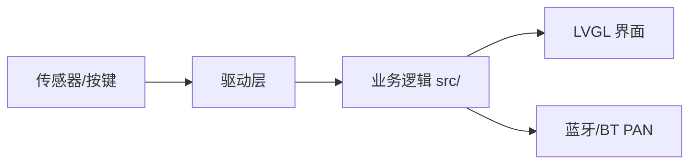

# 方案设计说明

## 棋子移动顺序修正设计（REQ-303/REQ-304，2026-10-18）

核心不再分成“数字整批先走、士兵整批后走”两段，而是新增一次统一遍历：

```text
按方向从目的边向另一端逐行/列/格处理：
  若当前格是数字块 -> 滑动、合并（每块每回合最多一次）
  若当前格是选中的己方士兵 -> 前方为空则前进一格；前方是存活敌兵则攻击
                              前方是数字/友军/死亡单位则不动
遍历结束后 -> 按数字块移动方向前方相邻士兵结算伤害（D1）
           -> finish() 统一移除死亡单位、结算击杀金币
```

因为目的边先处理，前面的士兵/数字先移动或让开，后面的士兵轮到时看到的是更新后的
棋盘；这就是“前到后”的语义。士兵攻击规则、攻击力、无反击、击杀奖励、死亡单位
阻挡到 `finish()` 都不变。

可移动数量 `gy_eligible_count(d)` 复用同一遍历，在棋盘副本上把所有己方存活士兵
标记为选中，统计实际前进或攻击的士兵数；模拟不改变真实棋盘、不生成随机块。
玩家选 N 个时，仍按初始位置到指示点的距离排序，从模拟可行动集合中取最近 N 个；
选中前缀在同一行内一定包含更靠近目的边的士兵，因此实际遍历的前后顺序与全选模拟
一致。数字合并奖励在模拟副本上计算，丢弃，不影响真实金币。

预览使用同一个 `apply_move`，因此 `gy_preview().visible` 自动反映修正后的位置和
伤害；UI 只需继续使用 `gy_eligible_count` 的数量上限，不新增预览逻辑。AI 的
`ai_generate`/`gy_simulate_move` 也自动使用新遍历；动作空间中的 count 上限会随
新可行动数变化。

性能：6×6 棋盘上每次 `gy_eligible_count` 多一次遍历；板端每 20ms 采样会对四个
方向调用，先实测，如超出预算再按 `revision+direction` 缓存，不改变语义。

## 人机对战准备页设计 REQ-317（2026-10-17）

新增独立 `prep_page` 容器，模式页只保留一个“人机对战”入口。准备页按想法稿
非联机模式上半部分布局：左侧红色方框表示红方先手，默认标签“玩家”；右侧蓝色
方框表示蓝方后手，默认标签“AI”；下方只有“取消”和“开始游戏”，不实现房间、
旁观者或联机控件。`prep_human_red` 默认 1，每次进入准备页恢复默认。

两个方框都是按钮，共用 `GY_UI_PREP_SWAP`：点击任一方框只切换
`prep_human_red` 并更新两个标签（颜色固定表示红/蓝方）。`GY_UI_PREP_CANCEL`
返回模式页；`GY_UI_PREP_START` 设置 `ai_side = prep_human_red ? 1 : 0`，进入
现有游戏页并按原有重开流程初始化新局，AI 执红时自动开始思考。`show_page`
负责隐藏/显示准备页并维护 `prep_active`；原有 AI 搜索、REQ-316 预览和灯效路径
不变，不新增联机/旁观逻辑。

## AI 决策预览设计 REQ-316（2026-10-17）

`gy_ui_tick` 收到合法 AI 结果后不立即 `gy_commit`，而是进入预览态：移动动作调用
`gy_preview` 写入现有 `preview`、`ready`、`direction`、`selected_count`，复用与人类
倾斜完全相同的格子高亮和数量显示；放兵动作设置 `placing`、`place_column`，复用
人类放兵预览的底线列高亮。记录 `lv_tick_get()` 时间，`gy_ui_tick` 每轮检查，达到
`AI_PREVIEW_MS=500` 时调用 `gy_commit` 或 `gy_place`，然后走既有灯效/胜负/换手路径。

`ai_preview_pending` 防止重复提交；AI 回合的输入 guard 继续阻止人类倾斜/确认/放兵/
格子操作；`cancel_ai` 清除预览态，首页/重开不会在离开后落子。预览结果仍带
generation/revision 校验，提交前 `gy_commit` 会再核对 `preview.before`。使用 LVGL
tick 非阻塞等待，桌面与板端共用同一状态机；500ms 是常量，板端实测后可调整。

## 人机对战设计 REQ-315（2026-10-17）

AI 规则核心放在 `src/geyi_ai.c`/`geyi_ai.h`，只依赖 `geyi_game`，不依赖 LVGL、
RT-Thread 或文件系统，便于主机测试和后续联机复用。搜索采用 negamax + Alpha-Beta，
与想法稿要求的 Minimax 等价；同一套代码提供 `use_pruning=0` 的全量搜索开关，用于
答辩性能对比。动作空间由当前核心规则生成：四个方向上的士兵数量 1..可行动数
（无可行动士兵时允许数量 0，只移动数字块），以及金币足够时己方底线空列；每个
动作先用轻量模拟验证，非法动作不进入搜索。

规则核心增加：

```c
int gy_simulate_move(const GyGame *g, GyMove move, GyGame *next, int spawn_next);
```

它复用 `gy_preview` 的走子/合并/伤害/胜负逻辑，但不修改原局面。AI 搜索固定传
`spawn_next=0`，只换手、不生成新数字块，因此不会读取真实 RNG；真实落子仍由 UI
调用 `gy_preview` + `gy_commit` 或 `gy_place`，随机块由游戏自身生成。接受“搜索中
少一个新生数字块”的近似，后续如需增强可在根节点按空格和 2/4 概率做期望平均。

评估函数从“当前行动方”视角计算，红蓝对称，使用整数权重（详见
`docs/refs/ai-evaluation-notes.md`）：终局胜负、士兵数量、总血量、可用金币、
数字块对双方士兵的实际威胁、机动性、己方底线空位；击杀/攻击等事件只用于走法
排序，不在叶子评估中重复计分。所有启发项之和限制在终局分以下，避免材料分
淹没胜负。

搜索采用迭代加深 1..5 层，默认单次 300ms、节点数上限 200000；每层用上一层的
最佳着法优先、攻击/击杀/合并/放兵优先的走法排序；超时或收到取消标志时保留
上一层已完成的最佳着法。置换表暂不实现，先测节点数和板端耗时再决定。搜索不
使用浮点和动态分配，递归逐层复用固定大小的局面/动作工作区。

运行方式：`src/geyi_ai_task.c` 提供任务封装。开发板上创建独立 `gy_ai` 线程
（约 16KB 栈），主线程传入棋盘快照并轮询结果；AI 线程只返回动作，不直接操作
UI 或棋盘。主页/重开通过取消标志和 generation 计数丢弃过期结果；主线程落地
前再核对 `revision`。桌面版使用同步回退实现，保持同一 UI 接口。

界面沿用现有三个页面容器：模式页把原禁用的“人机对战”替换为“人机对战（我执红）”
和“人机对战（我执蓝）”；进入后初始化新局并记录 `ai_side`。AI 回合显示“AI 思考中”，
屏蔽倾斜、确认、放兵和格子操作；AI 落子后走与人类确认相同的灯效/结算路径。
新增界面汉字继续由 `tools/generate_ui_font.py` 生成子集，保留 OFL 许可。

| 决策 | 备选 | 选择与确认 | ADR |
|---|---|---|---|
| AI 算法 | Minimax+Alpha-Beta / MCTS / Expectimax / 规则启发式 | 学生选择 Minimax+Alpha-Beta；想法稿明确要求剪枝对比 | adr/0003-ai-minimax.md |
| 随机生成块 | 搜索不建模 / 根节点期望 / 完整 Expectimax | 学生选择不建模，避免偷看 RNG，首版最简单 | adr/0003-ai-minimax.md |
| 运行方式 | 独立线程 / 主线程阻塞 / 主线程分片 | 学生选择独立 AI 线程，保证 LVGL 不冻结 | adr/0003-ai-minimax.md |
| 先后手入口 | 模式页两按钮 / 准备页 / 固定人类执红 | 学生选择模式页两个按钮 | adr/0003-ai-minimax.md |
## 参数配置与平衡性测试设计 REQ-401~411

沿用现有纯 C 规则库与共享 LVGL 界面，新增独立参数模块 `src/geyi_config.c/.h`，
不引入文件系统、键值库或任何新依赖。

**数据模型**：用**显式结构体字段**而非通用键值数组。`GyParamSet` 逐字段列出 10 项参数，
并在 `src/geyi_config.c` 内维护一张只读**范围表**（名称、单位、下限、上限、适用模式），
界面渲染与合法性校验**共用同一张表**，避免"界面写一套、校验写另一套"。
取舍理由见 `docs/adr/0002-参数模型与校验策略.md`。

**与现有模块的接线（坚持最小改动）**：

- `geyi_game.h` 的 `GyConfig` 只增加**一个**字段 `spawn_interval`（10 项里唯一属于规则输入的）；
  `geyi_game.c` 把"每次有效移动固定 `spawn`"改为按 `spawn_interval` 计数，**放置士兵不计数**
  （沿用 REQ-301 的原型约定）。移动/合并/攻击/金币/胜负逻辑一行不改。
- `geyi_input.h` 增加 `gy_input_configure(GyInput*, int dir_pct, int angle_pct)`，
  把现有两处**硬编码 10% 滞回**改为读入值；**不改**四向判定算法、分段规则与 200ms 稳定窗口。
- `search_depth` 只存在于 `GyParamSet`，由 AI 模块通过读取接口取值；本模块**不实现**搜索。

**三类配置与生效时机**：`static GyParamSet s_params[GY_MODE_COUNT]` 三份互相独立；
`gy_param_apply(mode)` 只在"**新开一局**"时调用一次，把参数转成 `GyConfig` 并配置 `GyInput`；
局中不再读取参数，从而保证 **REQ-407（局中改参数不改变当前对局）**。

**默认值与回归对照**：新增 4 项的默认值**取改造前的硬编码值**（生成间隔 1、方向缓冲 10%、
角度缓冲 10%、搜索深度 3），使改造前后行为一致，可直接用现有 TC-301~308 做回归对照。

**暂不持久化**：参数存 RAM，重启回默认（见 `docs/adr/0002-参数模型与校验策略.md` 的取舍与代价）。

| 模块 | 职责 | 对外接口 | 实现需求 | 代码路径 | 测试 |
|---|---|---|---|---|---|
| `geyi_config` | 10 项参数模型、范围表、校验与钳位、三类独立配置与重置、转换为 `GyConfig` | `gy_param_default_for()`、`gy_param_validate()`、`gy_param_clamp()`、`gy_param_apply()`、`gy_param_get()`、`gy_param_selftest()` | REQ-401~410 | `src/geyi_config.c/.h` | TC-401~407 |
| `balance_scan` | 主机端批量对局、参数网格扫描与统计输出 | 命令行工具 | REQ-411 | `tools/balance_scan.py` | TC-408 |

**校验策略分两层**：`gy_param_validate()` 返回**具体错误码**（供界面提示与测试精确断言）；
`gy_param_clamp()` 在设置入口做边界钳位，保证进入模型的数值一定合法。
两者共用同一张范围表，避免判据不一致。

**需求—设计追踪（本模块）**：

| 需求ID | 设计落点 | 说明 |
|---|---|---|
| REQ-401 | 数据模型 + 范围表 | 10 项逐字段 + 只读范围表 |
| REQ-402 | 校验策略 | `validate` 错误码 + `clamp` 钳位 + 界面警示色 |
| REQ-403 | 三类配置 | `s_params[mode]` 三份独立；`search_depth` 仅 PVE 显示与生效 |
| REQ-404 | 三类配置 | `gy_param_default_for(mode)` + 整份覆盖 |
| REQ-405 | 范围表 | 棋盘 4~8、深度 1~6 |
| REQ-406 | 范围表 + 校验 | 生成间隔奇数 1~9，偶数拒绝或钳到最近奇数 |
| REQ-407 | 三类配置 + 生效时机 | 只在 `gy_param_apply()` 时读取 |
| REQ-408 | 界面接线 | 初始页既有按钮由禁用改为可用，新增配置容器 |
| REQ-409 | 接线（`geyi_input`） | 两处硬编码 10% 改为读参数 |
| REQ-410 | 接线（`geyi_game`） | `spawn` 由"每次"改为按 `spawn_interval` 计数 |
| REQ-411 | `balance_scan` | 固定 seed 集合保证可复现 |

## RGB反馈设计 REQ-314

沿用SDK example/rt_device/rgb_led的PA32/GPTIM2_CH1、LDO3.3V与rgbled/PWM_CMD_SET_COLOR，
现有proj.conf已经启用相关选项，不新增音频或改变工程配置。
UI在真实提交成功/认输后发布灯事件，纯C时间调度计算颜色，主循环仅在颜色变化时写驱动，
无新增休眠、无每帧重复写RGB。使用无符号时间差处理时钟回绕，首页/重开取消未完成灯效。

## 初始入口设计 REQ-313

沿用共享LVGL界面，使用首页、模式、游戏三个容器切换可见性，不引入新的界面框架。
界面状态判断屏蔽非游戏页的行动、格子和倾斜输入；板端菜单期间重置输入状态机，
进入游戏后仍需先回中。未开放按钮禁用且明确说明，不能触发假AI或假联机。
新增界面汉字经现有小字库生成脚本补齐，保留原有字体许可。

## 简体显示设计 REQ-312

tools/generate_ui_font.py从SDK SourceHanSansSC-Normal.otf按UI字符串生成独立Geyi UI CN16字库，
以LVGL原生4bpp位图编译进src/geyi_font_cn16.c，ASCII与符号回退到原SDK字体。
不增加板端文件系统/FreeType依赖；子集许可为SIL OFL1.1，保留Adobe版权，不使用保留名称命名字库。
check_desktop_font.py检查每个中文码点均覆盖，--check验证生成文件一致，不只检查字符串替换。

## 板端设计 REQ-311

复用SDK littlevgl2rtt_init("lcd")和现有UI，主线程独占LVGL与棋盘；
IMU线程约20ms采样，经RT互斥锁发布快照，不在线程中调用LVGL。
依据peripheral_lab的lab_bus/test_game/test_key和SDK v2.5.1，不猜接口。
新增proj.conf项：RT_MAIN_THREAD_STACK_SIZE=8192留栈；PKG_USING_LITTLEVGL2RTT及
LVGL_V9接显示触摸；MONTSERRAT_12/14/18/24及SOURCE_HAN_SANS_SC_16_CJK满足共享UI；
BSP_USING_I2C3/PINMUX/GPIO接传感器按键；LV_FB_TWO_NOT_SCREEN_SIZE参考外设台限制缓冲；
禁用BSP_USING_PM避免首次联调自动休眠。其余音频蓝牙不复制，工程骨架不变。
RT_USING_MEMHEAP=y为SDK middleware/lvgl/app_mem.c的内存堆依赖，首次构建暴露缺项后按官方例程补齐。
学生选B一次接入全部后实测，备选A先显示/触摸后传感器已展示，见adr/0002-board-bringup.md。

## 图形原型设计 REQ-310

src/geyi_ui.c为LVGL界面，规则仍调用原C核心；tools/geyi_desktop.c只提供Win32窗口、
帧缓冲与鼠标/键盘输入，LVGL无独立业务逻辑副本。纯CPU绘图，不用额外SDL依赖。
GEYI_WITH_LVGL控制UI编译；本轮不启用板端LVGL配置，不改工程骨架。
GyPreview增加visible快照，保存伤害结算后、随机生成前的可见预览，after仍用于真实提交。
先用同一LVGL界面在电脑验证，保留迁移能力；窗口宿主仍是电脑专用，不能宣称已移植上板。

## 单机原型设计

REQ-309由src/geyi_input.c/.h处理输入状态机，通过TC-309的软件时间序列测试。
输入层不直接写棋盘，只输出选择/取消/确认事件；调用者用gy_eligible_count取得四方向可行动数，
选择事件调用gy_preview，确认事件才调用gy_commit。更新游戏后应重置输入并要求回中。
先做纯输入核心与测试，再接真实IMU、按键和LVGL，沿用已选择的分层结构而不新增传感器架构。

REQ-301至REQ-308：src/geyi_game.c和.h为无硬件依赖的C11核心；tools/geyi_cli.c为电脑端交互；
tests/test_geyi.c验证真实核心；src/main.c仅添加启动自检，不替换现有RGB例程为未验证屏幕游戏。
数据用固定上限8×8棋盘、整数血量金币和可复现PRNG，不使用动态分配。
游戏状态只有核心接口可写；preview复制并计算候选状态，commit检查版本及完整原状态再执行。
回合处理在副本中完成，无效输入不提交副本，避免随机种子、金币等被失败操作消耗。
每个数字块用合并标记防止二次合并；死亡单位至伤害阶段结束统一移除并判平局。

| 决策 | 备选 | 选择与确认 | ADR |
|---|---|---|---|
| 核心独立于界面硬件 | 纯C核心 / 规则嵌入LVGL | 前者便于主机测试与联机复用；用户要求按建议先做一版 | adr/0001-single-core.md |
| 合成攻防原型规则 | 想法稿 / PRD底线竞速 | 用户明确按想法稿；具体推荐规则授权先做，待团队评审 | adr/0001-single-core.md |

| 需求 | 实现 | 验证 |
|---|---|---|
| REQ-301 REQ-302 REQ-307 | 初始化、预览、版本检查 | TC-301 TC-302 TC-307 |
| REQ-303 REQ-304 REQ-305 REQ-306 | 移动、伤害、金币、放置、结算 | TC-303至TC-306 |
| REQ-308 | main启动自检 | TC-308，真机待验证 |

## M0 仓库协作设计（2026-10-15）

项目仓库为公开的 `Soviet-i/geyi`，本次不添加成员（REQ-201）。默认开发入口为 `develop`，`main` 保留集成基线。成员从 `develop` 建立 `feat/...`、`fix/...` 或 `docs/...` 分支，通过 PR 合入 `develop`；集成完成后由负责人发起 `develop → main` 的 PR（REQ-202）。

GitHub 为两个分支启用 PR 要求、课程检查 `check`、PR 目标检查 `pr-policy`，禁止强制推送及删除，规则也适用于管理员。暂不要求额外审核票数，因为学生明确暂不邀请其他成员。PR 检查允许目标为 `develop` 的 PR；目标为 `main` 时必须来自同一仓库的 `develop`。规则阻止不合规合并，不能阻止用户创建目标错误的 PR。验证见 TC-201 至 TC-203。

以下章节保留课程设计模板；其中模块、需求和指标示例尚未由学生确认为产品设计。

| 项 | 内容 |
|---|---|
| 文档编号 | DOC-02 |
| 项目名称 | <项目名称> |
| 版本 / 状态 | v0.1 / 草稿 |
| 负责人 / 日期 | <姓名> / <YYYY-MM-DD> |

## 修订记录

| 版本 | 日期 | 修改人 | 修改内容 | AI参与 |
|---|---|---|---|---|
| v0.1 | <日期> | <姓名> | 创建 | 否 |

> 写作提示：设计要能回答“每条需求由哪个模块实现、怎么验证”。设计变更时先改本文档再改代码，并更新 `adr/`。

## 1. 设计输入

- 需求来源：`01-需求规格说明.md`（版本 v<x.y>）
- 硬件平台：黄山派 SF32LB525UC6，板型 sf32lb52-lchspi-ulp；SDK 版本：v2.5.1（课程统一）
- 约束：<例：无 WiFi；Flash/RAM 上限；功耗预算>

## 2. 总体架构

> 画一张图（Mermaid 或手绘拍照放 `docs/img/`），标出模块划分与数据流向，并能对着图逐块讲清职责。



## 3. 模块划分与需求追踪

| 模块 | 职责 | 对外接口 | 实现的需求 | 代码路径 | 测试 |
|---|---|---|---|---|---|
| game | 规则核心：初始化、预览、走子、合并、伤害、金币、胜负、模拟 | `gy_init` `gy_preview` `gy_commit` `gy_place` `gy_simulate_move` | REQ-301, REQ-302, REQ-303, REQ-304, REQ-305, REQ-306, REQ-307, REQ-308, REQ-315 | `src/geyi_game.c` | TC-301~TC-308, TC-315 |
| ai | 人机搜索、评估与剪枝统计 | `gy_ai_choose` | REQ-315 | `src/geyi_ai.c` | TC-315 |
| ai_task | 板端 AI 线程与桌面同步回退 | `gy_ai_task_start` `gy_ai_task_poll` `gy_ai_task_cancel` | REQ-315 | `src/geyi_ai_task.c` | TC-315 |
| input | 倾斜/按键输入状态机 | `gy_input_update` | REQ-309, REQ-311 | `src/geyi_input.c` | TC-309, TC-311 |
| ui | LVGL 首页/模式/准备页/棋盘/放兵/AI 回合/预览 | `gy_ui_create` `gy_ui_action` `gy_ui_tick` | REQ-310, REQ-311, REQ-312, REQ-313, REQ-314, REQ-315, REQ-316, REQ-317 | `src/geyi_ui.c` | TC-310~TC-317 |
| board | 显示/触摸/IMU/按键接入 | `gy_board_start` `gy_board_poll` | REQ-311 | `src/geyi_board.c` | TC-311 |
| feedback | RGB 灯事件与调度 | `gy_light_start` `gy_light_color` | REQ-314 | `src/geyi_feedback.c` | TC-314 |
| repo | Git/GitHub 协作基线 | — | REQ-201, REQ-202 | — | TC-201~TC-203 |

## 4. 接口设计

### 4.1 软件接口

| 接口 | 输入 | 输出 | 错误处理 | 说明 |
|---|---|---|---|---|
| <函数/消息> | | | | |

### 4.2 数据结构与状态机

<关键结构体、状态转移表/图>

## 5. 硬件资源分配

| 外设 | 用途 | 引脚/总线 | 参数 | 来源（原理图/例程） |
|---|---|---|---|---|
| <例：I2C> | <IMU> | <引脚> | <速率> | <链接> |

## 6. 软件运行设计

- RT-Thread 线程/定时器规划：<线程名、优先级、栈大小、周期>
- 同步与通信：<信号量/消息队列/事件>
- 时序与实时性：<关键路径的时限>

## 7. 关键技术选型与决策

| 决策 | 备选方案 | 选择理由 | 决策人 | ADR |
|---|---|---|---|---|
| <决策> | <备选> | <理由> | <学生/agent建议+学生确认> | adr/0001-xxx.md |

## 8. 非功能设计

- 功耗：<策略>　性能：<策略>　资源：<预算>　可靠性：<看门狗/异常处理>

## 9. 风险与备选方案

| 风险 | 概率 | 影响 | 应对 / Plan B | 台账编号 |
|---|---|---|---|---|
| <风险> | | | | R-01 |

## 10. 物理验证计划

> 提前列出需要真机验证的节点，agent 到这些节点会暂停等待你的证据。

| 验证节点 | 验证内容 | 通过判据 | 对应需求 | 计划里程碑 |
|---|---|---|---|---|
| 固件启动 | 串口出现 core/input/ai PASS | 三项均 PASS，无异常复位 | REQ-315 | M3 |
| 显示与触摸 | lcd READY、屏幕不裁切、触摸确认/取消 | 实际屏幕与触摸操作正常 | REQ-311, REQ-313 | M3 |
| IMU/倾斜 | WHO_AM_I=6a、calibrated、四向预览 | 四向与按键符合 TC-311 | REQ-311 | M3 |
| 人机线程 | AI 思考/落子、输入屏蔽、首页取消 | TC-315 真机项通过 | REQ-315 | M3 |
| RGB 反馈 | 有效行动/终局灯色 | 与 TC-314 判据一致 | REQ-314 | M3 |

## 11. 需求—设计追踪

| 需求ID | 设计章节/模块 | 说明 |
|---|---|---|
| REQ-201, REQ-202 | M0 仓库协作设计 | 公开仓库、PR 目标与分支保护 |
| REQ-301, REQ-302, REQ-303, REQ-304, REQ-305, REQ-306, REQ-307, REQ-308 | 单机原型设计 / 3 模块 game | 初始化、预览、移动、合并、金币、胜负、状态安全 |
| REQ-309 | 单机原型设计 / input | 角度/按键输入状态机与滞回 |
| REQ-310 | 图形原型设计 / ui | 桌面 LVGL 图形原型 |
| REQ-311 | 板端设计 / board, input, ui | 显示、触摸、IMU、按键接入 |
| REQ-312 | 简体显示设计 / ui, font | 简体文本与 CN16 子集 |
| REQ-313 | 初始入口设计 / ui | 首页与模式选择 |
| REQ-314 | RGB反馈设计 / feedback, ui | 行动/终局灯效 |
| REQ-315 | 人机对战设计 / ai, ai_task, ui | Minimax+Alpha-Beta、独立线程、先后手入口 |
| REQ-316 | AI 决策预览设计 / ui | AI 预览约 500ms 后自动确认，人类输入屏蔽，取消不落子 |
| REQ-317 | 人机对战准备页设计 / ui | 单个入口、红先/蓝后、点击方框互换、取消/开始 |
