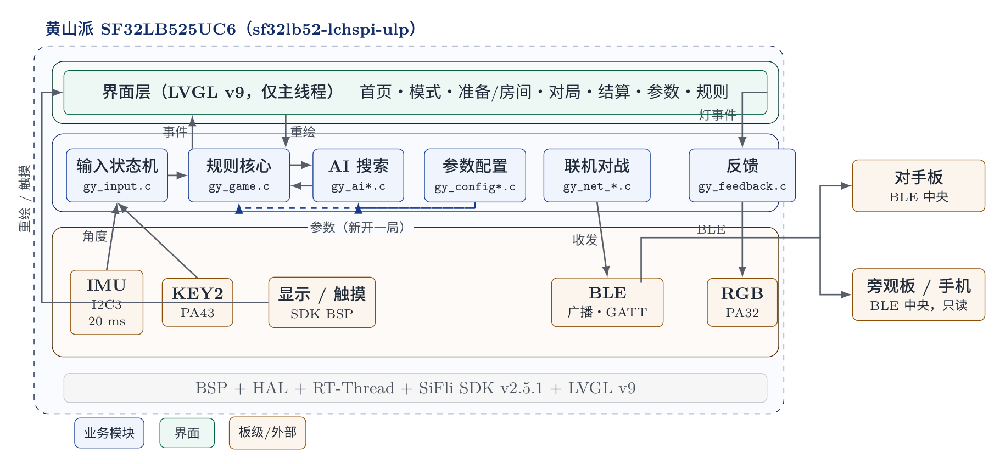
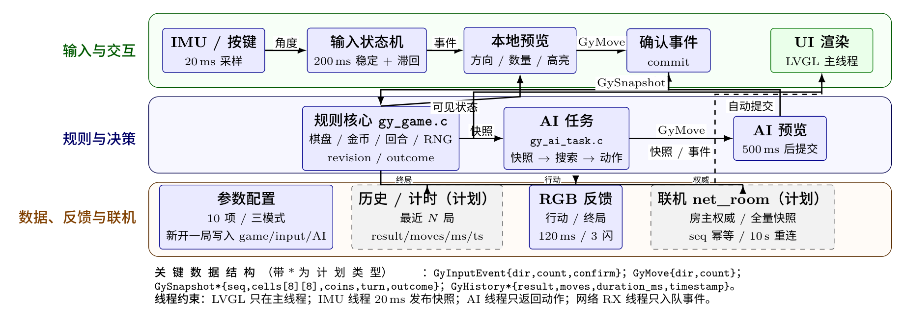
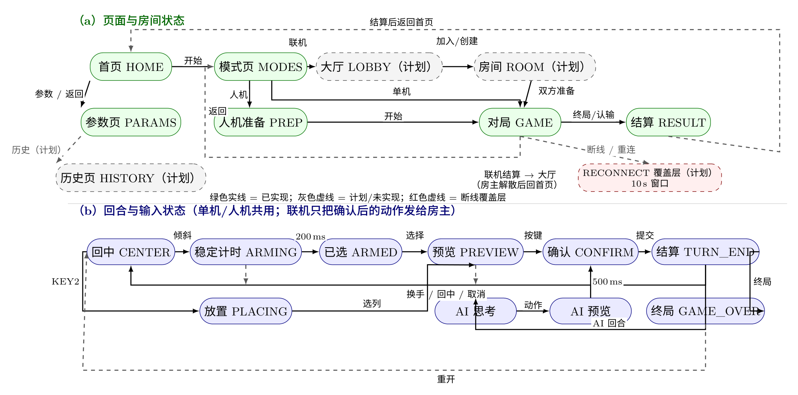
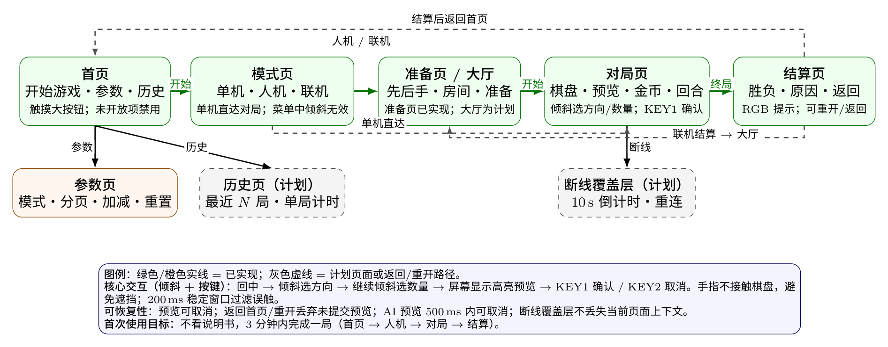
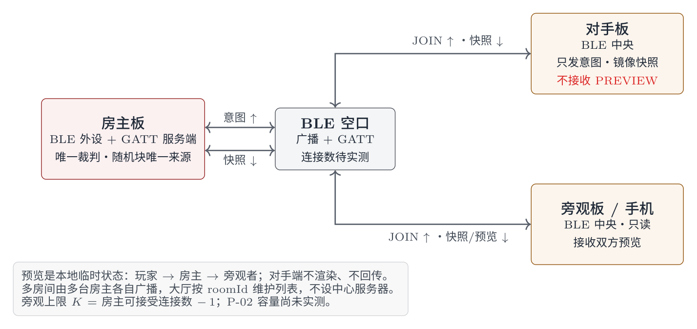
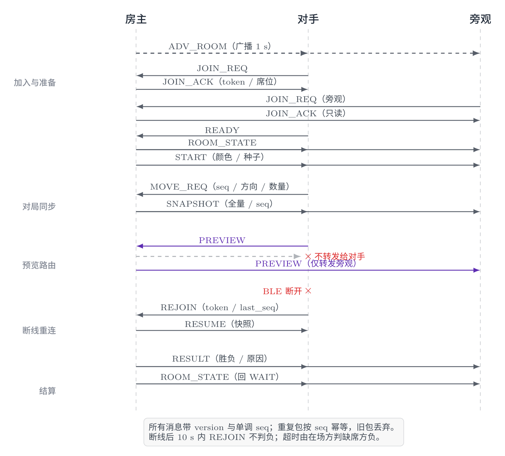

# 方案设计说明（格弈 / geyi）

## 硬件与平台约束（2026-10-28 根据旧立项材料整理并核对）

> 来源：`产品需求规格（PRD）-v0.1.md` 与 `立项-预研风险与必达范围.md`（课程目录，2026-10-10）。
> 这两份材料的产品范围已过时：当时以双人联机为必达、把 AI 对手列为不做。本项目当前按
> 《想法》稿改为单机/人机/参数优先、历史/计时进行中、联机/BLE 后续。以下只保留仍然有效的
> 硬件约束与预研结论；旧 PRD 的 M-01~M-12 不再逐条作为验收项。

| 项 | 约束 | 对设计的影响 |
|---|---|---|
| 平台 | 黄山派 SF32LB52-ULP（SF32LB525UC6），板型 `sf32lb52-lchspi-ulp`；SiFli SDK v2.5.1 / RT-Thread / LVGL v9；约 390×450 屏 | 棋盘 4~8（默认 6×6）；纯 C 规则核心与 LVGL 解耦；主机测试优先 |
| 通信 | 板载无 WiFi；联网只能走蓝牙/BLE；BLE + 经典蓝牙 PAN 并发未验证 | 联机对战按 BLE 设计；互联网联机列为拓展，不承诺；BT PAN 需双板/手机实测 |
| 存储 | 16MB NOR 与固件共享；无 TF 卡座 | 参数 v1 不持久化；历史记录若做只保留有限条，需先评估 Flash 占用 |
| 反馈 | 无震动马达（仅 PA20 驱动电路）、无电池 | 反馈只用板载 RGB；不承诺震动；对局中断电不可恢复 |
| 交互 | 倾斜 + 实体按键为主；触摸用于菜单/辅助 | 输入状态机与 UI 解耦；倾斜误触需专门验证，按键保留兜底 |
| 板卡 | 每周一次课可自由用板（当日归还）；课余每组一块借用板 | 主机/桌面测试优先；联机需两块板同时在线，排期风险高 |

**预研项状态**（旧立项编号，保留以便追溯）：

| 编号 | 预研项 | 当前状态 | 证据/说明 |
|---|---|---|---|
| P-01 | 两块板 BLE 双向通信 | 文档基线已立，未实现 | REQ-501/506 已定义拓扑与权威模型；双板实测未开始，这是联机功能的生死线 |
| P-02 | 单主机多客户端连接 | 未开始 | 双人对局必达；只读旁观为有条件目标，P-02 实测后由学生拍板；多端/观战仍非必达 |
| P-03 | 倾斜四向识别参数标定 | 部分完成 | 板端四向预览有照片/日志；正确率、误触发率、延迟未量化 |
| P-04 | 棋盘渲染帧率与 ePicasso 加速 | 未测 | 390×450、≥30fps 目标未实测 |
| P-05 | 中文字体转换链路 | 已完成 | 思源黑体子集，OFL 许可，桌面覆盖检查通过 |
| P-06 | BLE 与经典蓝牙 PAN 并发 | 未开始/不承诺 | 仅影响互联网联机拓展 |

**范围对齐说明**：旧 PRD 把“双人联机、断线重连、消息幂等”列为必达，把 AI 对手列为不做；
这与 2026-10-17 之后的想法稿和实际分工不一致。当前范围以 `01-需求规格说明.md` 的
REQ-301~REQ-317、REQ-401~REQ-411、REQ-501~REQ-513、REQ-601~REQ-606 为准；旧 PRD 中
“房主权威状态、全量快照、断线检测、消息幂等”已由 REQ-501~REQ-513 重新定义，仍须按
“未实现”记录，不能写成已承诺或已验收。

## 架构、数据流与状态（2026-11-08）

> 课程要求方案设计至少给出系统架构图、数据流图、状态机图。以下三张图为可编辑的
> TikZ 源文件，编译脚本为 `docs/img/src/build_figures.py`；图中“计划/未实现”用灰色虚线，
> 不得把计划模块讲成已实现。

### 图 2-1 系统架构图



- **已实现模块**（蓝色实线）：规则核心 `gy_game.c`、输入状态机 `gy_input.c`、AI
  `gy_ai.c`/`gy_ai_task.c`、参数 `gy_config.c`/`gy_param_ui.c`、反馈
  `gy_feedback.c`、板级 `gy_board.c`、UI `gy_ui.c`。
- **计划模块**（灰色虚线）：历史/计时 `geyi_history.c`、联机 `net_room → net_proto →
  net_link`；代码未提交，图中只表示设计位置。
- **外部角色**：对手板、旁观板/手机均以 BLE 中央设备连接房主；PC 只用于主机/桌面测试，
  不进入产品运行时。
- **线程边界**：LVGL 只在主线程；IMU 线程按 20 ms 发布快照；AI 线程只返回动作；
  网络 RX 线程只收包/入队，不直接操作 LVGL 或棋盘。

### 图 2-2 数据流图



关键数据与更新周期：

| 数据 | 生产者 → 消费者 | 格式/单位 | 更新周期/触发 |
|---|---|---|---|
| 倾斜角度 | IMU 线程 → 输入状态机 | 百分之一度（0.01°） | 约 20 ms |
| 按键 | 板级驱动 → 输入状态机 | 电平/20 ms 消抖 | 事件 |
| 选择事件 | 输入状态机 → UI/规则核心 | `GyInputEvent{dir,count,confirm}` | 200 ms 稳定后 |
| 预览 | 规则核心 → UI | `GyPreview`（visible 快照） | 每次选择变化 |
| 动作 | UI/AI → 规则核心 | `GyMove{dir,count}` | 确认/500 ms AI 预览后 |
| 权威状态 | 规则核心 → UI/历史/联机 | `GySnapshot{seq,cells,coins,turn,outcome}` | 每个合法动作 |
| 历史记录 | 规则核心 → 历史模块 | `GyHistory{result,moves,duration_ms,timestamp}` | 终局/认输一次 |
| 联机消息 | net_room ↔ net_proto ↔ net_link | 带 version + seq 的字节流 | 事件/1 s 心跳 |

### 图 2-3 状态机图



- **页面状态**：首页 → 模式页 → 人机准备页/联机大厅 → 对局 → 结算；参数页、历史页、
  断线覆盖层为分支。结算后可返回首页；对局可返回模式页；断线覆盖层不丢失当前页面上下文。
- **回合/输入状态**：回中 → 稳定计时（200 ms）→ 已选 → 预览 → 确认 → 结算；
  AI 回合为“AI 思考 → AI 预览（500 ms）→ 确认”；放兵为独立分支；取消/回中/重开回到回中。
- **恢复语义**：预览可取消；返回/重开丢弃未提交预览；AI 过期结果按 generation/revision 丢弃；
  联机断线进入 10 s 重连窗口，超时由在场方判缺席方负。

### 图 2-4 页面流转与交互



> 图源：`docs/img/src/fig-page-flow.tex`。单机/人机结算回首页；联机结算回大厅（房主解散后回首页）；
> 灰色虚线为计划页面（大厅/房间/历史/断线覆盖层）。与 `docs/01` 用户交互专章一致。

## 棋子移动顺序修正设计（REQ-303/REQ-304，2026-10-18）

核心不再分成“数字整批先走、士兵整批后走”两段，而是新增一次统一遍历：

```text
按方向从目的边向另一端逐行/列/格处理：
  若当前格是数字块 -> 滑动、合并（每块每回合最多一次）
  若当前格是选中的己方士兵 -> 前方为空则前进一格；前方是存活敌兵则攻击
                              前方是数字/友军/死亡单位则不动
遍历结束后 -> 按数字块移动方向前方相邻士兵结算伤害（D1）
           -> finish() 统一移除死亡单位、结算击杀金币
```

因为目的边先处理，前面的士兵/数字先移动或让开，后面的士兵轮到时看到的是更新后的
棋盘；这就是“前到后”的语义。士兵攻击规则、攻击力、无反击、击杀奖励、死亡单位
阻挡到 `finish()` 都不变。

可移动数量 `gy_eligible_count(d)` 复用同一遍历，在棋盘副本上把所有己方存活士兵
标记为选中，统计实际前进或攻击的士兵数；模拟不改变真实棋盘、不生成随机块。
玩家选 N 个时，仍按初始位置到指示点的距离排序，从模拟可行动集合中取最近 N 个；
选中前缀在同一行内一定包含更靠近目的边的士兵，因此实际遍历的前后顺序与全选模拟
一致。数字合并奖励在模拟副本上计算，丢弃，不影响真实金币。

预览使用同一个 `apply_move`，因此 `gy_preview().visible` 自动反映修正后的位置和
伤害；UI 只需继续使用 `gy_eligible_count` 的数量上限，不新增预览逻辑。AI 的
`ai_generate`/`gy_simulate_move` 也自动使用新遍历；动作空间中的 count 上限会随
新可行动数变化。

性能：4~8 棋盘（默认 6×6）上每次 `gy_eligible_count` 多一次遍历；板端每 20ms 采样会对四个
方向调用，先实测，如超出预算再按 `revision+direction` 缓存，不改变语义。

## 人机对战准备页设计 REQ-317（2026-10-17）

新增独立 `prep_page` 容器，模式页只保留一个“人机对战”入口。准备页按想法稿
非联机模式上半部分布局：左侧红色方框表示红方先手，默认标签“玩家”；右侧蓝色
方框表示蓝方后手，默认标签“AI”；下方只有“取消”和“开始游戏”，不实现房间、
旁观者或联机控件。`prep_human_red` 默认 1，每次进入准备页恢复默认。

两个方框都是按钮，共用 `GY_UI_PREP_SWAP`：点击任一方框只切换
`prep_human_red` 并更新两个标签（颜色固定表示红/蓝方）。`GY_UI_PREP_CANCEL`
返回模式页；`GY_UI_PREP_START` 设置 `ai_side = prep_human_red ? 1 : 0`，进入
现有游戏页并按原有重开流程初始化新局，AI 执红时自动开始思考。`show_page`
负责隐藏/显示准备页并维护 `prep_active`；原有 AI 搜索、REQ-316 预览和灯效路径
不变，不新增联机/旁观逻辑。

2026-11-07 视觉细化：准备页标题、副标题和提示使用固定宽度 326 的居中 label；
红/蓝方框上方各用宽度 150 的居中 label 显示“先手/后手”。方框内部用 LVGL
基础对象自绘 64×64 图标：人物为圆形头部+圆角肩部，AI 为圆角头+双眼+天线；
图标下方用居中 label 显示“玩家/AI”。图标子对象全部取消 `CLICKABLE`，点击
图标区域仍由方框按钮接收。`update_prep_labels` 同时切换两个 label 和人物/AI
图标可见性，方框底色与取消/开始逻辑不变。不增加图片资源或新字库字符。

## AI 决策预览设计 REQ-316（2026-10-17）

`gy_ui_tick` 收到合法 AI 结果后不立即 `gy_commit`，而是进入预览态：移动动作调用
`gy_preview` 写入现有 `preview`、`ready`、`direction`、`selected_count`，复用与人类
倾斜完全相同的格子高亮和数量显示；放兵动作设置 `placing`、`place_column`，复用
人类放兵预览的底线列高亮。记录 `lv_tick_get()` 时间，`gy_ui_tick` 每轮检查，达到
`AI_PREVIEW_MS=500` 时调用 `gy_commit` 或 `gy_place`，然后走既有灯效/胜负/换手路径。

`ai_preview_pending` 防止重复提交；AI 回合的输入 guard 继续阻止人类倾斜/确认/放兵/
格子操作；`cancel_ai` 清除预览态，首页/重开不会在离开后落子。预览结果仍带
generation/revision 校验，提交前 `gy_commit` 会再核对 `preview.before`。使用 LVGL
tick 非阻塞等待，桌面与板端共用同一状态机；500ms 是常量，板端实测后可调整。

## 人机对战设计 REQ-315（2026-10-17）

AI 规则核心放在 `src/geyi_ai.c`/`geyi_ai.h`，只依赖 `geyi_game`，不依赖 LVGL、
RT-Thread 或文件系统，便于主机测试和后续联机复用。搜索采用 negamax + Alpha-Beta，
与想法稿要求的 Minimax 等价；同一套代码提供 `use_pruning=0` 的全量搜索开关，用于
答辩性能对比。动作空间由当前核心规则生成：四个方向上的士兵数量 1..可行动数
（无可行动士兵时允许数量 0，只移动数字块），以及金币足够时己方底线空列；每个
动作先用轻量模拟验证，非法动作不进入搜索。

规则核心增加：

```c
int gy_simulate_move(const GyGame *g, GyMove move, GyGame *next, int spawn_next);
```

它复用 `gy_preview` 的走子/合并/伤害/胜负逻辑，但不修改原局面。AI 搜索固定传
`spawn_next=0`，只换手、不生成新数字块，因此不会读取真实 RNG；真实落子仍由 UI
调用 `gy_preview` + `gy_commit` 或 `gy_place`，随机块由游戏自身生成。接受“搜索中
少一个新生数字块”的近似，后续如需增强可在根节点按空格和 2/4 概率做期望平均。

评估函数从“当前行动方”视角计算，红蓝对称，使用整数权重（详见
`docs/refs/ai-evaluation-notes.md`）：终局胜负、士兵数量、总血量、可用金币、
数字块对双方士兵的实际威胁、机动性、己方底线空位；击杀/攻击等事件只用于走法
排序，不在叶子评估中重复计分。所有启发项之和限制在终局分以下，避免材料分
淹没胜负。

搜索采用迭代加深 1..6 层，默认单次 300ms、节点数上限 200000；每层用上一层的
最佳着法优先、攻击/击杀/合并/放兵优先的走法排序；超时或收到取消标志时保留
上一层已完成的最佳着法。置换表暂不实现，先测节点数和板端耗时再决定。搜索不
使用浮点和动态分配，递归逐层复用固定大小的局面/动作工作区。

运行方式：`src/geyi_ai_task.c` 提供任务封装。开发板上创建独立 `gy_ai` 线程
（约 16KB 栈），主线程传入棋盘快照并轮询结果；AI 线程只返回动作，不直接操作
UI 或棋盘。主页/重开通过取消标志和 generation 计数丢弃过期结果；主线程落地
前再核对 `revision`。桌面版使用同步回退实现，保持同一 UI 接口。

界面沿用现有三个页面容器：模式页把原禁用的“人机对战”改为单个入口，进入
REQ-317 准备页选择先后手（左红先手默认玩家、右蓝后手默认 AI，点击方框互换）；
开始后初始化新局并记录 `ai_side`。AI 回合显示“AI 思考中”，
屏蔽倾斜、确认、放兵和格子操作；AI 落子后走与人类确认相同的灯效/结算路径。
新增界面汉字继续由 `tools/generate_ui_font.py` 生成子集，保留 OFL 许可。

| 决策 | 备选 | 选择与确认 | ADR |
|---|---|---|---|
| AI 算法 | Minimax+Alpha-Beta / MCTS / Expectimax / 规则启发式 | 学生选择 Minimax+Alpha-Beta；想法稿明确要求剪枝对比 | adr/0003-ai-minimax.md |
| 随机生成块 | 搜索不建模 / 根节点期望 / 完整 Expectimax | 学生选择不建模，避免偷看 RNG，首版最简单 | adr/0003-ai-minimax.md |
| 运行方式 | 独立线程 / 主线程阻塞 / 主线程分片 | 学生选择独立 AI 线程，保证 LVGL 不冻结 | adr/0003-ai-minimax.md |
| 先后手入口 | 模式页两按钮 / 准备页 / 固定人类执红 | 学生选择单个人机入口 + 先后手准备页（REQ-317） | adr/0004-ai-setup-page.md |

## 参数配置与平衡性测试设计 REQ-401~411

沿用现有纯 C 规则库与共享 LVGL 界面，新增独立参数模块 `src/geyi_config.c/.h`，
不引入文件系统、键值库或任何新依赖。

**数据模型**：用**显式结构体字段**而非通用键值数组。`GyParamSet` 逐字段列出 10 项参数，
并在 `src/geyi_config.c` 内维护一张只读**范围表**（名称、单位、下限、上限、适用模式），
界面渲染与合法性校验**共用同一张表**，避免"界面写一套、校验写另一套"。
取舍理由见 `docs/adr/0006-param-model.md`。

**与现有模块的接线（坚持最小改动）**：

- `geyi_game.h` 的 `GyConfig` 只增加**一个**字段 `spawn_interval`（10 项里唯一属于规则输入的）；
  `geyi_game.c` 把"每次有效移动固定 `spawn`"改为按 `spawn_interval` 计数，**放置士兵不计数**
  （沿用 REQ-301 的原型约定）。移动/合并/攻击/金币/胜负逻辑一行不改。
- `geyi_input.h` 增加 `gy_input_configure(GyInput*, int dir_pct, int angle_pct)`，
  把现有两处**硬编码 10% 滞回**改为读入值；**不改**四向判定算法、分段规则与 200ms 稳定窗口。
- `search_depth` 只存在于 `GyParamSet`，由界面开局启动 AI 时读取并写入 `GyAiConfig.max_depth`；本模块**不实现**搜索。

**三类配置与生效时机**：`static GyParamSet s_params[GY_MODE_COUNT]` 三份互相独立；
`gy_param_apply(mode)` 只在"**新开一局**"时调用一次，把参数转成 `GyConfig`；
板端 `gy_board` 在同一时机用当前模式的 `dir_buffer/angle_buffer` 配置 `GyInput`；
局中不再读取参数，从而保证 **REQ-407（局中改参数不改变当前对局）**。

**默认值与回归对照**：新增 4 项的默认值**取改造前的硬编码值**（生成间隔 1、方向缓冲 10%、
角度缓冲 10%、搜索深度 3），使改造前后行为一致，可直接用现有 TC-301~308 做回归对照。

**暂不持久化**：参数存 RAM，重启回默认（见 `docs/adr/0006-param-model.md` 的取舍与代价）。

| 模块 | 职责 | 对外接口 | 实现需求 | 代码路径 | 测试 |
|---|---|---|---|---|---|
| `geyi_config` | 10 项参数模型、范围表、校验与钳位、三类独立配置与重置、转换为 `GyConfig` | `gy_param_default_for()`、`gy_param_validate()`、`gy_param_clamp()`、`gy_param_apply()`、`gy_param_get()`、`gy_param_selftest()` | REQ-401~410 | `src/geyi_config.c/.h` | TC-401~409 |
| `geyi_param_ui` | 参数页模式/分页/条目映射/增减/重置状态，不依赖 LVGL | `gy_param_ui_*()` | REQ-403/404/408 | `src/geyi_param_ui.c/.h` | TC-407 主机段 |
| `balance_scan` | 主机端批量对局、参数网格扫描与统计输出 | `geyi-balance-scan` + `tools/balance_scan.py` | REQ-411 | `tools/geyi_balance.c`、`tools/geyi_balance_scan.c`、`tools/balance_scan.py` | TC-408 |

**校验策略分两层**：`gy_param_validate()` 返回**具体错误码**（供界面提示与测试精确断言）；
`gy_param_clamp()` 在设置入口做边界钳位，保证进入模型的数值一定合法。
两者共用同一张范围表，避免判据不一致。

**需求—设计追踪（本模块）**：

| 需求ID | 设计落点 | 说明 |
|---|---|---|
| REQ-401 | 数据模型 + 范围表 | 10 项逐字段 + 只读范围表 |
| REQ-402 | 校验策略 | `validate` 错误码 + `clamp` 钳位 + 界面警示色 |
| REQ-403 | 三类配置 | `s_params[mode]` 三份独立；`search_depth` 仅 PVE 显示与生效 |
| REQ-404 | 三类配置 | `gy_param_default_for(mode)` + 整份覆盖 |
| REQ-405 | 范围表 | 棋盘 4~8、深度 1~6 |
| REQ-406 | 范围表 + 校验 | 生成间隔奇数 1~9，偶数拒绝或钳到最近奇数 |
| REQ-407 | 三类配置 + 生效时机 | 只在 `gy_param_apply()` 时读取 |
| REQ-408 | 界面接线 | 初始页既有按钮由禁用改为可用，新增配置容器 |
| REQ-409 | 接线（`geyi_input`） | 两处硬编码 10% 改为读参数 |
| REQ-410 | 接线（`geyi_game`） | `spawn` 由"每次"改为按 `spawn_interval` 计数 |
| REQ-411 | `balance_scan` | 固定 seed 集合保证可复现 |

## 联机对战设计（REQ-501~REQ-513，2026-11-08）

> 本节依据蔡融汉 2026-11-08 给出的联机方案编写，是**设计基线**，不代表已实现。
> 代码、BLE 配置、协议编解码和双板验证均未开始；实现前必须先查 SDK v2.5.1 的
> BLE 例程与头文件，不凭记忆写 API。对应 ADR：`adr/0007-online-topology-authority.md`、
> `adr/0008-online-reconnect.md`、`adr/0009-online-preview-privacy.md`。

### 1. 拓扑与角色



> 图源：`docs/img/src/fig-online-topology.tex`。**隐私修正**：早期草图的 Mermaid 把
> `PREVIEW` 也画给对手，违反 REQ-507；本图与 ADR-0009 明确“对手不接收 PREVIEW，
> 房主只转发给旁观者”。实现与测试以本图和 REQ-507 为准。

- 房主：BLE 外设、GATT 服务端、房间与对局唯一权威；广播房间摘要；每房间 1 台。
- 对手：BLE 中央，镜像房主状态，只发操作意图；每房间 1 台。
- 旁观者：BLE 中央，只读镜像；0..K 台，K = 房主可接受连接数 − 1。
- 一台板同一时刻只属于一个房间；多房间 = 多台房主各自广播，不做中心服务器。
- 首版不实现局内房主迁移；等待阶段房主退出时按 REQ-505 转移或关闭房间。

**容量待实测**：SDK/芯片可接受的 BLE 并发连接数未验证（P-02）。若只能 1 条连接，
首版砍掉旁观或改中继；在实测前，旁观容量和满员广播策略都按“未定”记录，不能写成已支持。
连接态是否还能继续广播也未验证；若不能，大厅只靠 3s TTL 保留并标“未知”。

### 2. 页面与房间阶段

页面状态：

```text
单机/人机：首页 → 模式页 →（单机直接对局 / 人机准备页）→ 对局 → 结算 → 首页
联机：    首页 → 模式页 → 大厅 → 连接中(≤5s) → 房间(角色) → 对局/旁观 → 结算 → 大厅
          （房主返回大厅即解散；解散后回首页）
```

房间阶段（仅房主推进，其余端镜像）：

```text
WAIT（等待/准备） → STARTING（3s 倒计时） → PLAYING → RESULT
```

- 有人加入/退出不改变原玩家准备状态。
- 双方准备后进入 STARTING；倒计时中任一方取消准备 → 回 WAIT。
- RESULT 后房间保留约 10s 供重连者看结果；房主返回大厅即解散。
- 断线覆盖层独立于页面状态，不因重连弹窗丢失当前页面上下文。

### 3. 权威模型与同步

- 房主持有：棋盘、金币、回合、随机种子、席位/颜色、准备状态、阶段。
- 客户端只发 `MOVE_REQ`/`READY`/`SET_SEAT`/`LEAVE` 等意图，**不本地提交落子**。
- 每个合法动作后房主广播**全量快照**，带单调递增 `seq`；客户端只接受最新 `seq`，
  旧包/重复包直接丢弃（幂等）。
- 客户端可以本地倾斜预览（不发规则层提交），确认后等待快照；快照到达前棋盘不变。
- 非法/过期动作：房主回 `REJECT(reason, seq)`；客户端丢弃暂存意图并按当前权威快照重绘。
- 随机块只由房主生成并写入快照；客户端不自行生成，避免两端随机序列分叉。
- 不做增量同步；6×6 棋盘的全量快照体积小，换取实现简单和断线恢复直接。
  包长与 BLE MTU/吞吐需在实现时实测（见风险 R-026）。

### 4. 消息集合（功能级）

| 消息 | 方向 | 用途 | 幂等/错误处理 |
|---|---|---|---|
| `ADV_ROOM` | 房主→空中 | roomId、人数、阶段、观战数、协议版本 | 大厅按 roomId 更新；3s 过期移除 |
| `JOIN_REQ` | 加入者→房主 | `{role, player_id, roomId}`；role=玩家/旁观/auto | 满员/阶段不允许 → `JOIN_REJECT(reason)`；auto 由房主按当前空位裁决 |
| `JOIN_ACK` | 房主→加入者 | token、席位、player_id、房间快照 | token 绑定席位，房间存续期有效 |
| `ROOM_STATE` | 房主→房间内 | 席位颜色、双方 player_id、准备状态、观战数、阶段 | 客户端只接受房主版本 |
| `READY` / `SET_SEAT` / `LEAVE` | 玩家→房主 | 准备/取消、交换红蓝、退出 | 非法状态 → `REJECT(reason, seq)` |
| `START` | 房主→房间内 | 颜色分配、随机种子、初始快照 | 仅 STARTING→PLAYING 时有效 |
| `MOVE_REQ` | 玩家→房主 | `{seq, 方向, 数量, 放兵列}` | 非法/过期 → `REJECT(reason, seq)` |
| `SNAPSHOT` | 房主→房间内 | 全量权威状态 + 单调 seq | 客户端只认最新 seq；重复丢弃 |
| `RESULT` | 房主→房间内 | 胜负与原因 | 结算保留约 10s |
| `PREVIEW` | 玩家→房主→仅旁观 | `{side, 方向, 指示点/受影响格, seq}` | 限流；对手不接收、不回传 |
| `PREVIEW_CLEAR` | 玩家→房主→仅旁观 | 清除该玩家预览 | 确认/回中/取消时发送 |
| `HEARTBEAT` / `PING` | 房主→客方 / 客方→房主 | 1s 判活 | 10s 无包判断连 |
| `REJOIN` / `RESUME` | 客方→房主 / 房主→客方 | token + last_seq 重连、全量恢复 | token/席位不匹配拒绝 |

协议要求：消息带版本号；序列化有明确字节序和长度上限；未知消息忽略或拒绝并记录；
不得直接把 C 结构体内存当作网络包发送（避免填充/字节序/版本问题）。

#### 2026-11-09 实现修订（学生反馈后）

- **协议 v2**：`JOIN_REQ` 增加 `player_id`（uint16，芯片 UID 派生）与 `role` 的
  auto 值（2）；`JOIN_ACK` 增加自己的 `player_id`；`ROOM_STATE` 增加 host/guest 两个
  `player_id`。旧 v1 固件会被版本检查拒绝；两块板必须同版本。
- **唯一 ID 来源**：`bt_mac_addr_generate_via_uid_v2()`（失败退回 v1 / 公共地址），
  只读一次并缓存。不能用 `ble_get_public_address()` 的低 16 位作为身份：部分批次
  NVDS 地址相同，两块板都显示 `#FD5C`。
- **auto 角色**：大厅点击发 `JOIN_REQ{role=2}`；房主按“WAIT 且 player_count<2”判玩家，
  否则判旁观；即使大厅摘要滞后（刚退出一人仍显示 2/2）也不会把本可当玩家的人塞成旁观。
  显式 `watch`/旁观入口发 `role=1`，不受 auto 影响。
- **按座位 ready**：`GyNetSeat.ready` 与 `view.host_ready/guest_ready` 都按颜色更新；
  UI 用 `gy_net_app_seat_ready(color)` 分别取两个座位，禁止用“房主/非房主”或
  “按钮是否禁用”推导整块背景。准备中的座位变白，未准备保持红/蓝，空位灰色。
- **等待期退出**：WAIT 阶段没有可恢复对局，客方/旁观者断线或 LEAVE 立即释放席位并
  广播 `ROOM_STATE`，不再等 10 s；PLAYING 仍保留 10 s 重连窗口。
- **关房/转移**：房主 LEAVE 时若客人已连接 → 房主转给客人（`LEAVE_PROMOTED`），
  房间继续广播；若只有房主 → `PHASE_CLOSED` 并停止广播。客户端收到 CLOSED 只提示
  “房间不存在”，不得调用旧 promote 分支接管。
- **广播刷新**：`ROOM_STATE` 在席位/ready/阶段变化时立即广播；advertising 摘要
  使用 `is_auto_restart=1`，不在连接/断线事件里手动 start（会叠实例并
  `Create advertising failed`）。update 在 STARTING/STOPPING 被拒时只置 dirty，
  由 `gy_net_ble_poll()` 在 ADV_STARTED 后重试，最多 200 ms 一次。
- **大厅防抖**：已在大厅时再次进入不 stop/start 扫描；scan start 返回 busy 时
  1 s 后由 poll 重试，避免“再次点联机对战就再也扫不到房间”。

#### 2026-11-09 第二轮（房间循环与延迟）

- **RESULT → WAIT**：`GY_NET_RESULT_KEEP_MS` 改为 4s。超时后房间回 WAIT、
  `game_valid=0`、双方 ready 清零、result 复位；不置 CLOSED。只有房主 LEAVE 才关房。
  开局 STARTING→PLAYING 也清零 ready，下一局必须重新准备。
- **UI 路由**：游戏页在 RESULT 显示居中结算弹窗；phase 变 WAIT 时自动
  `show_page(net_room_page)`，同一房间继续。房主/客方/旁观者共用。
- **连接间隔**：客户端 `conn_intv_min/max` 从 0x60/0x80（120–160ms）改为
  0x06/0x08（7.5–10ms）。GATT 服务发现要多次 ATT 往返，旧间隔导致加入房间约 4s；
  实测降到约 0.9–1.1s。
- **关房时延**：房主关房先广播 `players=0/phase=CLOSED` 摘要并等 200ms 再停播；
  大厅收到 CLOSED/0 人立即移除，TTL 从 3s 降到 1.5s 作为兜底。实测关房到大厅消失
  约 0.2–0.4s。
- **JOIN 提前**：客户端可在 RX 特征已知时先发 JOIN（`gy_net_ble_write_ready()`），
  不必等 CCCD；ACK 由 400ms 重发兜底，CCCD 就绪后自然收到。
- **UI 可操作性**：退出/认输改为一次点击打开确认弹窗；旁观隐藏准备；准备座位绿色；
  倒计时黄底大字；对局页顶部按钮加大、底部状态条加深色底；结算用弹窗而非左下角小字。

#### 2026-11-09 第三轮（房主权威与连接资源）

- **RESIGN ≠ LEAVE**：客户端 `LEAVE` 消息带 `reason`。房主收到 `RESIGN` 只结算、
  **保留 ConnMap 与席位**；收到 `LEFT` 才释放席位并删除映射。否则结算后客方
  READY 因 `conn_find()` 为空被丢弃，表现为“房主收不到房客准备”。
- **客方倒计时**：`ROOM_STATE` 没有主机时间戳；客方首次进入 STARTING 时把
  `phase_since_ms` 设为本地 `g.now`，之后 3/2/1 由本地时钟推进。离开 STARTING
  再进入会重新起算。
- **对局页单按钮**：删除首页/大厅按钮与 `restart_button` 死代码；右上角按钮按上下文
  显示 认输/退出旁观/返回首页/退出。单机/人机结算后点击即回首页，联机结算自动回房，
  旁观退出回大厅。
- **字体子集**：`geyi_font_cn16.c` 由 UI/配置中文字面量生成；新增文案必须先运行
  `tools/generate_ui_font.py`。`run_host.py` 调用 `check_desktop_font.py` 作为门禁。
- **Remote service 生命周期**：`sibles_register_remote_svc()` 返回 0 是合法索引，
  `0xFFFF` 是槽位耗尽。记录 `conn_idx/start/end`，在断开、切换连接、重新搜索前
  `sibles_unregister_remote_svc()`；旧连接迟到的 SEARCH/REGISTER 事件按 conn_idx 丢弃。
- **RESULT→WAIT 清理**：结算结束回 WAIT 时释放已断线客人，避免“房主一直 2/2”。



> 图源：`docs/img/src/fig-online-sequence.tex`。时序图只表达协议顺序，不代表已实现；
> 真实 BLE 断连/重连、旁观设备与屏幕观感必须双板物理验证。

### 5. 分层与线程模型

```text
net_link（BLE 广播/扫描/连接/收发包/心跳/重连定时器，独立 RX 线程 + 队列）
   ↓ 事件
net_proto（消息定义、版本、序列化/反序列化、seq 幂等）
   ↓ 结构化消息
net_room（房主权威状态机 / 客方镜像 / 旁观视图，纯逻辑，不依赖 LVGL/RT-Thread/BLE）
   ↓ 事件
UI（LVGL 主线程消费；所有 LVGL 调用只在主线程）
```

- `net_link` 的 RX 线程只做收包、校验、入队，不直接操作 LVGL 或棋盘。
- `net_room` 是纯逻辑：输入“收到的消息 + 本地意图”，输出“要发的消息 + 给 UI 的事件”；
  可在 PC 上用内存管道跑两个实例对打。
- 主线程每轮 `gy_ui_tick`/新增 `gy_net_poll` 消费队列事件，再渲染；网络线程不阻塞 UI。
- 心跳/广播定时器可由 RT-Thread 定时器或主循环时间戳驱动，具体实现以 SDK 例程为准。

### 6. 数据结构（计划）

| 结构 | 关键字段 | 说明 |
|---|---|---|
| `GyNetSeat` | `role`（房主/对手/旁观）、`color`（红/蓝）、`ready`、`connected`、`player_id`、`token` | 席位、权限与唯一身份 |
| `GyNetRoom` | `room_id`、`phase`、`seats[]`、`spectators[]`、`seq`、`last_snapshot` | 房主权威房间状态 |
| `GyNetSnapshot` | `seq`、`GyGame game`、`seat colors`、`phase` | 全量快照；`GyGame` 复用现有规则核心 |
| `GyNetMsg` | `version`、`type`、`seq`、`payload`、`len` | 协议消息头 + 负载 |
| `GyNetIntent` | `side`、`kind`（move/place/ready/leave）、`move`/`column` | 客户端意图 |
| `GyNetEvent` | `type`、`seat`、`snapshot`/`reason` | 给 UI 的事件 |

`net_room` 复用 `GyGame`/`GyMove`，不复制规则；房主只用现有 `gy_preview`/`gy_commit`/
`gy_place` 结算，客户端永不调用提交接口。

### 7. 断线、重连与判定

| 场景 | 对局 | 处理 |
|---|---|---|
| 客方瞬断 | 冻结，显示“重连中 10…9…” | 10s 内 `REJOIN(token,last_seq)` → 全量快照 → 继续；超时由房主判其负 |
| 房主掉线 | 客方冻结/重试 | 客方重试连接 10s；超时显示“对方断线”的本地终局提示。**这不是房主广播的权威 RESULT**；旁观者不跟随判负，只显示本地断线提示；恢复后不沿用该本地结果 |
| 旁观者掉线 | 不冻结对局 | 10s 内可重连拿快照；超时回大厅提示“已离开旁观” |
| 等待阶段退出/掉线 | 不判负 | 释放席位；房主退出则另一人变房主，无人则关房 |
| 对局中主动退出 | 立即判负 | “退出”二次确认后按认输处理，不等 10s |
| 结算后 | 保留约 10s | 供重连者看结果；房主返回大厅即解散 |

判定责任：在场方判缺席方负；旁观者只显示房主广播的结果或本地断线提示，不自行判定。
应用层心跳 1s、10s 无包判断连，不依赖 BLE 链路监督超时；具体定时器精度在实现时实测。

### 8. 预览私密性

- 预览是本地临时状态，从不发给对手。
- 玩家倾斜时向房主发 `PREVIEW{side, 方向, 指示点/受影响格, seq}`，限流到方向或
  指示点变化时；确认/回中/取消发 `PREVIEW_CLEAR`。
- 房主只转发给旁观者；房主自己作为对手时不渲染、不回传。
- 房主自己也是玩家：其本地预览不经过网络回环，直接由房主转发给旁观者，同样受
  `PREVIEW_CLEAR` 约束。
- 客户端只接受“来自自己”的预览，远程预览丢弃。
- 旁观者用双方各自颜色叠加两个预览；对局页的对手端不显示远程预览。
- 验收必须多板：对手屏幕看不到、旁观屏幕看得到；桌面/主机只能验证路由，不代替物理验收。

### 9. UI 接入

- 模式页“联机对战”由禁用改为可用，进入大厅；大厅/房间/旁观页新增，复用现有
  准备页布局与中文字库。
- 对局页复用现有棋盘/预览/金币/回合渲染，顶部增加对手/连接状态条；
  “退出”在对局中按认输二次确认。
- 旁观版只读：棋盘、双方预览、双方信息；不显示确认/放兵等操作按钮。
- 等待页显示“玩家1/玩家2”、各席准备状态、观战人数（眼睛图标 + 数字）。
- 所有页面切换仍走现有 `show_page`/`gy_ui_action` 风格；新增动作枚举，不把网络逻辑塞进 UI 回调。

### 10. 测试策略

1. **主机（PC，无硬件）**：`net_proto` 编解码/版本/seq 幂等；`net_room` 双实例内存管道
   跑准备、开局、落子、拒绝、断线、重连、旁观路由；接入 `tools/run_host.py`。
2. **桌面 LVGL**：大厅列表/TTL、房间三视图、准备/倒计时/取消、对局状态条、旁观只读；
   接入 `tools/geyi_desktop.c --test`。
3. **双板物理**：BLE 发现/连接、真实准备/开局、落子同步、预览私密、断线重连、
   房主掉线、旁观掉线、结算保留；证据放 `evidence/M4/`（或实际里程碑目录）并登记 manifest。
4. **容量实测**：P-02 最大连接数、连接态广播、全量快照包长/吞吐；结果写入
   `docs/04` 与 `docs/06`，再决定旁观容量/降级方案。

### 11. 未决与待实测

- BLE 并发连接数、连接态广播能力、MTU/吞吐（P-02、R-026）。
- roomId 生成与 BLE 地址稳定性/隐私地址对重连的影响。
- 双人面对面倾斜方向映射（L-05）：首版至少 UI 提示朝向；镜像开关是否做待定。
- 房主等待期退出转移的具体实现（席位/颜色/token 迁移）需在编码前细化。
- 旁观容量 K 与满员降级策略：等 P-02 实测后由学生拍板，必要时新建 ADR。

### 12. 实现顺序与当前状态（2026-11-08）

按“先纯逻辑、后传输、再 UI/物理”的顺序推进，避免把 BLE 和 LVGL 依赖带进可测试核心：

| 步骤 | 内容 | 状态 |
|---|---|---|
| 1 | `net_proto` 消息定义/版本/序列化/快照编解码 | 已实现：`src/geyi_net_proto.c/.h`；主机测试通过 |
| 2 | `net_room` 房主权威/客方镜像/旁观视图/大厅 TTL/断线重连 | 已实现：`src/geyi_net_room.c/.h`；主机 253 checks PASS；房主可与空位交换先后手 |
| 3 | `net_link` 内存管道（双实例测试） | 已实现：`src/geyi_net_link.c/.h`；BLE 后端见第 4 步 |
| 4 | BLE 后端：广播/扫描/连接/GATT 服务/收发包/心跳 | 已实现：`src/geyi_net_ble.c/.h`（自定义 GATT、分片重组、CCCD、广播摘要、独立 TX 线程）；依据 SDK v2.5.1 peripheral/central_and_peripheral 例程；`AddLCPU()` 生成 LCPU 镜像；GATT 注册/服务搜索在主线程执行；分片无 ACK/重传（R-031） |
| 5 | UI：大厅、房间三视图、对局状态条、旁观只读 | 已实现：`src/geyi_ui.c` 联机入口/大厅/房间/对局/旁观；房间页空位灰色“点击交换”、玩家名左/准备状态右；桌面 LVGL 因本机缺 MSVC 未跑 |
| 6 | 双板物理：发现/连接/落子/预览私密/断线重连/容量 P-02 | **双板 BLE 自动冒烟已通过**（A 建房、B 扫描/连接/服务发现/CCCD/加入、双方准备 PLAYING、双向落子 seq 同步）；**真实触摸 UI 视觉/旁观/重连/容量未执行** |

当前验证边界：主机测试证明协议/房间/大厅逻辑；自动冒烟证明两块板的 BLE 发现、连接、
GATT 收发与基本对局同步，但**不证明真实触摸 UI 视觉、旁观、断线重连或容量**。
正式验收前仍需这些物理项；不得把自动冒烟写成完整联机验收。

## 历史记录与计时设计（REQ-601~REQ-606，2026-11-08）

> 本节是**设计基线**，代码尚未提交；实现前需学生确认 ADR-0010 的 RAM-only 取舍。
> 对应需求：REQ-601、REQ-602、REQ-603、REQ-604、REQ-605、REQ-606；
> 测试：`docs/03` 的 TC-601~TC-606。

### 1. 范围与取舍

- v1 只做 **RAM 内最近 N=10 局** 与 **单局计时**；重启清空，不做 Flash/TF 持久化。
- 不做云端同步、跨设备历史、导出/分享、按模式筛选；这些列为拓展。
- 理由：16 MB NOR 与固件共享、无 TF 卡座；历史不是核心闭环，掉电写入与寿命风险高于收益。
  备选方案与代价见 `adr/0010-history-timer-ram.md`（**提议，待学生确认**）。

### 2. 模块与数据模型

| 模块 | 职责 | 对外接口（计划） | 代码路径 |
|---|---|---|---|
| `geyi_history` | 环形缓冲、记录写入/读取/清空、容量淘汰；纯逻辑，不依赖 LVGL/RT-Thread | `gy_history_init` `gy_history_add` `gy_history_get` `gy_history_count` `gy_history_clear` `gy_history_selftest` | `src/geyi_history.c/.h`（计划） |
| `geyi_timer` | 单局计时：开始/停止/读取；uint32 回绕安全 | `gy_timer_start` `gy_timer_stop` `gy_timer_elapsed_ms` | 可并入 `geyi_history.c` 或独立 `src/geyi_timer.c`（实现时定） |
| UI | 对局页显示 mm:ss；历史页列表/详情/空状态/清空确认 | 复用 `gy_ui_action`/`gy_ui_tick` 风格 | `src/geyi_ui.c` |

```c
typedef struct {
    uint8_t  mode;          /* 0 单机 / 1 人机 / 2 联机 */
    uint8_t  size;          /* 4..8 */
    uint8_t  result;        /* 红胜/蓝胜/平局/认输 */
    uint8_t  winner;        /* 0 红 / 1 蓝 / 0xFF 无 */
    uint16_t moves;         /* 有效行动数 */
    uint32_t duration_ms;   /* 单局时长 */
    uint32_t timestamp;     /* 开机后的秒数或 RTC（v1 可用 tick/秒） */
} GyHistoryEntry;

typedef struct {
    GyHistoryEntry entries[GY_HISTORY_CAP]; /* 10 */
    uint8_t head;   /* 下一个写入位置 */
    uint8_t count;  /* 0..CAP */
} GyHistory;
```

- 固定数组、无动态分配；写入满后覆盖最旧；`count` 最大 10。
- 记录只在“终局/认输”时写入一次；重开新局不重复写上一局；结算页重进不重复写。
- 计时用 `rt_tick_get()`/`lv_tick_get()` 的单调毫秒；用无符号差值处理回绕；
  终局后停止，不再增长。若后续需要暂停，另立需求。

### 3. 与现有模块的接线

- 规则核心在 `gy_commit`/`gy_place` 后已有 `revision`、`outcome`、`moves`；终局时 UI 读取
  `GyGame` 快照并调用 `gy_history_add`。规则核心不直接依赖历史模块，保持纯 C 可测。
- 计时在“新开一局”时 `gy_timer_start`；在 `outcome != GY_PLAYING` 或认输时
  `gy_timer_stop`；对局页每 tick 读取并格式化 `mm:ss`，不阻塞。
- 历史页只读 `GyHistory` 快照；清空需二次确认；损坏记录（字段越界）跳过并记日志。
- 联机模式只记录**本地视角**的结果与时长；权威状态仍以房主为准，历史不参与胜负。

### 4. 失败与边界

| 情形 | 处理 | 判据 |
|---|---|---|
| 记录未满 | 追加，`count++` | 顺序正确 |
| 记录已满 | 覆盖最旧，`head` 前进 | 只剩最近 10 局 |
| 同一局重复进入结算 | 不重复写 | 记录数不增加 |
| 计时 tick 回绕 | 无符号差值 | 不出现负数/跳变 |
| 字段越界/损坏 | 跳过该条并记日志 | 不崩溃 |
| 清空取消 | 不改数据 | 记录不变 |
| 重启 | 清空 | 空状态 |

### 5. 测试策略

- **主机**：`tests/test_history.c` 覆盖追加/淘汰/重复写入/清空/损坏记录/计时回绕；
  接入 `tools/run_host.py`，目标新增 1 个 target。
- **桌面 LVGL**：历史页列表/详情/空状态/清空确认；对局页计时显示。
- **板端**：完成一局后查看记录、重启后为空、计时与真实时间对照；证据入 `evidence/`。
- 在实现前，TC-601~TC-606 一律标“未实现”，不得写成通过。

## RGB反馈设计 REQ-314

沿用SDK example/rt_device/rgb_led的PA32/GPTIM2_CH1、LDO3.3V与rgbled/PWM_CMD_SET_COLOR，
现有proj.conf已经启用相关选项，不新增音频或改变工程配置。
UI在真实提交成功/认输后发布灯事件，纯C时间调度计算颜色，主循环仅在颜色变化时写驱动，
无新增休眠、无每帧重复写RGB。使用无符号时间差处理时钟回绕，首页/重开取消未完成灯效。

## 初始入口设计 REQ-313

沿用共享LVGL界面，使用首页、模式、游戏三个容器切换可见性，不引入新的界面框架。
界面状态判断屏蔽非游戏页的行动、格子和倾斜输入；板端菜单期间重置输入状态机，
进入游戏后仍需先回中。未开放按钮禁用且明确说明，不能触发假AI或假联机。
新增界面汉字经现有小字库生成脚本补齐，保留原有字体许可。

## 简体显示设计 REQ-312

tools/generate_ui_font.py从SDK SourceHanSansSC-Normal.otf按UI字符串生成独立Geyi UI CN16字库，
以LVGL原生4bpp位图编译进src/geyi_font_cn16.c，ASCII与符号回退到原SDK字体。
不增加板端文件系统/FreeType依赖；子集许可为SIL OFL1.1，保留Adobe版权，不使用保留名称命名字库。
check_desktop_font.py检查每个中文码点均覆盖，--check验证生成文件一致，不只检查字符串替换。

## 板端设计 REQ-311

复用SDK littlevgl2rtt_init("lcd")和现有UI，主线程独占LVGL与棋盘；
IMU线程约20ms采样，经RT互斥锁发布快照，不在线程中调用LVGL。
依据peripheral_lab的lab_bus/test_game/test_key和SDK v2.5.1，不猜接口。
新增proj.conf项：RT_MAIN_THREAD_STACK_SIZE=8192留栈；PKG_USING_LITTLEVGL2RTT及
LVGL_V9接显示触摸；MONTSERRAT_12/14/18/24及SOURCE_HAN_SANS_SC_16_CJK满足共享UI；
BSP_USING_I2C3/PINMUX/GPIO接传感器按键；LV_FB_TWO_NOT_SCREEN_SIZE参考外设台限制缓冲；
禁用BSP_USING_PM避免首次联调自动休眠。其余音频蓝牙不复制，工程骨架不变。
RT_USING_MEMHEAP=y为SDK middleware/lvgl/app_mem.c的内存堆依赖，首次构建暴露缺项后按官方例程补齐。
学生选B一次接入全部后实测，备选A先显示/触摸后传感器已展示，见adr/0002-board-bringup.md。

## 图形原型设计 REQ-310

src/geyi_ui.c为LVGL界面，规则仍调用原C核心；tools/geyi_desktop.c只提供Win32窗口、
帧缓冲与鼠标/键盘输入，LVGL无独立业务逻辑副本。纯CPU绘图，不用额外SDL依赖。
GEYI_WITH_LVGL控制UI编译；本轮不启用板端LVGL配置，不改工程骨架。
GyPreview增加visible快照，保存伤害结算后、随机生成前的可见预览，after仍用于真实提交。
先用同一LVGL界面在电脑验证，保留迁移能力；窗口宿主仍是电脑专用，不能宣称已移植上板。

## 单机原型设计

REQ-309由src/geyi_input.c/.h处理输入状态机，通过TC-309的软件时间序列测试。
输入层不直接写棋盘，只输出选择/取消/确认事件；调用者用gy_eligible_count取得四方向可行动数，
选择事件调用gy_preview，确认事件才调用gy_commit。更新游戏后应重置输入并要求回中。
先做纯输入核心与测试，再接真实IMU、按键和LVGL，沿用已选择的分层结构而不新增传感器架构。

REQ-301至REQ-308：src/geyi_game.c和.h为无硬件依赖的C11核心；tools/geyi_cli.c为电脑端交互；
tests/test_geyi.c验证真实核心；src/main.c仅添加启动自检，不替换现有RGB例程为未验证屏幕游戏。
数据用固定上限8×8棋盘、整数血量金币和可复现PRNG，不使用动态分配。
游戏状态只有核心接口可写；preview复制并计算候选状态，commit检查版本及完整原状态再执行。
回合处理在副本中完成，无效输入不提交副本，避免随机种子、金币等被失败操作消耗。
每个数字块用合并标记防止二次合并；死亡单位至伤害阶段结束统一移除并判平局。

| 决策 | 备选 | 选择与确认 | ADR |
|---|---|---|---|
| 核心独立于界面硬件 | 纯C核心 / 规则嵌入LVGL | 前者便于主机测试与联机复用；用户要求按建议先做一版 | adr/0001-single-core.md |
| 格弈原型规则 | 想法稿 / PRD底线竞速 | 用户明确按想法稿；具体推荐规则授权先做，待团队评审 | adr/0001-single-core.md |

| 需求 | 实现 | 验证 |
|---|---|---|
| REQ-301 REQ-302 REQ-307 | 初始化、预览、版本检查 | TC-301 TC-302 TC-307 |
| REQ-303 REQ-304 REQ-305 REQ-306 | 移动、伤害、金币、放置、结算 | TC-303至TC-306 |
| REQ-308 | main启动自检 | TC-308 主机 PASS；10-15 串口有启动自检，AI `ai=PASS` 未单独确认 |

## M0 仓库协作设计（2026-10-15）

项目仓库为公开的 `Soviet-i/geyi`；初始建立时未添加成员，后续组员通过 fork/PR 参与（REQ-201，当前成员见 `docs/00`）。默认开发入口为 `develop`，`main` 保留集成基线。成员从 `develop` 建立 `feat/...`、`fix/...` 或 `docs/...` 分支，通过 PR 合入 `develop`；集成完成后由负责人发起 `develop → main` 的 PR（REQ-202）。

GitHub 为两个分支启用 PR 要求、课程检查 `check`、PR 目标检查 `pr-policy`，禁止强制推送及删除，规则也适用于管理员。当前仍不要求额外审核票数；成员已通过 fork/PR 参与，是否改为至少一人审核由团队后续决定。PR 检查允许目标为 `develop` 的 PR；目标为 `main` 时必须来自同一仓库的 `develop`。规则阻止不合规合并，不能阻止用户创建目标错误的 PR。验证见 TC-201 至 TC-203。

以下章节沿用课程设计模板的结构；本文已按项目实际填写，未实现/未执行项显式标注，不再保留模板示例。

| 项 | 内容 |
|---|---|
| 文档编号 | DOC-02 |
| 项目名称 | 格弈（geyi） |
| 版本 / 状态 | v1.3 / 开发中（联机主机逻辑、BLE/UI 已实现；253+70 主机断言通过；双板 BLE 自动冒烟通过；真实 UI/旁观/重连/容量未验证） |
| 负责人 / 日期 | 蔡融汉 / 2026-11-08 |

## 修订记录

| 版本 | 日期 | 修改人 | 修改内容 | AI参与 |
|---|---|---|---|---|
| v0.1 | 2026-10-15 | 蔡融汉 | 创建；M0 仓库协作与单机原型设计 | 是(Claude Code) |
| v0.2 | 2026-10-17 | 郑瑞杭、吴周锦 | 人机对战、AI 预览/准备页、参数子系统设计 | 是(Claude Code) |
| v0.3 | 2026-10-18 | 郑瑞杭 | 移动顺序改为前到后统一遍历 | 是(Claude Code) |
| v0.4 | 2026-10-28 | 蔡融汉 | 集成 PR #4/#6/#7；补充硬件与平台约束；清理模板占位 | 是(Claude Code) |
| v0.5 | 2026-10-28 | 蔡融汉 | 统一人机视频/移动顺序照片的状态口径；修正成员与参数测试编号描述 | 是(Claude Code) |
| v0.6 | 2026-10-28 | 蔡融汉 | 增加 geyi_param_ui 模块与动态棋盘/输入/AI 接线说明；参数页桌面/板端待验证 | 是(Claude Code) |
| v0.7 | 2026-10-28 | 蔡融汉 | 参数页中文名/末行布局、平衡扫描实现；最终中文第 1 页确认 | 是(Claude Code) |
| v0.8 | 2026-11-08 | 蔡融汉 | 新增联机对战设计基线（REQ-501~REQ-513）：BLE 拓扑、房主权威/全量快照、大厅/房间、预览私密、断线重连；模块/接口/风险/物理验证计划同步 | 是(Claude Code / deepseek-v4-flash；按学生 2026-11-08 方案起草) |
| v1.0 | 2026-11-08 | 蔡融汉 | 补系统架构/数据流/状态机/页面流转/联机拓扑/时序六张 TikZ 图；新增历史/计时设计（RAM-only，REQ-601~606）；更新模块/接口/非功能/风险/物理验证/追踪 | 是(Claude Code / deepseek-v4-flash；图由 TikZ 生成，历史/计时取舍待学生确认) |
| v1.1 | 2026-11-08 | 蔡融汉 | 实现 net_proto/net_room/net_link 主机纯逻辑（242 checks PASS）并接入 main 自检；补实现顺序与验证边界；BLE/UI 已实现，双板未执行 | 是(Claude Code / deepseek-v4-flash；按学生方案实现，测试与构建由 agent 运行) |
| v1.2 | 2026-11-08 | 蔡融汉 | 接入 BLE GATT/广播/扫描/分片与大厅/房间/对局 UI；按 review 修正 state/snapshot seq、换座颜色、广播重启、对局 LEAVE、MOVE_REQ 幂等；新增 app 路由测试 70 checks | 是(Claude Code / deepseek-v4-flash；review findings 由 agent 逐条修复) |
| v1.3 | 2026-11-08 | 蔡融汉 | 双板 BLE bring-up：AddLCPU、GATT 主线程注册、UUID/远端索引 0/JOIN 重发；房间页空位灰色/玩家名左/状态右；253+70 断言；自动冒烟通过，真实 UI/旁观/重连/容量未验证 | 是(Claude Code / deepseek-v4-flash；agent 用 PC BLE 扫描/原厂例程对照修复) |

> 写作提示：设计要能回答“每条需求由哪个模块实现、怎么验证”。设计变更时先改本文档再改代码，并更新 `adr/`。

## 1. 设计输入

- 需求来源：`01-需求规格说明.md`（当前版本 v1.0，2026-11-08；REQ-201~202、REQ-301~317、
  REQ-401~411、REQ-501~513、REQ-601~606）
- 硬件平台：黄山派 SF32LB525UC6，板型 sf32lb52-lchspi-ulp；SDK 版本：v2.5.1（课程统一）
- 约束：无 WiFi，联网走蓝牙/BLE；16MB NOR 与固件共享、无 TF 卡；无震动马达/电池；
  倾斜 + 按键为主、触摸用于菜单；板卡课余每组一块。完整表格见本文开头“硬件与平台约束”。

## 2. 总体架构

系统由“板级驱动 → 输入/规则/AI/参数/反馈 → UI”组成，历史/计时与联机是计划模块。
完整架构、数据流与状态机见本文开头“架构、数据流与状态（2026-11-08）”的图 2-1~图 2-3；
本节只给阅读顺序：

1. 传感器与按键经 `gy_board.c` 进入 `gy_input.c`；
2. 输入状态机输出选择/确认事件，规则核心 `gy_game.c` 负责预览、提交、合并、伤害、金币与胜负；
3. AI 线程只接收局面快照并返回动作；AI 结果先预览约 500 ms 再提交；
4. 参数在“新开一局”时写入游戏/输入/AI 配置，局中不生效；
5. UI 只在主线程调用 LVGL；历史/计时与联机模块通过事件/快照与 UI 交换数据；
6. 联机时房主持有唯一权威状态，客户端只发意图、只认最新 `seq` 的全量快照。

## 3. 模块划分与需求追踪

| 模块 | 职责 | 对外接口 | 实现的需求 | 代码路径 | 测试 |
|---|---|---|---|---|---|
| game | 规则核心：初始化、预览、走子、合并、伤害、金币、胜负、模拟 | `gy_init` `gy_preview` `gy_commit` `gy_place` `gy_simulate_move` | REQ-301, REQ-302, REQ-303, REQ-304, REQ-305, REQ-306, REQ-307, REQ-308, REQ-315 | `src/geyi_game.c` | TC-301~TC-308, TC-315 |
| ai | 人机搜索、评估与剪枝统计 | `gy_ai_choose` | REQ-315 | `src/geyi_ai.c` | TC-315 |
| ai_task | 板端 AI 线程与桌面同步回退 | `gy_ai_task_start` `gy_ai_task_poll` `gy_ai_task_cancel` | REQ-315 | `src/geyi_ai_task.c` | TC-315 |
| input | 倾斜/按键输入状态机 | `gy_input_update` | REQ-309, REQ-311 | `src/geyi_input.c` | TC-309, TC-311 |
| ui | LVGL 首页/模式/准备页/棋盘/放兵/AI 回合/预览 | `gy_ui_create` `gy_ui_action` `gy_ui_tick` | REQ-310, REQ-311, REQ-312, REQ-313, REQ-314, REQ-315, REQ-316, REQ-317 | `src/geyi_ui.c` | TC-310~TC-317 |
| board | 显示/触摸/IMU/按键接入 | `gy_board_start` `gy_board_poll` | REQ-311 | `src/geyi_board.c` | TC-311 |
| feedback | RGB 灯事件与调度 | `gy_light_start` `gy_light_color` | REQ-314 | `src/geyi_feedback.c` | TC-314 |
| config | 10 项参数模型、范围表、校验/钳位、三类独立配置与重置 | `gy_param_default_for` `gy_param_validate` `gy_param_clamp` `gy_param_apply` `gy_param_get` `gy_param_selftest` | REQ-401~REQ-410 | `src/geyi_config.c` | TC-401~TC-409 |
| param_ui | 参数页模式/分页/条目/增减/重置状态 | `gy_param_ui_*` | REQ-403/404/408 | `src/geyi_param_ui.c` | TC-407 主机段 |
| balance_scan | 主机端批量对局、参数网格扫描与 CSV 统计 | `tools/geyi_balance.c` + `tools/balance_scan.py` | REQ-411 | 已实现；证据 `evidence/balance/20261028/` | TC-408（主机通过） |
| history | RAM 内最近 N 局环形缓冲、记录写入/读取/清空、单局计时 | `gy_history_init/add/get/count/clear/selftest`、`gy_timer_*`（计划） | REQ-601~REQ-606 | `src/geyi_history.c/.h`（计划，未实现） | TC-601~TC-606 |
| net_link | 内存管道/收发队列；BLE 广播/扫描/连接/GATT 后端 | `gy_net_pipe_*` `gy_net_memory_link_*`；`gy_net_ble_*`（BLE） | REQ-501~REQ-503, REQ-508~REQ-511, REQ-513 | `src/geyi_net_link.c`、`src/geyi_net_ble.c` | TC-501~TC-503, TC-508~TC-511, TC-513（主机段；双板待执行） |
| net_proto | 消息定义、版本、序列化、快照编解码、长度/类型校验 | `gy_net_proto_encode` `gy_net_proto_decode` `gy_net_pack_*` `gy_net_unpack_*` | REQ-512 | `src/geyi_net_proto.c`（已实现） | TC-512（主机段） |
| net_room | 房主权威状态机、客方镜像、旁观视图、大厅 TTL、断线重连 | `gy_net_room_*` `gy_net_lobby_*` | REQ-504~REQ-507, REQ-513 | `src/geyi_net_room.c`（主机逻辑已实现） | TC-504~TC-507, TC-513（主机段） |
| repo | Git/GitHub 协作基线 | — | REQ-201, REQ-202 | — | TC-201~TC-203 |

> 当前实现/证据状态（截至 2026-11-07）：`config` 主机段 2517 断言通过；参数页状态机
> `param_ui` 主机 85 断言通过；参数页已接入首页并应用单机/人机参数，棋盘按 4~8
> 动态布局；桌面 LVGL `--test` 通过（含 size=7、SPAWN 减一、末行隐藏）；固件 `main.bin`
> 847,344 B（10-28 参数页）与 847,944 B（11-07 准备页视觉）已烧录并留照片；
> 参数页最终版本连续 3 次启动 `param/paramui=PASS`；学生已确认进入/返回 10 次并回传
> 最终中文第 1 页照片；参数生效待验证。
> `balance_scan`（REQ-411）已实现并通过可复现性测试；历史/计时为设计基线，代码未提交。
> 板端状态以 `04-测试报告.md` 顶部“当前状态总表”为准；视频/照片只按学生确认记录，
> 不写成 agent 实测。
>
> 联机模块（2026-11-08）：`net_proto`/`net_room`/`net_link` 的**主机纯逻辑已实现**，
> `tests/test_net.c` 253 checks + `tests/test_net_app.c` 70 checks PASS
> （`evidence/net/20261108/host_test_final.log`），
> BLE 传输（自定义 GATT/广播/扫描/分片）与大厅/房间/对局/旁观 UI 已实现，
> 固件 1,056,484 B + LCPU 6,384 B 编译通过（`evidence/net/20261108/firmware_build_final.log`），
> COM7/COM8 两板启动与双板 BLE 自动冒烟通过（`evidence/net/20261108/board/auto_*_221612.log`）。
> **真实触摸 UI/旁观/重连/容量未执行**；不得把主机逻辑、编译通过或自动冒烟写成完整联机可用。
> 历史/计时（2026-11-08）：REQ-601~REQ-606 与 `history` 模块为**设计基线**，
> 代码未提交；RAM-only 取舍见 `adr/0010-history-timer-ram.md`（提议，待学生确认）。

## 4. 接口设计

### 4.1 软件接口

| 接口 | 输入 | 输出 | 错误处理 | 说明 |
|---|---|---|---|---|
| `gy_init` | `GyConfig`、随机种子 | 成功/失败 | 配置越界返回 0，不修改原状态 | 初始化棋盘、金币、回合 |
| `gy_eligible_count` | 方向 | 可行动士兵数 | 越界方向返回 0 | 用前到后遍历模拟，不改棋盘 |
| `gy_preview` | 方向 + 数量 | `GyPreview` 快照 | 非法动作返回 0 | 预览不改原局面、不消耗 RNG |
| `gy_commit` | `GyPreview` | 成功/失败 | 过期/不匹配快照拒绝 | 确认后走子、结算、生成、换手 |
| `gy_place` | 底线列 | 成功/失败 | 金币不足/列占用/越界拒绝 | 放兵不触发生成计数 |
| `gy_simulate_move` | 局面、动作、`spawn_next` | 新局面的副本 | 非法动作返回 0 | `spawn_next=0` 供 AI 搜索，不读真实 RNG |
| `gy_ai_choose` | 局面、AI 配置 | 动作 + 统计 | 无可行动作返回失败 | negamax + Alpha-Beta，迭代加深 |
| `gy_ai_task_start/poll/cancel` | 棋盘快照、取消标志 | 动作/状态 | 过期结果丢弃 | 板端独立线程，桌面同步回退 |
| `gy_input_update` | 角度、时间、按键电平 | 选择/取消/确认事件 | 无样本/越界取消旧选择 | 四向判定、滞回、稳定窗口 |
| `gy_param_apply` | 模式 | 成功/失败 | 非法模式返回错误 | 新开一局时把参数转成 `GyConfig` 并配置输入 |
| `gy_ui_action` / `gy_ui_tick` | UI 事件 / tick | 页面状态 | 非游戏页屏蔽游戏输入 | 首页、模式、准备页、棋盘、AI 回合 |
| `gy_history_init/add/get/count/clear`（计划） | 记录、索引 | 成功/记录快照/数量 | 满则覆盖最旧；非法字段拒绝；损坏跳过 | RAM 环形缓冲，N=10，无动态分配 |
| `gy_timer_start/stop/elapsed_ms`（计划） | 无 / 单调 tick | 成功 / 毫秒 | 回绕用无符号差值；未开始返回 0 | 单局计时，终局停止，不做暂停 |
| `gy_net_link_start/stop/poll`（计划） | 板型/角色/回调 | 启动/停止/事件 | BLE 未就绪返回错误，UI 提示 | 广播、扫描、连接、收发包、心跳；独立 RX 线程 |
| `gy_net_proto_encode/decode`（计划） | `GyNetMsg` / 字节流 | 字节流 / 消息 | 版本/长度/字段非法返回错误 | 统一字节序与长度上限，不直接发结构体内存 |
| `gy_net_room_*`（计划） | 收到的消息 / 本地意图 | 待发消息 + UI 事件 | 非法状态回 REJECT，过期 seq 丢弃 | 房主权威/客方镜像/旁观视图，纯逻辑 |
| `gy_net_poll`（计划） | 无 | 把网络事件分发给 UI | 无事件返回 0 | 主线程每轮调用，非阻塞 |

### 4.2 数据结构与状态机

- `GyCell`：`kind`（空/数字/士兵）、`owner`（红/蓝）、`hp`、`value`。
- `GyGame`：`cells[8][8]`、`GyConfig`、双方金币、当前回合、胜负结果、有效移动计数、
  `revision`（防止过期预览/陈旧 AI 结果）、PRNG 状态。
- `GyMove`：方向 + 士兵数量，或放兵列；`GyPreview` 保存 `before/after/visible/ready`，
  其中 `before` 用于提交前核对，`visible` 是隐藏随机生成块后的预览画面。
- `GyConfig`：`size/hp/attack/cost/merge_reward/kill_reward/spawn_interval`；
  `GyParamSet` 在此基础上增加 `search_depth/dir_buffer_pct/angle_buffer_pct` 等 10 项参数，
  由 `geyi_config` 维护范围表和三份模式配置。
- 页面状态：首页 → 模式页 →（单机直接开局 / 人机准备页 / 联机大厅）→ 对局 → 结算/认输；
  AI 状态：空闲 → 搜索中 → 预览中（约 500ms）→ 提交/取消。
- 联机状态（计划）：大厅扫描 → 连接中(≤5s) → 房间 WAIT → STARTING(3s) → PLAYING → RESULT；
  断线覆盖层独立于页面，客方 10s 重连窗口内冻结对局。
- 联机数据结构（计划）：`GyNetSeat`（角色/颜色/准备/连接/token）、`GyNetRoom`（房主权威
  阶段/席位/seq/快照）、`GyNetSnapshot`（seq + `GyGame` 全量状态）、`GyNetMsg`（版本/类型/
  seq/负载/长度）、`GyNetIntent`、`GyNetEvent`。`net_room` 复用 `GyGame`/`GyMove`，不复制规则。
- 输入状态：回中 → 方向/数量稳定 → 可确认 → 提交后要求回中；放置模式单独选择底线列。
- 历史/计时（计划）：`GyHistoryEntry{mode,size,result,winner,moves,duration_ms,timestamp}`；
  `GyHistory{entries[10],head,count}` 固定数组环形缓冲；`GyTimer` 保存开始 tick 与
  停止 tick，用无符号差值计算毫秒；终局/认输只写一次，重启清空。

## 5. 硬件资源分配

| 外设 | 用途 | 引脚/总线 | 参数 | 来源（原理图/例程） |
|---|---|---|---|---|
| 板载 LCD（CO5300） | 棋盘/菜单显示 | SDK BSP 初始化 | 约 390×450 | SDK `littlevgl2rtt_init("lcd")` |
| 板载触摸（FT6146） | 菜单/辅助操作 | SDK BSP 初始化 | — | SDK BSP |
| LSM6DS3TR-C IMU（课程硬件表；代码按 WHO_AM_I=0x6A 兼容） | 倾斜方向/数量 | I2C3，地址 0x6A | 约 20ms 采样 | 课程 `peripheral_lab` / SDK 例程 |
| KEY1 | 确认（短按） | PA34（与电源键复用） | 稳定 20ms | 课程板说明 |
| KEY2 | 取消预览 / 放置 | PA43 | 稳定 20ms | 课程板说明 |
| RGB LED | 行动/终局反馈 | PA32 / GPTIM2_CH1 | 低亮短闪 120ms；终局三闪 | SDK `example/rt_device/rgb_led` |
| 蓝牙 | 联机/BLE | 板载双模蓝牙 | BLE 外设+中央双角色；GATT 自定义服务；连接数待实测 | SDK `example/ble/central_and_peripheral` 等；尚未实现 |
| NOR Flash | 固件存储 | 板载 16MB | 与固件共享 | 无 TF 卡座 |

## 6. 软件运行设计

- 线程：主线程负责 LVGL 与棋盘；IMU 线程约 20ms 采样并发布快照；AI 线程独立（约 16KB 栈），
  不直接操作 UI 或棋盘。所有 LVGL 调用只在主线程。联机计划增加 `net_link` RX 线程，
  只收包/校验/入队，不碰 LVGL 或棋盘；主线程用 `gy_net_poll` 消费事件。
- 同步：IMU 用互斥锁发布快照；AI 结果携带 `generation`/`revision`，主线程落地前核对，
  首页/重开通过取消标志丢弃过期结果；预览用 `lv_tick_get()` 非阻塞计时。联机用单调 `seq`
  丢弃旧/重复快照，客户端不本地提交；断线重连靠全量快照恢复。
- 时序：输入方向/数量稳定 200ms 才允许确认；AI 默认最多 6 层、单次 300ms/200000 节点上限；
  AI 预览 500ms；IMU 采样 20ms。联机计划：房间摘要 1s 广播、大厅 3s TTL、心跳 1s、
  断线判定/重连窗口 10s、STARTING 3s、结算保留约 10s；实际定时精度与 BLE 吞吐待实测。

## 7. 关键技术选型与决策

| 决策 | 备选方案 | 选择理由 | 决策人 | ADR |
|---|---|---|---|---|
| 规则核心独立于界面/硬件 | 纯 C 核心 / 规则嵌入 LVGL | 便于主机测试、AI 搜索和后续联机复用 | 殷白玉（学生） | adr/0001-single-core.md |
| 板端一次接入显示/触摸/IMU/按键 | 先显示触摸再倾斜 / 一次接入 | 减少反复烧录；分层记录编译与物理验证 | 殷白玉（学生）选择 B | adr/0002-board-bringup.md |
| 人机对战用 negamax + Alpha-Beta，搜索 `spawn=0`，独立线程 | MCTS / Expectimax / 规则启发式；读真实 RNG；主线程阻塞 | 想法稿要求剪枝对比；避免偷看随机块；不冻结 UI | 学生（郑瑞杭模块） | adr/0003-ai-minimax.md |
| 人机入口改为单入口 + 先后手准备页 | 模式页两个按钮 / 固定人类执红 | 匹配想法稿非联机准备页；先后手可交换 | 学生 | adr/0004-ai-setup-page.md |
| 移动顺序采用前到后统一遍历 + 最终 D1 伤害 | 数字先走 / 士兵先走 / 分批结算 | 修复数字挡路和旧棋盘选兵问题；预览、AI、输入共用同一语义 | 学生确认 B1 + D1 | adr/0005-move-order.md |
| 参数用显式结构体 + 只读范围表，v1 不持久化 | 通用键值数组 / 持久化到 Flash | 固定 10 项便于精确断言；避免掉电写入与存储占用 | 吴周锦提出；范围待蔡融汉确认 | adr/0006-param-model.md |
| 联机只走板载蓝牙，不做 WiFi/互联网匹配 | BLE / BLE+BT PAN / 外接 WiFi | 板载无 WiFi；课程板卡稀缺，先保单机/人机/参数闭环 | 蔡融汉（按硬件约束） | adr/0007-online-topology-authority.md |
| 联机采用房主权威 + 全量快照 + 客户端只发意图 | 双端锁步 / 增量同步 / 客户端权威 / P2P | 房主是唯一裁判，随机块只由房主生成；全量快照在 6×6 规模简单且断线恢复直接 | 蔡融汉（2026-11-08 方案） | adr/0007-online-topology-authority.md |
| 断线 10s 冻结 + token REJOIN + 在场方判负 | 立即判负 / 无限等待 / 新会话重开 / 只依赖 BLE 链路超时 | 避免瞬断误判；token 绑定席位；窗口内全量快照恢复 | 蔡融汉（2026-11-08 方案） | adr/0008-online-reconnect.md |
| 预览只转发旁观者，对手不可见 | 广播给所有人 / 不显示远程预览 / 延迟显示 | 预览是本地临时状态，避免对手偷看；旁观可看双方 | 蔡融汉（2026-11-08 方案） | adr/0009-online-preview-privacy.md |

## 8. 非功能设计

> 目标值与当前状态见 `docs/01` 的 L3 表（NFR-01~NFR-14）。本节只写设计取舍，
> 不把目标值写成实测结果。

- **性能**：4~8 棋盘（默认 6×6）；390×450 全屏目标 ≥30 fps，**板端未测**。
  输入状态机的稳定窗口为 200 ms；主机实测倾斜到预览 201–220 ms（`docs/07`），
  说明延迟主要来自稳定窗口而非采样率。AI 单次 300 ms/6 层上限；主机深度 3–5 为
  0.2–3.2 ms（`docs/07`），板端耗时未测，不能把主机时间写成板端性能。
- **资源**：规则核心固定数组、不使用动态分配；AI 线程约 16 KiB 栈；16 MB NOR 与固件共享；
  参数与历史 v1 存 RAM；历史环形缓冲固定 10 条，不引入文件系统。
- **可靠性**：预览/提交用 `revision` 防止陈旧状态；AI 结果用 `generation` 丢弃过期结果；
  联机用 `seq` 幂等、10 s 重连窗口与 token 校验；未实现看门狗和掉电恢复，
  参数/历史重启回默认/清空，属于明确的产品边界。
- **可测试性**：规则、输入、参数、AI 均可在主机编译并跑断言；UI 用桌面 LVGL 测试；
  联机 `net_room` 计划为纯逻辑，可用内存管道双实例测试；物理项必须在板上留证。
- **安全/隐私**：不采集、不上传用户数据；联机只走 BLE，token 绑定席位；仓库不存密钥。
- **可维护性**：模块边界见第 3 节；新增主机测试接入 `tools/run_host.py`；CI 运行
  `scripts/check_all.py` 与主机测试；核心模块主机覆盖率 76.2%–100%（2026-11-08，`coverage.py --min 70` PASS）；
  CI 已接入，远端 run 待确认；覆盖率是主机指标，不写成板端指标。

## 9. 风险与备选方案

| 风险 | 概率 | 影响 | 应对 / Plan B | 台账编号 |
|---|---|---|---|---|
| 倾斜误触发（挪动板子/线性加速度） | 中高 | 高 | 静止放置测试、方向/角度滞回、按键兜底；板端尚未量化 | L-03 |
| BLE 连接数/稳定性不足 | 中 | 中 | 先做双人 BLE；观战/多端降级；必要时改经典蓝牙 SPP | L-01 / L-02 |
| 390×450 帧率不足 | 中 | 高 | 6×6 小棋盘、减少重绘；ePicasso 是否生效待测 | L-04 |
| 5 人并行集成冲突 | 中高 | 高 | 纯 C 核心、小步提交、集成分支；PR #4 已发生文档冲突并手工解决 | L-08 |
| 板卡稀缺导致联机排期风险 | 高 | 中 | 主机/桌面测试优先；联机需两块板同时在线，集中在课上联调 | R-021 |
| 历史/计时、参数页最终 UI、参数生效未完成 | 高 | 中 | 明确列为未执行，不写成通过；历史 v1 采用 RAM-only，先保证闭环与测试 | R-012 / R-031；完成度见 docs/04 §7 |
| 历史只存 RAM，重启/掉电丢失 | 中 | 中 | 产品说明写明“重启清空”；若要求持久化，先评估 NOR 占用/掉电写入并另立 ADR | R-031 |
| 计时用 tick 回绕/重复写入 | 低 | 中 | 无符号差值；终局只写一次；主机固定 tick 序列测试 | R-032 |
| BLE 并发连接数不足，旁观容量 K 无法保证 | 中 | 高 | 先做 P-02 实测；若只有 1 条连接，首版砍旁观或改中继 | L-01 / R-023 |
| 连接态广播不可持续，大厅列表失真 | 中 | 中 | 大厅用 3s TTL 保留并标“未知”，不假装实时 | R-024 |
| 全量快照频率/包长与 BLE MTU/吞吐不匹配 | 中 | 高 | 6×6 快照先实测包长与延迟；必要时压缩/降频，但不改权威模型 | R-026 |
| 预览路由错误泄露给对手 | 中 | 高 | net_room 路由单测 + 多板“对手看不到/旁观看得到”验证 | R-027 |
| 断线/重连竞态与判负责任不清 | 中 | 高 | 纯逻辑 net_room + 双实例时钟测试；在场方判缺席方负 | R-025 |
| 仅一块板可用，联机物理验证无法完成 | 高 | 高 | 主机/桌面先做；板端段标未执行；集中在课上双板联调 | R-021 |

> 完整台账（含 AI 专项 R-008~R-018、板端 R-S01~R-S06、初始化 R-001~R-007）见
> `06-风险与问题台账.md`；本表只列影响当前产品闭环的主要项。

## 10. 物理验证计划

> 提前列出需要真机验证的节点，agent 到这些节点会暂停等待你的证据。

| 验证节点 | 验证内容 | 通过判据 | 对应需求 | 计划里程碑 |
|---|---|---|---|---|
| 固件启动 | 串口出现 core/input/ai PASS | 三项均 PASS，无异常复位 | REQ-315 | M3 |
| 显示与触摸 | lcd READY、屏幕不裁切、触摸确认/取消 | 实际屏幕与触摸操作正常 | REQ-311, REQ-313 | M3 |
| IMU/倾斜 | WHO_AM_I=6a、calibrated、四向预览 | 四向与按键符合 TC-311 | REQ-311 | M3 |
| 人机线程 | AI 思考/落子、输入屏蔽、首页取消 | TC-315 真机项通过 | REQ-315 | M3 |
| RGB 反馈 | 有效行动/终局灯色 | 与 TC-314 判据一致 | REQ-314 | M3 |
| 参数界面 | 首页进入配置页、返回、未实现项标注 | TC-407 板端通过 | REQ-408 | M3 |
| 参数生效 | 局中改参数不生效、重开后生效 | TC-406 板端段通过 | REQ-407, REQ-410 | M3 |
| 历史/计时 | 历史列表、详情、清空、单局计时显示、重启清空 | TC-601~TC-606 板端段通过；记录字段/顺序/淘汰正确 | REQ-601~REQ-606 | M3/M4 |
| 联机/BLE 发现与加入 | 房主广播、大厅列表、玩家/旁观加入、满员拒绝 | REQ-501~REQ-503；两块板同时在线 | REQ-501~REQ-503 | M4 |
| 联机房间与开局 | 准备/交换红蓝/3s 倒计时/取消/房主转移 | REQ-504~REQ-505 | REQ-504, REQ-505 | M4 |
| 联机对局同步 | 客户端只发意图、全量快照、seq 幂等、REJECT | REQ-506, REQ-512 | REQ-506, REQ-512 | M4 |
| 预览私密性 | 对手看不到、旁观看得到、PREVIEW_CLEAR | REQ-507 | REQ-507 | M4 |
| 断线/重连 | 客方/房主/旁观掉线、10s 窗口、token 恢复、判负 | REQ-508~REQ-511 | REQ-508~REQ-511 | M4 |
| BLE 容量与吞吐 | P-02 最大连接数、连接态广播、快照包长/延迟 | 记录实测值；未测不得宣称旁观可用 | REQ-503, REQ-512 | M4 |

> 2026-10-17 学生视频已确认人机准备页/对局流程；表中串口 `ai=PASS`、REQ-316 的
> 500ms/取消细节、AI 耗时/栈、布局裁切和倾斜量化仍未完成。视频不覆盖 10-18 移动顺序
> 修正和 10-28 参数集成；当前 HEAD 未重新编译/烧录。
> 2026-11-08 历史/计时与联机均只有文档基线，表中板端项全部“未执行”；
> 联机至少需要两块板同时在线，历史/计时可用一块板完成。

## 11. 需求—设计追踪

| 需求ID | 设计章节/模块 | 说明 |
|---|---|---|
| REQ-201, REQ-202 | M0 仓库协作设计 | 公开仓库、PR 目标与分支保护 |
| REQ-301, REQ-302, REQ-303, REQ-304, REQ-305, REQ-306, REQ-307, REQ-308 | 单机原型设计 / 3 模块 game | 初始化、预览、移动、合并、金币、胜负、状态安全 |
| REQ-309 | 单机原型设计 / input | 角度/按键输入状态机与滞回 |
| REQ-310 | 图形原型设计 / ui | 桌面 LVGL 图形原型 |
| REQ-311 | 板端设计 / board, input, ui | 显示、触摸、IMU、按键接入 |
| REQ-312 | 简体显示设计 / ui, font | 简体文本与 CN16 子集 |
| REQ-313 | 初始入口设计 / ui | 首页与模式选择 |
| REQ-314 | RGB反馈设计 / feedback, ui | 行动/终局灯效 |
| REQ-315 | 人机对战设计 / ai, ai_task, ui | Minimax+Alpha-Beta、独立线程、先后手入口 |
| REQ-316 | AI 决策预览设计 / ui | AI 预览约 500ms 后自动确认，人类输入屏蔽，取消不落子 |
| REQ-317 | 人机对战准备页设计 / ui | 单个入口、红先/蓝后、点击方框互换、取消/开始 |
| REQ-401~REQ-410 | 参数配置与平衡性测试设计 / config | 10 项参数、范围表、三类配置、重置、输入/生成接线 |
| REQ-411 | 参数配置与平衡性测试设计 / balance_scan | 批量对局与 CSV 统计（主机已实现） |
| REQ-601~REQ-606 | 历史记录与计时设计 / history, ui | RAM 环形缓冲、字段、淘汰、清空、单局计时；未实现 |
| REQ-501, REQ-502, REQ-503 | 联机对战设计 / net_link, net_room | 拓扑、大厅、容量与满员策略 |
| REQ-504, REQ-505 | 联机对战设计 / net_room, ui | 房间阶段、等待页、准备/倒计时/房主转移 |
| REQ-506 | 联机对战设计 / net_room, net_proto, ui | 房主权威、全量快照、客户端意图、REJECT |
| REQ-507 | 联机对战设计 / net_room, ui | 预览只转发旁观者，对手不可见 |
| REQ-508, REQ-509, REQ-510, REQ-511 | 联机对战设计 / net_link, net_room | 心跳、断线判定、重连、主动退出与结算保留 |
| REQ-512, REQ-513 | 联机对战设计 / net_proto, net_link, net_room | 消息/版本/seq 幂等、分层与主机双实例测试 |
