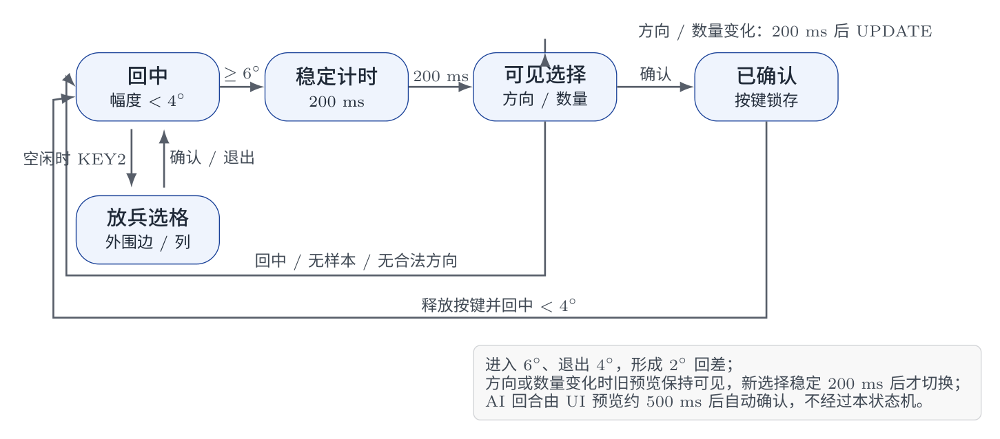
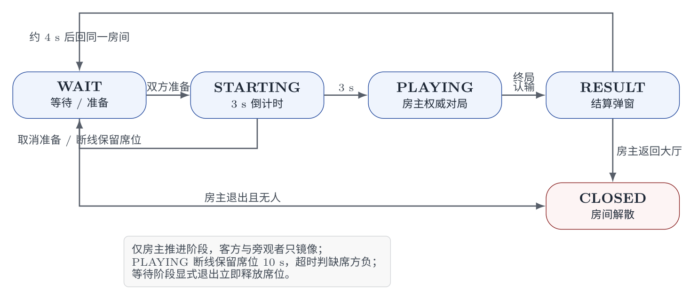

# 方案设计说明（格弈 / geyi）

| 项 | 内容 |
|---|---|
| 文档编号 | DOC-02 |
| 项目名称 | 格弈（geyi） |
| 版本 / 状态 | v1.6 / 功能完成 + 清理重构；联机 428 + app 358 checks；双板/三端套件 PASS |
| 负责人 / 日期 | 蔡融汉 / 2026-11-10 |

## 摘要

格弈的运行时分四层：最上是 LVGL v9 界面层，只在一个主线程里调用；中间是纯 C 的规则、输入、AI、参数、联机与反馈模块；下面是显示/触摸、IMU、KEY2、RGB 与 BLE 板级服务；最底是 RT-Thread、SiFli SDK v2.5.1 与 BSP/HAL。规则核心不依赖界面或硬件，输入状态机只输出选择/取消/确认事件，AI 在独立线程里搜索，联机采用“房主权威 + 全量快照 + 客户端只发意图”，这些边界让同一套逻辑能在主机、桌面和板端复用。

本版设计在 2026-11-10 完成一次有测试支撑的清理重构：保留按 kind 的协议校验、同 revision 快照不清放兵、发送失败返回、UI 与网络放兵一致等承载性修复，删除追查“客方无法落子/预览回弹”期间留下的重复 reset、诊断日志和死字段。外部行为与公开接口语义不变；重构后主机、双板、三端旁观与输入注入回归全部通过。

> 图为可编辑的 TikZ 源文件，编译脚本 `docs/img/src/build_figures.py`；统计图由 `docs/img/src/build_charts.py` 生成。图中“计划/未实现”的模块使用灰色或红色虚线，不把计划模块画成已实现。

## 1. 设计输入与约束

### 1.1 硬件与平台约束

| 项 | 约束 | 对设计的影响 |
|---|---|---|
| 平台 | 黄山派 SF32LB52-ULP（SF32LB525UC6），板型 `sf32lb52-lchspi-ulp`；SiFli SDK v2.5.1 / RT-Thread / LVGL v9；约 390×450 屏 | 棋盘 4~8（默认 6×6）；纯 C 规则核心与 LVGL 解耦；主机测试优先 |
| 通信 | 板载无 WiFi；联网只能走蓝牙/BLE；BLE + 经典蓝牙 PAN 并发未验证 | 联机按 BLE 设计；互联网联机列为拓展；BT PAN 需双板/手机实测 |
| 存储 | 16 MB NOR 与固件共享；无 TF 卡座 | 参数/历史 v1 均存 RAM、重启清空；若做持久化，再评估 Flash 占用与掉电写入 |
| 反馈 | 无震动马达（仅 PA20 驱动电路）、无电池 | 反馈只用板载 RGB；不承诺震动；对局中断电不可恢复 |
| 交互 | 倾斜 + 实体按键为主；触摸用于菜单/辅助 | 输入状态机与 UI 解耦；倾斜误触需专门验证，按键保留兜底 |
| 板卡 | 每周一次课可自由用板（当日归还）；课余每组一块借用板 | 主机/桌面测试优先；联机需两块板同时在线，排期风险高 |

### 1.2 预研结论

| 编号 | 预研项 | 当前状态 | 证据/说明 |
|---|---|---|---|
| P-01 | 两块板 BLE 双向通信 | 已完成 | 双板建房/加入/落子/旁观/断线重连、三块实体板旁观套件通过；学生真机确认 |
| P-02 | 单主机多客户端连接 | 未完成 | 双人对局必达；只读旁观为有条件目标；满旁观容量未实测 |
| P-03 | 倾斜四向识别参数标定 | 部分完成 | 板端四向预览有照片/日志；正确率、误触发率、延迟未量化 |
| P-04 | 棋盘渲染帧率与 ePicasso 加速 | 未测 | 390×450、≥30 fps 目标未实测 |
| P-05 | 中文字体转换链路 | 已完成 | 思源黑体子集，OFL 许可，桌面覆盖检查通过 |
| P-06 | BLE 与经典蓝牙 PAN 并发 | 未开始/不承诺 | 仅影响互联网联机拓展 |

### 1.3 设计目标与原则

设计的第一目标是“可验证”。规则、输入、参数、AI 和联机的房间逻辑都做成不依赖 LVGL/RT-Thread/BLE 的纯 C 模块，能在 PC 上编译并跑断言；界面用桌面 LVGL 测试；只有真实 BLE、触摸、倾斜手感、帧率和长时稳定性才留给板端。这样，大部分回归不消耗板卡，板端时间集中花在物理项上。

第二目标是“状态安全”。规则核心用 `revision` 防止过期预览和陈旧 AI 结果；AI 结果还带 `generation`，切页/重开即丢弃；联机用单调 `seq` 丢弃旧包和重复包，客户端不本地提交；参数只在“新开一局”时应用，局中不改变手感。所有跨线程数据都通过快照/队列传递，LVGL 只在主线程调用。

第三目标是“失败可定位”。BLE 链路身份与应用会话分开建模：链路带代际 `gen`，会话带 token 与席位；异常退出、秒退、旧包迟到、广播停止都按正常状态迁移处理，而不是在 UI 回调里打补丁。输入状态机把“可见选择”和“待稳定候选”分开，方向/数量变化时旧预览保持可见，避免 1↔2 兵之间出现“0 个兵”的空档。

第四目标是“证据分级”。主机/桌面通过、编译通过、双板自动套件、学生真机确认是四种不同级别的证据；设计文档只描述机制与验证方法，不把某一次自动套件写成完整联机验收，也不把学生视频写成 agent 目测。

## 2. 总体架构

### 2.1 分层架构


> 图源 `docs/img/src/fig-architecture.tex`。界面层只负责页面与渲染；业务层是可主机测试的纯 C 模块；板级层封装显示/触摸、IMU、KEY2、RGB 与 BLE；平台层是 SDK/RT-Thread/BSP。历史/计时尚未实现，未在图中展开，设计见 3.7 节。

架构的关键边界有三条。第一，LVGL 只在主线程调用，IMU 线程只发布角度快照，AI 线程只返回动作，网络 RX 线程只收包/校验/入队；任何后台线程都不直接操作界面或棋盘。第二，规则核心 `gy_game.c` 不依赖界面、传感器或网络，只接受 `GyMove`/`GyPreview` 并返回权威状态；联机房主复用它，客户端永不调用提交接口。第三，板级驱动把“采样、消抖、坐标映射”封装在 `gy_board.c`，上层只看到已校准的角度、按键事件和触摸坐标，便于在桌面替换为鼠标/键盘。

### 2.2 模块职责

| 模块 | 职责 | 对外接口 | 实现需求 | 代码路径 |
|---|---|---|---|---|
| game | 规则核心：初始化、预览、走子、合并、伤害、金币、胜负、模拟 | `gy_init` `gy_preview` `gy_commit` `gy_place` `gy_place_at` `gy_simulate_move` | REQ-301~308, REQ-315, REQ-320 | `src/geyi_game.c` |
| ai | 人机搜索、评估与剪枝统计 | `gy_ai_choose` | REQ-315, REQ-316 | `src/geyi_ai.c` |
| ai_task | 板端 AI 线程与桌面同步回退 | `gy_ai_task_start/poll/cancel` | REQ-315 | `src/geyi_ai_task.c` |
| input | 倾斜输入状态机、方位比例、外围落点映射 | `gy_input_update` `gy_input_place_cell` | REQ-309, REQ-311, REQ-319, REQ-320 | `src/geyi_input.c` |
| ui | 首页/模式/准备页/棋盘/放兵/AI 回合/规则页/大厅/房间/旁观；倾斜与按钮仲裁 | `gy_ui_create/action/tick/key2` `gy_ui_tilt_allowed/cancel` | REQ-310~320, REQ-501~511 | `src/geyi_ui.c` |
| board | 显示/触摸/IMU/KEY2 接入与采样新鲜度 | `gy_board_start/poll` | REQ-311 | `src/geyi_board.c` |
| feedback | RGB 灯事件与调度 | `gy_light_start/color` | REQ-314 | `src/geyi_feedback.c` |
| config | 10 项参数模型、范围表、校验/钳位、三类独立配置与重置 | `gy_param_*` | REQ-401~410 | `src/geyi_config.c` |
| param_ui | 参数页模式/分页/条目/增减/重置状态 | `gy_param_ui_*` | REQ-403/404/408 | `src/geyi_param_ui.c` |
| balance_scan | 主机端批量对局、参数网格扫描与 CSV 统计 | `geyi-balance-scan` + `tools/balance_scan.py` | REQ-411 | `tools/geyi_balance.c` |
| history | RAM 内最近 N 局环形缓冲、记录写入/读取/清空、单局计时 | `gy_history_*` `gy_timer_*`（计划） | REQ-601~606 | 未实现 |
| net_link | 内存管道/收发队列；BLE 广播/扫描/连接/GATT 后端 | `gy_net_pipe_*` `gy_net_ble_*` | REQ-501~503, REQ-508~511, REQ-513 | `src/geyi_net_link.c`、`src/geyi_net_ble.c` |
| net_proto | 消息定义、版本、序列化、快照编解码、长度/类型校验 | `gy_net_proto_*` `gy_net_pack_*` `gy_net_unpack_*` | REQ-512 | `src/geyi_net_proto.c` |
| net_room | 房主权威状态机、客方镜像、旁观视图、大厅 TTL、断线重连 | `gy_net_room_*` `gy_net_lobby_*` | REQ-504~507, REQ-513 | `src/geyi_net_room.c` |
| repo | Git/GitHub 协作基线 | — | REQ-201, REQ-202 | — |

### 2.3 线程与数据流


> 图源 `docs/img/src/fig-dataflow.tex`。实线是交互主线的数据流，虚线是“新开一局”时才生效的参数总线（参数 → 规则核心 / 输入 / AI）；联机与 AI 是旁路，不阻塞主线的预览/确认。

| 数据 | 生产者 → 消费者 | 格式/单位 | 更新周期/触发 |
|---|---|---|---|
| 倾斜角度 | IMU 线程 → 输入状态机 | 百分之一度（0.01°） | 约 20 ms |
| 按键 KEY2 | 板级驱动消抖 → `gy_ui_key2()` | 电平/20 ms 消抖 | 短按事件 |
| 选择事件 | 输入状态机 → UI/规则核心 | `GyInputEvent{dir,count,aim,confirm}` | 200 ms 稳定后 |
| 预览 | 规则核心 → UI | `GyPreview`（visible 快照） | 每次选择变化 |
| 动作 | UI/AI → 规则核心 | `GyMove{dir,count,aim}` / `gy_place_at(row,col)` | 确认/500 ms AI 预览后 |
| 权威状态 | 规则核心 → UI/联机 | `GySnapshot{seq,cells,coins,turn,outcome}` | 每个合法动作 |
| 联机消息 | net_room ↔ net_proto ↔ net_link | 带 version + seq 的字节流 | 事件/1 s 心跳 |
| 历史记录 | 规则核心 → 历史模块 | `GyHistory{mode,size,result,moves,duration_ms}` | 终局/认输一次（计划） |

## 3. 关键机制设计

### 3.1 规则核心与走子顺序

规则核心把棋盘、金币、回合、随机种子和胜负封装在 `GyGame` 里，预览、提交和 AI 模拟共用同一条执行路径。走子不再分成“数字整批先走、士兵整批后走”，而是按方向从目的边向另一端逐行/列/格统一遍历：轮到数字块时滑动、合并（每块每回合最多一次），轮到选中的己方士兵时前进一格或攻击前方敌兵。前面的单位先移动或让开，后面的单位看到的是更新后的棋盘，这就是“前到后”的语义。

```text
按方向从目的边向另一端逐格处理：
  数字块   -> 滑动、合并（每块每回合最多一次）
  选中士兵 -> 前方为空则前进一格；前方是存活敌兵则攻击并原地不动
             前方是数字/友军/死亡单位则不动
遍历结束后 -> 按数字块移动方向前方相邻士兵结算 D1 伤害
           -> finish() 统一移除死亡单位、结算击杀金币、判胜负
```

`gy_eligible_count(d)` 复用同一遍历，在棋盘副本上把所有己方存活士兵标记为选中，统计实际前进或攻击的士兵数；模拟不改变真实棋盘、不生成随机块。玩家选 N 个时，先按初始位置到方位线的横向距离、再按到目的边深度排序；同一行动使用开始时的位置选兵，中途死亡不补选。预览、实际落子、AI 搜索和输入层共用这套逻辑，UI 不新增预览规则。

固定验收局面有两组。数字 2 在 (1,1)、红士兵在 (3,1)，向右选 1 个士兵，数字应到 (3,1)、士兵到 (4,1)，而不是数字停在 (2,1)。一行 `N2 B8 N2 . B8 .`，蓝方向右选 2 个士兵，`gy_eligible_count(RIGHT)` 应为 2，结果为 `. N2 B6 . N2 B6`，两个数字分别补位并各造成 2 伤害。这两组局面同时覆盖“数字让开”和“两兵都移动”，是判断前到后遍历是否正确的关键。

### 3.2 倾斜输入状态机



> 图源 `docs/img/src/fig-input-state.tex`。状态机只输出 SELECT/UPDATE/CANCEL/CONFIRM 事件，不直接写棋盘；调用者用 `gy_eligible_count` 取数量上限，确认事件才调用 `gy_commit`。

| 参数 | 值 | 说明 |
|---|---|---|
| 进入门限 `ENTER` | 600（6°） | 低于该幅度不进入预览 |
| 退出门限 `EXIT` | 400（4°） | 回中/取消只在低于该幅度时发生，形成 2° 回差 |
| 数量档宽 `band` | 1000（10°） | 从 6° 起每 10° 一档；若 N 档超过 60°，退回 6°~60° 按 N 等分 |
| 稳定窗口 | 200 ms | 方向/数量连续一致 200 ms 才发 UPDATE；期间旧预览保持可见 |
| 方向缓冲 | 0~50%，默认 10% | 新方向需强出 `dir_buffer+1%` 才切换 |
| 角度缓冲 | 0~50%，默认 10% | 数量档位边界的回差 |
| 回差带 | 4°~6° | 已有选择时保持当前方向/数量，轻微横倾不改向 |
| 放兵死区 | 4° | 进入放兵后，倾斜越过死区才选格；死区内保持当前目标 |

确认后置 `locked`，幅度低于 4° 才解锁；启动/换回合不置 `locked`，所以轮到自己时板子已经斜着，也能在稳定 200 ms 后进入预览。板端 KEY2 在 UI 层，KEY2 后 `gy_board_poll()` 会 `reset_input()`；若仍倾斜，会重新预览，但 KEY2 需要新的按下。角度越界、无有效样本、可行动兵数变化或明显指向没有可行动兵的方向时清空选择并发 CANCEL，不能确认陈旧输入。

### 3.3 AI 与 AI 预览

AI 采用 negamax + Alpha-Beta，与想法稿要求的 Minimax 等价；同一套代码保留 `use_pruning=0` 的全量搜索开关，用于答辩时对比节点数与耗时。动作空间由当前规则生成：四个方向上的士兵数量 1..可行动数（无可行动士兵时允许数量 0，只移动数字块），以及金币足够时按外围射线搜索到的空格。每个动作先用轻量模拟验证，非法动作不进入搜索。

搜索固定使用 `gy_simulate_move(..., spawn_next=0)`，只换手、不生成新数字块，因此不读取真实 RNG，也不会“偷看”下一步随机结果；真实落子仍由 UI 调用 `gy_preview`/`gy_commit` 或 `gy_place_at`，随机块由游戏自身生成。评估函数从当前行动方视角计算，红蓝对称，使用整数权重：终局胜负、士兵数量、总血量、可用金币、数字块对双方士兵的实际威胁、机动性、己方底线空位；所有启发项之和限制在终局分以下，避免材料分淹没胜负。

搜索采用迭代加深 1..6 层，默认单次 300 ms、节点数上限 200000；每层用上一层最佳着法优先，攻击/击杀/合并/放兵优先的走法排序；超时或取消时保留上一层已完成的最佳着法。板端在独立 `gy_ai` 线程（约 16 KB 栈）运行，主线程传入棋盘快照并轮询结果；AI 线程只返回动作，不直接操作 UI 或棋盘。AI 结果先进入预览态，约 500 ms 后自动确认一次；预览期间人类输入被屏蔽，首页/重开通过 generation/revision 丢弃过期结果。

### 3.4 参数子系统

参数模块用显式结构体字段而不是通用键值数组，10 项参数逐字段列出；`src/geyi_config.c` 维护一张只读范围表（名称、单位、下限、上限、适用模式），界面渲染与合法性校验共用同一张表，避免“界面写一套、校验写另一套”。`gy_param_validate()` 返回具体错误码，`gy_param_clamp()` 在设置入口做边界钳位，两者共用范围表。

| 参数 | 默认 | 范围 | 适用模式 | 说明 |
|---|---:|---|---|---|
| 棋盘大小 `size` | 6 | 4~8 | 全部 | 棋盘 N×N |
| 生成间隔 `spawn_interval` | 1 | 奇数 1~9 | 全部 | 每 N 次有效移动生成一个数字，放置不计数 |
| 士兵血量 `hp` | 8 | 1~64 | 全部 | 本局血量与血条定标 |
| 攻击力 `attack` | 2 | 1~16 | 全部 | 士兵攻击伤害 |
| 放置费 `cost` | 4 | 1~20 | 全部 | 放兵所需金币 |
| 合并奖励 `merge_reward` | 1 | 0~5 | 全部 | 每次合并获得金币 |
| 击杀奖励 `kill_reward` | 2 | 0~10 | 全部 | 击杀敌兵获得金币 |
| AI 搜索深度 `search_depth` | 3 | 1~6 | 仅人机 | 启动 AI 时读取 |
| 方向缓冲 `dir_buffer` | 10% | 0~50% | 全部 | 方向切换回差 |
| 角度缓冲 `angle_buffer` | 10% | 0~50% | 全部 | 数量档位回差 |

三类配置 `s_params[GY_MODE_SINGLE/PVE/PVP]` 互相独立，`gy_param_apply(mode)` 只在“新开一局”时调用一次，把参数转成 `GyConfig`；板端 `gy_board` 在同一时机用当前模式的 `dir_buffer/angle_buffer` 配置 `GyInput`。局中不再读取参数，从而保证 REQ-407；联机对局以房主参数为准，避免两端规则不一致。参数存 RAM，重启回默认，v1 不做 Flash 持久化。

### 3.5 联机对战

| 需求 | 设计落点 | 状态 |
|---|---|---|
| REQ-501 | 房主 = BLE 外设/GATT 服务端/唯一裁判；对手与旁观者为 BLE 中央；一台板只属一个房间 | 双板/三端 PASS |
| REQ-502 | 大厅按 roomId 维护摘要，1 s 广播/3 s TTL；auto 角色由房主按真实空位裁决 | 主机/双板/三端 PASS |
| REQ-503 | 旁观上限 K = 实测连接数 − 1；满员 JOIN_REJECT；连接态广播按 TTL 标“未知” | P-02 容量未测 |
| REQ-504 | WAIT → STARTING（3 s）→ PLAYING → RESULT；RESULT 约 4 s 回 WAIT | 主机/双板/三端 PASS |
| REQ-505 | 房间页红蓝席位、按座位 ready、房主交换限制、房主退出转移/关房 | 主机/双板/三端 PASS |
| REQ-506 | 房主权威 + 全量快照 + 单调 seq；客户端只发意图；REJECT 后重绘 | 主机 428 + app 358 PASS |
| REQ-507 | PREVIEW 只发房主、房主只转发旁观；对手不接收、不回传 | 主机路由/三端/学生确认 |
| REQ-508 | 1 s 心跳、10 s 无包判断连；不依赖 BLE 链路监督超时 | 主机/双板 PASS |
| REQ-509 | 10 s 重连窗口；REJOIN(token,last_seq) 校验后回全量快照 | 主机/双板/三端 PASS |
| REQ-510 | 房主掉线客方重试 10 s 后本地终局提示；旁观掉线不冻结对局 | 主机/三端 PASS |
| REQ-511 | 主动退出 ≠ 断线；对局中二次确认判负；结算 4 s 后回同一房间 | 主机/双板/三端 PASS |
| REQ-512 | 消息带版本/seq；明确字节序与长度上限；重复包幂等；非法消息拒绝 | 主机 428 checks PASS |
| REQ-513 | net_link → net_proto → net_room → UI；net_room 不依赖 LVGL/RT-Thread/BLE | 主机/双板/三端/桌面回退 PASS |

#### 3.5.1 拓扑与权威模型


> 图源 `docs/img/src/fig-online-topology.tex`。房主同时是 BLE 外设、GATT 服务端和唯一裁判；对手与旁观者都是连接房主的 BLE 中央。预览只发给房主，房主只转发给旁观者，对手端不接收、不回传。

房主持有棋盘、金币、回合、随机种子、席位/颜色、准备状态和阶段；客户端只发 `MOVE_REQ`/`READY`/`SET_SEAT`/`LEAVE` 等意图，不本地提交落子。每个合法动作后房主广播全量快照，带单调递增 `seq`；客户端只接受最新 `seq`，旧包/重复包直接丢弃。客户端可以本地倾斜预览，但确认后等待快照，快照到达前棋盘不变。非法/过期动作回 `REJECT(reason, seq)`，客户端丢弃暂存意图并按当前权威快照重绘。随机块只由房主生成并写入快照，客户端不自行生成，避免两端随机序列分叉。

6×6 棋盘的全量快照体积小，换取实现简单和断线恢复直接；不做增量同步。包长与 BLE MTU/吞吐在实现时实测，分片无 ACK/重传（R-031）。多房间由多台房主各自广播，大厅按 `roomId` 维护列表，3 s TTL 移除；不做中心服务器。一台板同一时刻只属于一个房间，首版不实现局内房主迁移；等待阶段房主退出时按 REQ-505 转移或关闭房间。

#### 3.5.2 房间阶段



> 图源 `docs/img/src/fig-room-fsm.tex`。仅房主推进阶段，客方与旁观者只镜像；双方准备后 3 s 倒计时开局，结算弹窗约 4 s 后回同一房间，房主返回大厅才解散。图中 PLAYING→RESULT 的边同时表示终局、认输与 10 s 断线超时判负。

WAIT 阶段双方可准备/取消、房主可交换红蓝；有人加入或退出不改变原玩家准备状态。双方准备后进入 STARTING，用大号黄底 `3 s / 2 s / 1 s` 实时更新；倒计时中任一方取消准备回 WAIT。PLAYING 阶段房主权威结算，终局/认输/断线超时进入 RESULT；RESULT 弹窗约 4 s 后回 WAIT，`game_valid=0`、双方 ready 清零、result 复位，不置 CLOSED。只有房主返回大厅才关房。

#### 3.5.3 消息与幂等

| 消息 | 方向 | 用途 | 幂等/错误处理 |
|---|---|---|---|
| `ADV_ROOM` | 房主→空中 | roomId、人数、阶段、观战数、协议版本 | 大厅按 roomId 更新；3 s 过期移除 |
| `JOIN_REQ` | 加入者→房主 | `{role, player_id, roomId}`；role=玩家/旁观/auto | 满员/阶段不允许 → `JOIN_REJECT(reason)`；auto 由房主按真实空位裁决 |
| `JOIN_ACK` | 房主→加入者 | token、席位、player_id、房间快照 | token 绑定席位，房间存续期有效 |
| `ROOM_STATE` | 房主→房间内 | 席位颜色、双方 player_id、准备状态、观战数、阶段、两个座位在线位与断线剩余秒数 | 客户端只接受房主版本；同一 seq 仍刷新瞬时在线/倒计时 |
| `READY` / `SET_SEAT` / `LEAVE` | 玩家→房主 | 准备/取消、交换红蓝、退出 | 非法状态 → `REJECT(reason, seq)` |
| `START` | 房主→房间内 | 颜色分配、随机种子、初始快照 | 仅 STARTING→PLAYING 时有效 |
| `MOVE_REQ` | 玩家→房主 | `{seq, kind, 方向, 数量, 方位, 放兵行/列}` | 非法/过期 → `REJECT(reason, seq)`；kind 只校验对应字段 |
| `SNAPSHOT` | 房主→房间内 | 全量权威状态 + 单调 seq | 客户端只认最新 seq；重复丢弃；同 revision 不覆盖本地放兵/预览 |
| `RESULT` | 房主→房间内 | 胜负与原因 | 弹窗约 4 s，然后回 WAIT |
| `PREVIEW` / `PREVIEW_CLEAR` | 玩家→房主→仅旁观 | `{side, 方向, 指示点/受影响格, seq}` | 限流；对手不接收、不回传 |
| `HEARTBEAT` / `PING` | 房主→客方 / 客方→房主 | 1 s 判活 | 10 s 无包判断连 |
| `REJOIN` / `RESUME` | 客方→房主 / 房主→客方 | token + last_seq 重连、全量恢复 | token/席位不匹配拒绝；同链路同 token 重复 REJOIN 幂等回 ACK |

协议要求消息带版本号，序列化有明确字节序和长度上限，未知消息忽略或拒绝并记录，不直接把 C 结构体内存当作网络包发送。协议从 v1 演进到 v4：v2 增加 `player_id` 与 auto 角色；v3 的 `ROOM_STATE` 增加 `seat_online` 与 `seat_reconnect_s[2]`；v4 的 `MOVE_REQ`/`PREVIEW` 携带 `aim` 与放兵 `row`，并引入 kind 感知的字段校验。三块板必须同版本，旧版本会被版本检查拒绝。

#### 3.5.4 断线与重连

| 场景 | 对局 | 处理 |
|---|---|---|
| 客方瞬断 | 冻结，显示“重连中 10…9…” | 10 s 内 `REJOIN(token,last_seq)` → 全量快照 → 继续；超时由房主判其负 |
| 房主掉线 | 客方冻结/重试 | 客方重试连接 10 s；超时显示“对方断线”的本地终局提示，不是房主广播的权威 RESULT；旁观者不跟随判负 |
| 旁观者掉线 | 不冻结对局 | 10 s 内可重连拿快照；超时回大厅提示“已离开旁观” |
| 等待阶段退出/掉线 | 不判负 | 释放席位；房主退出则另一人变房主，无人则关房 |
| 对局中主动退出 | 立即判负 | “退出”二次确认后按认输处理，不等 10 s |
| 结算后 | 约 4 s | 弹窗看结果，然后回同一房间；房主返回大厅才解散 |

判定责任是在场方判缺席方负；旁观者只显示房主广播的结果或本地断线提示，不自行判定。应用层心跳 1 s、10 s 无包判断连，不依赖 BLE 链路监督超时。客方重启后没有旧 token，房主按芯片 UID 派生的稳定 `player_id` 在 10 s 内把该玩家放回原颜色席位（不是旁观/新玩家），新 token、ready 清零；PLAYING 时继续原棋局，WAIT 时回房间页。房主重启等于房间消失，本轮不承诺恢复。

#### 3.5.5 加入、对局与重连时序


> 图源 `docs/img/src/fig-online-sequence.tex`。时序只表达协议顺序；真实 BLE 断连/重连、旁观与屏幕观感由双板/三端套件和学生真机确认，容量/故障注入仍未做。

#### 3.5.6 预览私密性

预览是本地临时状态，从不发给对手。玩家倾斜时向房主发 `PREVIEW{side, 方向, 指示点/受影响格, seq}`，限流到方向或指示点变化时；确认/回中/取消发 `PREVIEW_CLEAR`。房主只转发给旁观者；房主自己作为对手时不渲染、不回传；房主自己的预览不经过网络回环，直接由房主转发给旁观者，同样受 `PREVIEW_CLEAR` 约束。客户端只接受“来自自己”的预览，远程预览丢弃。旁观者用双方各自颜色叠加两个预览；对局页的对手端不显示远程预览。验收必须多板：对手屏幕看不到、旁观屏幕看得到；桌面/主机只能验证路由，不代替物理验收。

### 3.6 UI 页面与安全区


> 图源 `docs/img/src/fig-page-flow.tex`。单机/人机结算回首页；联机结算约 4 s 回同一房间，房主返回大厅后解散；灰色虚线为未实现的历史页，红色虚线为断线覆盖层（可覆盖房间页/对局页，图中只画对局页入口）。

首页只保留“开始游戏 / 自定义参数 / 历史记录 / 游戏规则”，模式页只保留单机/人机/联机，未开放项禁用。规则页用同一个 `lv_label` 切换四页正文（`LV_LABEL_LONG_MODE_WRAP`，宽 334），右上角显示 `1/4`~`4/4`，底部固定“返回 / 上一页 / 下一页”；页码只做钳位，不循环，返回首页不触碰 `gy_net_app` 或当前棋局。

真机是 390×450 圆角矩形，四角存在物理裁切。设计取保守圆角 R=48：屏幕四角各有一个半径 48 的圆角裁切区，按钮/文字框的四个角都必须落在圆角矩形内。对局页因此删除左上角装饰性 GEYI，右上角按钮从 `(286,8,88,32)` 移到 `(270,22,96,36)`；回合/金币下移到 y=26/50；方向行、确认行、底部提示条分别下移到 y=330/368/404，提示条缩为 `(24,404,342,30)`。`gy_ui_corner_clip_count(radius)` 递归遍历当前屏幕所有可见按钮与 label，用圆角矩形公式检查四角；桌面 `--test` 在首页、规则 1~4 页、对局页分别断言为 0。

### 3.7 反馈与历史/计时

RGB 反馈沿用 SDK `example/rt_device/rgb_led` 的 PA32/GPTIM2_CH1、LDO3.3V 与 `rgbled/PWM_CMD_SET_COLOR`，不新增音频或改变工程配置。UI 在真实提交成功/认输后发布灯事件，纯 C 时间调度计算颜色，主循环只在颜色变化时写驱动；有效确认走棋/放兵后低亮绿灯短闪 120 ms，终局红胜闪红、蓝胜闪蓝、平局闪黄各 3 次（亮 300 ms/灭 300 ms）。使用无符号时间差处理时钟回绕，首页/重开取消未完成灯效。

历史/计时目前只有设计基线：v1 只做 RAM 内最近 N=10 局与单局计时，重启清空，不做 Flash/TF 持久化、云端同步、跨设备历史、导出/分享或按模式筛选。`GyHistoryEntry` 固定字段 `{mode,size,result,winner,moves,duration_ms,timestamp}`，`GyHistory{entries[10],head,count}` 用固定数组环形缓冲；记录只在终局/认输时写入一次，重进结算页不重复写。计时用单调 tick 的无符号差值，终局停止，不做暂停。RAM-only 取舍见 ADR-0010（提议，待学生确认）。

## 4. 接口设计

### 4.1 软件接口

| 接口 | 输入 | 输出 | 错误处理 | 说明 |
|---|---|---|---|---|
| `gy_init` | `GyConfig`、随机种子 | 成功/失败 | 配置越界返回 0，不修改原状态 | 初始化棋盘、金币、回合 |
| `gy_eligible_count` | 方向 | 可行动士兵数 | 越界方向返回 0 | 用前到后遍历模拟，不改棋盘 |
| `gy_preview` | 方向 + 数量 + 方位 | `GyPreview` 快照 | 非法动作返回 0 | 预览不改原局面、不消耗 RNG |
| `gy_commit` | `GyPreview` | 成功/失败 | 过期/不匹配快照拒绝 | 确认后走子、结算、生成、换手 |
| `gy_place_at` / `gy_place` | 二维落点 / 底线列 | 成功/失败 | 金币不足/非外围首空/占用/越界拒绝 | 放兵不触发生成计数；`gy_place` 为兼容入口 |
| `gy_simulate_move` | 局面、动作、`spawn_next` | 新局面的副本 | 非法动作返回 0 | `spawn_next=0` 供 AI 搜索，不读真实 RNG |
| `gy_ai_choose` | 局面、AI 配置 | 动作 + 统计 | 无可行动作返回失败 | negamax + Alpha-Beta，迭代加深 |
| `gy_ai_task_start/poll/cancel` | 棋盘快照、取消标志 | 动作/状态 | 过期结果丢弃 | 板端独立线程，桌面同步回退 |
| `gy_input_update` | 角度、时间、key 参数 | 选择/取消事件 | 无样本/越界取消旧选择 | 四向判定、滞回、稳定窗口；板端 key 固定 0 |
| `gy_input_place_cell` | 方向、方位、棋盘 | 二维落点/0 | 射线无空格返回 0 | 外围边格沿射线内缩 |
| `gy_ui_key2` | 当前 UI/放兵状态 | 确认/进入退出放兵 | 非对局页无动作 | 板端 KEY2 与桌面测试共用同一语义 |
| `gy_param_apply` | 模式 | 成功/失败 | 非法模式返回错误 | 新开一局时把参数转成 `GyConfig` 并配置输入 |
| `gy_ui_action` / `gy_ui_tick` | UI 事件 / tick | 页面状态 | 非游戏页屏蔽游戏输入 | 首页、模式、准备页、棋盘、AI 回合 |
| `gy_net_room_*` | 收到的消息 / 本地意图 | 待发消息 + UI 事件 | 非法状态回 REJECT，过期 seq 丢弃 | 房主权威/客方镜像/旁观视图，纯逻辑 |
| `gy_net_poll` | 无 | 把网络事件分发给 UI | 无事件返回 0 | 主线程每轮调用，非阻塞 |

### 4.2 数据结构

| 结构 | 关键字段 | 说明 |
|---|---|---|
| `GyCell` | `kind`（空/数字/士兵）、`owner`（红/蓝）、`hp`、`value` | 单个格子 |
| `GyGame` | `cells[8][8]`、`GyConfig`、双方金币、当前回合、胜负、有效移动计数、`revision`、PRNG 状态 | 规则核心的权威状态 |
| `GyMove` | 方向 + 士兵数量 + 横向方位比例 `aim`（-100..100） | 移动/选兵；放兵用二维 `row/column` |
| `GyPreview` | `before`/`after`/`visible`/`ready` | `before` 用于提交前核对，`visible` 是隐藏随机生成块后的预览画面 |
| `GyConfig` / `GyParamSet` | `size/hp/attack/cost/merge_reward/kill_reward/spawn_interval`；参数集另有 `search_depth/dir_buffer_pct/angle_buffer_pct` | 规则配置与三类参数配置 |
| `GyNetSeat` | `role`、`color`、`ready`、`connected`、`player_id`、`token` | 席位、权限与唯一身份 |
| `GyNetRoom` | `room_id`、`phase`、`seats[]`、`spectators[]`、`seq`、`last_snapshot` | 房主权威房间状态 |
| `GyNetSnapshot` | `seq`、`GyGame game`、`seat colors`、`phase` | 全量快照；复用规则核心 |
| `GyNetMsg` | `version`、`type`、`seq`、`payload`、`len` | 协议消息头 + 负载 |
| `GyHistoryEntry` / `GyHistory` | `{mode,size,result,winner,moves,duration_ms,timestamp}`；`entries[10],head,count` | 历史/计时（计划） |

## 5. 资源与运行设计

### 5.1 硬件资源

| 外设 | 用途 | 引脚/总线 | 参数 | 来源 |
|---|---|---|---|---|
| 板载 LCD（CO5300） | 棋盘/菜单显示 | SDK BSP 初始化 | 约 390×450 | SDK `littlevgl2rtt_init("lcd")` |
| 板载触摸（FT6146） | 菜单/辅助操作 | SDK BSP 初始化 | — | SDK BSP |
| LSM6DS3TR-C IMU | 倾斜方向/数量 | I2C3，地址 0x6A | 约 20 ms 采样 | 课程 `peripheral_lab` / SDK 例程 |
| KEY1 | 不参与游戏输入（电源/下载复用键） | PA34，代码不配置、不读取 | — | 课程板说明 |
| KEY2 | 唯一游戏键：确认/进入退出放兵 | PA43 | 稳定 20 ms | 课程板说明 |
| RGB LED | 行动/终局反馈 | PA32 / GPTIM2_CH1 | 低亮短闪 120 ms；终局三闪 | SDK `example/rt_device/rgb_led` |
| 蓝牙 | 联机/BLE | 板载双模蓝牙 | BLE 外设+中央双角色；GATT 自定义服务；连接数待实测 | SDK `example/ble/central_and_peripheral` 等 |
| NOR Flash | 固件存储 | 板载 16 MB | 与固件共享 | 无 TF 卡座 |

### 5.2 线程与定时

| 执行体 | 职责 | 周期/上限 | 同步方式 |
|---|---|---|---|
| 主线程 | LVGL、页面、棋盘、`gy_net_poll`、KEY2/触摸 | 每帧；输入稳定 200 ms | 所有 LVGL 调用只在主线程 |
| IMU 线程 | I2C3 采样、坐标映射、发布角度快照 | 约 20 ms | 互斥锁发布快照；主线程按 `m.seq` 判新鲜度 |
| AI 线程 | 棋盘快照 → negamax 搜索 → 动作 | 300 ms/6 层/200000 节点上限 | generation/revision 丢弃过期结果 |
| 网络 RX 线程 | BLE 收包、校验、入队 | 事件驱动；心跳 1 s | 队列；不直接操作 LVGL/棋盘 |
| 定时器/时间戳 | 房间摘要、倒计时、重连、结算 | 1 s adv/heartbeat；3 s STARTING；4 s RESULT；10 s 重连 | 主循环时间戳；精确边界待实测 |

## 6. 关键决策

| 决策 | 备选 | 选择与确认 | ADR |
|---|---|---|---|
| 规则核心独立于界面/硬件 | 纯 C 核心 / 规则嵌入 LVGL | 便于主机测试、AI 搜索和联机复用 | `adr/0001-single-core.md` |
| 板端一次接入显示/触摸/IMU/按键 | 先显示触摸再倾斜 / 一次接入 | 减少反复烧录；分层记录编译与物理验证 | `adr/0002-board-bringup.md` |
| 人机用 negamax + Alpha-Beta，搜索 `spawn=0`，独立线程 | MCTS / Expectimax / 规则启发式；读真实 RNG；主线程阻塞 | 想法稿要求剪枝对比；避免偷看随机块；不冻结 UI | `adr/0003-ai-minimax.md` |
| 人机入口改为单入口 + 先后手准备页 | 模式页两个按钮 / 固定人类执红 | 匹配想法稿非联机准备页；先后手可交换 | `adr/0004-ai-setup-page.md` |
| 移动顺序采用前到后统一遍历 + 最终 D1 伤害 | 数字先走 / 士兵先走 / 分批结算 | 修复数字挡路和旧棋盘选兵问题；预览、AI、输入共用同一语义 | `adr/0005-move-order.md` |
| 参数用显式结构体 + 只读范围表，v1 不持久化 | 通用键值数组 / 持久化到 Flash | 固定 10 项便于精确断言；避免掉电写入与存储占用 | `adr/0006-param-model.md` |
| 联机只走板载蓝牙，不做 WiFi/互联网匹配 | BLE / BLE+BT PAN / 外接 WiFi | 板载无 WiFi；课程板卡稀缺，先保单机/人机/参数闭环 | `adr/0007-online-topology-authority.md` |
| 房主权威 + 全量快照 + 客户端只发意图 | 双端锁步 / 增量同步 / 客户端权威 / P2P | 房主是唯一裁判，随机块只由房主生成；6×6 全量快照简单且断线恢复直接 | `adr/0007-online-topology-authority.md` |
| 断线 10 s 冻结 + token REJOIN + 在场方判负 | 立即判负 / 无限等待 / 新会话重开 / 只依赖 BLE 链路超时 | 避免瞬断误判；token 绑定席位；窗口内全量快照恢复 | `adr/0008-online-reconnect.md` |
| 预览只转发旁观者，对手不可见 | 广播给所有人 / 不显示远程预览 / 延迟显示 | 预览是本地临时状态，避免对手偷看；旁观可看双方 | `adr/0009-online-preview-privacy.md` |
| agent 驱动分层端到端自动化测试 | 纯人工 / 只做主机 / 只用 PC BLE 模拟 | L1 主机 + L2 桌面 + L3 板端脚本；板端只注入输入源，屏幕/手感/BLE 物理确认留给学生 | `adr/0011-agent-driven-e2e-testing.md` |
| 联机/输入模块做有测试支撑的定向清理重构 | 保持现状 / 整批回退追查期补丁 | 降低重复清理与死代码噪声，保持外部行为不变；双板/三端/输入回归与独立 review 保障 | `adr/0012-online-cleanup-refactor.md` |

## 7. 非功能设计与风险

### 7.1 非功能设计

性能上，4~8 棋盘（默认 6×6）在 390×450 全屏目标 ≥30 fps，板端未测；输入状态机的稳定窗口为 200 ms，主机实测倾斜到预览 201–220 ms，说明延迟主要来自稳定窗口而非采样率；AI 单次 300 ms/6 层上限，主机深度 3–5 为 0.2–3.2 ms，板端耗时未测。资源上，规则核心固定数组、不使用动态分配；AI 线程约 16 KiB 栈；16 MB NOR 与固件共享；参数与历史 v1 存 RAM；历史环形缓冲固定 10 条。固件当前 1,091,788 B（约 1.041 MiB），低于范围变更后重新基线化的 1.5 MiB 资源目标；NOR 容量充足。

可靠性上，预览/提交用 `revision` 防止陈旧状态；AI 结果用 `generation` 丢弃过期结果；联机用 `seq` 幂等、10 s 重连窗口与 token 校验；未实现看门狗和掉电恢复，参数/历史重启回默认/清空，属于明确的产品边界。可测试性上，规则、输入、参数、AI 均可在主机编译并跑断言；UI 用桌面 LVGL 测试；联机 `net_room` 是纯逻辑，可用内存管道双实例测试；物理项必须在板上留证。安全/隐私上，不采集、不上传用户数据；联机只走 BLE，token 绑定席位；仓库不存密钥。可维护性上，模块边界见 2.2；新增主机测试接入 `tools/run_host.py`；CI 运行 `check_all.py` 与主机测试；核心模块主机覆盖率 76.5%–100%。

### 7.2 主要风险

| 风险 | 概率 | 影响 | 应对 / Plan B | 台账 |
|---|---|---|---|---|
| 倾斜误触发（挪动板子/线性加速度） | 中高 | 高 | 200 ms 稳定窗口、方向/角度滞回、按键兜底；板端尚未量化 | L-03 |
| BLE 连接数/稳定性不足 | 中 | 中 | 先做双人 BLE；观战/多端降级；必要时改经典蓝牙 SPP | L-01 / L-02 |
| 390×450 帧率不足 | 中 | 高 | 6×6 小棋盘、减少重绘；ePicasso 是否生效待测 | L-04 |
| 5 人并行集成冲突 | 中高 | 高 | 纯 C 核心、小步提交、集成分支；PR #4 曾发生文档冲突并手工解决 | L-08 |
| 板卡稀缺导致联机排期风险 | 高 | 中 | 主机/桌面测试优先；联机需两块板同时在线，集中在课上联调 | R-021 |
| 历史/计时、参数页最终 UI、参数生效未完成 | 高 | 中 | 明确列为未执行，不写成通过；历史 v1 采用 RAM-only | R-012 / R-031 |
| BLE 并发连接数不足，旁观容量 K 无法保证 | 中 | 高 | 先做 P-02 实测；若只有 1 条连接，首版砍旁观或改中继 | L-01 / R-023 |
| 全量快照频率/包长与 BLE MTU/吞吐不匹配 | 中 | 高 | 6×6 快照先实测包长与延迟；必要时压缩/降频，但不改权威模型 | R-026 |
| 预览路由错误泄露给对手 | 中 | 高 | net_room 路由单测 + 多板“对手看不到/旁观看得到”验证 | R-027 |
| 断线/重连竞态与判负责任不清 | 中 | 高 | 纯逻辑 net_room + 双实例时钟测试；在场方判缺席方负 | R-025 |

> 完整台账（含 AI 专项 R-008~R-018、板端 R-S01~R-S06、初始化 R-001~R-007）见 `06-风险与问题台账.md`；本表只列影响当前产品闭环的主要项。

## 8. 需求—设计追踪

| 需求 | 设计章节/模块 | 验证 |
|---|---|---|
| REQ-201, REQ-202 | M0 仓库协作设计 / repo | TC-201~TC-203 |
| REQ-301~REQ-308 | 3.1 规则核心 / game | TC-301~TC-308、TC-303-05、TC-304-05 |
| REQ-309~REQ-314 | 3.2 输入状态机、3.6 UI、3.7 反馈 / input, ui, feedback | TC-309~TC-314 |
| REQ-315~REQ-317 | 3.3 AI 与预览 / ai, ai_task, ui | TC-315~TC-317 |
| REQ-318, REQ-319 | 3.6 UI 与安全区、3.2 输入仲裁 / ui, input | TC-318、TC-319 |
| REQ-320 | 3.1 规则、3.2 输入 / game, input, ui | TC-320 |
| REQ-401~REQ-411 | 3.4 参数子系统 / config, param_ui, balance_scan | TC-401~TC-409 |
| REQ-501~REQ-513 | 3.5 联机 / net_link, net_proto, net_room, ui | TC-501~TC-513 |
| REQ-601~REQ-606 | 3.7 历史/计时（计划）/ history | TC-601~TC-606（未实现） |
| NFR-01~NFR-14 | 7.1 非功能设计 | TC-NF-01~TC-NF-15 |

## 附录 A 设计演进与实现记录

> 本节保留开发过程中的详细设计、修订轮次与实现记录，按模块和时间排列。当前设计以正文为准；本节中的“计划/未实现/待验证”是当时状态。

### 棋子移动顺序修正设计（REQ-303/REQ-304，2026-10-18）

核心不再分成“数字整批先走、士兵整批后走”两段，而是新增一次统一遍历：

```text
按方向从目的边向另一端逐行/列/格处理：
  若当前格是数字块 -> 滑动、合并（每块每回合最多一次）
  若当前格是选中的己方士兵 -> 前方为空则前进一格；前方是存活敌兵则攻击
                              前方是数字/友军/死亡单位则不动
遍历结束后 -> 按数字块移动方向前方相邻士兵结算伤害（D1）
           -> finish() 统一移除死亡单位、结算击杀金币
```

因为目的边先处理，前面的士兵/数字先移动或让开，后面的士兵轮到时看到的是更新后的
棋盘；这就是“前到后”的语义。士兵攻击规则、攻击力、无反击、击杀奖励、死亡单位
阻挡到 `finish()` 都不变。

可移动数量 `gy_eligible_count(d)` 复用同一遍历，在棋盘副本上把所有己方存活士兵
标记为选中，统计实际前进或攻击的士兵数；模拟不改变真实棋盘、不生成随机块。
玩家选 N 个时，先按初始位置到方位线的横向距离、再按到目的边深度排序，从模拟可行动集合中取最近 N 个；
选中前缀在同一行内一定包含更靠近目的边的士兵，因此实际遍历的前后顺序与全选模拟
一致。数字合并奖励在模拟副本上计算，丢弃，不影响真实金币。

预览使用同一个 `apply_move`，因此 `gy_preview().visible` 自动反映修正后的位置和
伤害；UI 只需继续使用 `gy_eligible_count` 的数量上限，不新增预览逻辑。AI 的
`ai_generate`/`gy_simulate_move` 也自动使用新遍历；动作空间中的 count 上限会随
新可行动数变化。

性能：4~8 棋盘（默认 6×6）上每次 `gy_eligible_count` 多一次遍历；板端每 20ms 采样会对四个
方向调用，先实测，如超出预算再按 `revision+direction` 缓存，不改变语义。

### 人机对战准备页设计 REQ-317（2026-10-17）

新增独立 `prep_page` 容器，模式页只保留一个“人机对战”入口。准备页按想法稿
非联机模式上半部分布局：左侧红色方框表示红方先手，默认标签“玩家”；右侧蓝色
方框表示蓝方后手，默认标签“AI”；下方只有“取消”和“开始游戏”，不实现房间、
旁观者或联机控件。`prep_human_red` 默认 1，每次进入准备页恢复默认。

两个方框都是按钮，共用 `GY_UI_PREP_SWAP`：点击任一方框只切换
`prep_human_red` 并更新两个标签（颜色固定表示红/蓝方）。`GY_UI_PREP_CANCEL`
返回模式页；`GY_UI_PREP_START` 设置 `ai_side = prep_human_red ? 1 : 0`，进入
现有游戏页并按原有重开流程初始化新局，AI 执红时自动开始思考。`show_page`
负责隐藏/显示准备页并维护 `prep_active`；原有 AI 搜索、REQ-316 预览和灯效路径
不变，不新增联机/旁观逻辑。

2026-11-07 视觉细化：准备页标题、副标题和提示使用固定宽度 326 的居中 label；
红/蓝方框上方各用宽度 150 的居中 label 显示“先手/后手”。方框内部用 LVGL
基础对象自绘 64×64 图标：人物为圆形头部+圆角肩部，AI 为圆角头+双眼+天线；
图标下方用居中 label 显示“玩家/AI”。图标子对象全部取消 `CLICKABLE`，点击
图标区域仍由方框按钮接收。`update_prep_labels` 同时切换两个 label 和人物/AI
图标可见性，方框底色与取消/开始逻辑不变。不增加图片资源或新字库字符。

### AI 决策预览设计 REQ-316（2026-10-17）

`gy_ui_tick` 收到合法 AI 结果后不立即 `gy_commit`，而是进入预览态：移动动作调用
`gy_preview` 写入现有 `preview`、`ready`、`direction`、`selected_count`，复用与人类
倾斜完全相同的格子高亮和数量显示；放兵动作设置 `placing`、`place_column`，复用
人类放兵预览的底线列高亮。记录 `lv_tick_get()` 时间，`gy_ui_tick` 每轮检查，达到
`AI_PREVIEW_MS=500` 时调用 `gy_commit` 或 `gy_place`，然后走既有灯效/胜负/换手路径。

`ai_preview_pending` 防止重复提交；AI 回合的输入 guard 继续阻止人类倾斜/确认/放兵/
格子操作；`cancel_ai` 清除预览态，首页/重开不会在离开后落子。预览结果仍带
generation/revision 校验，提交前 `gy_commit` 会再核对 `preview.before`。使用 LVGL
tick 非阻塞等待，桌面与板端共用同一状态机；500ms 是常量，板端实测后可调整。

### 人机对战设计 REQ-315（2026-10-17）

AI 规则核心放在 `src/geyi_ai.c`/`geyi_ai.h`，只依赖 `geyi_game`，不依赖 LVGL、
RT-Thread 或文件系统，便于主机测试和后续联机复用。搜索采用 negamax + Alpha-Beta，
与想法稿要求的 Minimax 等价；同一套代码提供 `use_pruning=0` 的全量搜索开关，用于
答辩性能对比。动作空间由当前核心规则生成：四个方向上的士兵数量 1..可行动数
（无可行动士兵时允许数量 0，只移动数字块），以及金币足够时按外围射线搜索到的空格；每个
动作先用轻量模拟验证，非法动作不进入搜索。

规则核心增加：

```c
int gy_simulate_move(const GyGame *g, GyMove move, GyGame *next, int spawn_next);
```

它复用 `gy_preview` 的走子/合并/伤害/胜负逻辑，但不修改原局面。AI 搜索固定传
`spawn_next=0`，只换手、不生成新数字块，因此不会读取真实 RNG；真实落子仍由 UI
调用 `gy_preview` + `gy_commit` 或 `gy_place`，随机块由游戏自身生成。接受“搜索中
少一个新生数字块”的近似，后续如需增强可在根节点按空格和 2/4 概率做期望平均。

评估函数从“当前行动方”视角计算，红蓝对称，使用整数权重（详见
`docs/refs/ai-evaluation-notes.md`）：终局胜负、士兵数量、总血量、可用金币、
数字块对双方士兵的实际威胁、机动性、己方底线空位；击杀/攻击等事件只用于走法
排序，不在叶子评估中重复计分。所有启发项之和限制在终局分以下，避免材料分
淹没胜负。

搜索采用迭代加深 1..6 层，默认单次 300ms、节点数上限 200000；每层用上一层的
最佳着法优先、攻击/击杀/合并/放兵优先的走法排序；超时或收到取消标志时保留
上一层已完成的最佳着法。置换表暂不实现，先测节点数和板端耗时再决定。搜索不
使用浮点和动态分配，递归逐层复用固定大小的局面/动作工作区。

运行方式：`src/geyi_ai_task.c` 提供任务封装。开发板上创建独立 `gy_ai` 线程
（约 16KB 栈），主线程传入棋盘快照并轮询结果；AI 线程只返回动作，不直接操作
UI 或棋盘。主页/重开通过取消标志和 generation 计数丢弃过期结果；主线程落地
前再核对 `revision`。桌面版使用同步回退实现，保持同一 UI 接口。

界面沿用现有三个页面容器：模式页把原禁用的“人机对战”改为单个入口，进入
REQ-317 准备页选择先后手（左红先手默认玩家、右蓝后手默认 AI，点击方框互换）；
开始后初始化新局并记录 `ai_side`。AI 回合显示“AI 思考中”，
屏蔽倾斜、确认、放兵和格子操作；AI 落子后走与人类确认相同的灯效/结算路径。
新增界面汉字继续由 `tools/generate_ui_font.py` 生成子集，保留 OFL 许可。

| 决策 | 备选 | 选择与确认 | ADR |
|---|---|---|---|
| AI 算法 | Minimax+Alpha-Beta / MCTS / Expectimax / 规则启发式 | 学生选择 Minimax+Alpha-Beta；想法稿明确要求剪枝对比 | adr/0003-ai-minimax.md |
| 随机生成块 | 搜索不建模 / 根节点期望 / 完整 Expectimax | 学生选择不建模，避免偷看 RNG，首版最简单 | adr/0003-ai-minimax.md |
| 运行方式 | 独立线程 / 主线程阻塞 / 主线程分片 | 学生选择独立 AI 线程，保证 LVGL 不冻结 | adr/0003-ai-minimax.md |
| 先后手入口 | 模式页两按钮 / 准备页 / 固定人类执红 | 学生选择单个人机入口 + 先后手准备页（REQ-317） | adr/0004-ai-setup-page.md |

### 首页、游戏规则页与圆角安全区设计（REQ-318/NFR-UX-06，2026-11-09）

**首页重排**：左上角标题由 `GEYI` 改为中文“格弈”，删除“格弈 / 合成攻防”副标题，把纵向空间让给
“开始游戏 / 自定义游戏参数 / 历史记录 / 游戏规则”四个入口。历史记录仍为禁用占位，游戏规则为可用按钮。

**规则页**：新增独立 `rules_page` 容器，4 页正文用同一个 `lv_label` 切换（`LV_LABEL_LONG_MODE_WRAP`，
宽 334），右上角显示 `1/4`~`4/4`，底部固定“返回 / 上一页 / 下一页”。页码只做钳位，不循环；
返回首页调用统一的 `show_page(home_page)`，不触碰 `gy_net_app` 或当前棋局。

**圆角安全区**：真机为 390×450 圆角矩形，四角存在物理裁切。设计上取保守圆角 R=48：
屏幕四角各有一个半径 48 的圆角裁切区，按钮/文字框的四个角都必须落在圆角矩形内。
对局页因此删除左上角装饰性 GEYI，右上角“认输/退出旁观/返回首页”从 `(286,8,88,32)` 移到
`(270,22,96,36)`；回合/金币下移到 y=26/50；方向行、确认行、底部提示条分别下移到 y=330/368/404，
提示条缩为 `(24,404,342,30)`，避免底角裁切。

**自动验证**：`gy_ui_corner_clip_count(radius)` 递归遍历当前屏幕所有可见 `lv_button` 与 `lv_label`，
用圆角矩形公式检查四角；页面容器（透明全屏 `lv_obj`）和隐藏控件不计。桌面 `--test` 在首页、
规则 1~4 页、对局页分别断言 `==0`，并渲染 `home.bmp`/`rules1..4.bmp`/`initial.bmp` 供目测。

**字体与标点**：规则正文逐字采用学生给出的表述；`tools/generate_ui_font.py` 现在把所有
**非 ASCII** UI 字面量（汉字、全角标点、`°`）都编进 CN16，ASCII/图标才走 SDK fallback。
`tools/check_desktop_font.py` 按生成文件的 `Glyphs:` 清单检查全部非 ASCII 覆盖，不再依赖
fallback 是否包含某个全角标点。

**状态泄漏修正**：联机大厅返回后 `g.role` 仍保留 `SPECTATOR` 用于清理，旧 `gy_net_app_is_spectator()`
只看 role，导致随后进入单机/人机时确认按钮被当成旁观而永久禁用。现改为 `g.active && role==SPECTATOR`，
并加主机断言与桌面“大厅返回后单机可确认”回归。

### 参数配置与平衡性测试设计 REQ-401~411

沿用现有纯 C 规则库与共享 LVGL 界面，新增独立参数模块 `src/geyi_config.c/.h`，
不引入文件系统、键值库或任何新依赖。

**数据模型**：用**显式结构体字段**而非通用键值数组。`GyParamSet` 逐字段列出 10 项参数，
并在 `src/geyi_config.c` 内维护一张只读**范围表**（名称、单位、下限、上限、适用模式），
界面渲染与合法性校验**共用同一张表**，避免"界面写一套、校验写另一套"。
取舍理由见 `docs/adr/0006-param-model.md`。

**与现有模块的接线（坚持最小改动）**：

- `geyi_game.h` 的 `GyConfig` 只增加**一个**字段 `spawn_interval`（10 项里唯一属于规则输入的）；
  `geyi_game.c` 把"每次有效移动固定 `spawn`"改为按 `spawn_interval` 计数，**放置士兵不计数**
  （沿用 REQ-301 的原型约定）。移动/合并/攻击/金币/胜负逻辑一行不改。
- `geyi_input.h` 增加 `gy_input_configure(GyInput*, int dir_pct, int angle_pct)`，
  把现有两处**硬编码 10% 滞回**改为读入值；**不改**四向判定算法、分段规则与 200ms 稳定窗口。
- `search_depth` 只存在于 `GyParamSet`，由界面开局启动 AI 时读取并写入 `GyAiConfig.max_depth`；本模块**不实现**搜索。

**三类配置与生效时机**：`static GyParamSet s_params[GY_MODE_COUNT]` 三份互相独立；
`gy_param_apply(mode)` 只在"**新开一局**"时调用一次，把参数转成 `GyConfig`；
板端 `gy_board` 在同一时机用当前模式的 `dir_buffer/angle_buffer` 配置 `GyInput`；
局中不再读取参数，从而保证 **REQ-407（局中改参数不改变当前对局）**。

**默认值与回归对照**：新增 4 项的默认值**取改造前的硬编码值**（生成间隔 1、方向缓冲 10%、
角度缓冲 10%、搜索深度 3），使改造前后行为一致，可直接用现有 TC-301~308 做回归对照。

**暂不持久化**：参数存 RAM，重启回默认（见 `docs/adr/0006-param-model.md` 的取舍与代价）。

| 模块 | 职责 | 对外接口 | 实现需求 | 代码路径 | 测试 |
|---|---|---|---|---|---|
| `geyi_config` | 10 项参数模型、范围表、校验与钳位、三类独立配置与重置、转换为 `GyConfig` | `gy_param_default_for()`、`gy_param_validate()`、`gy_param_clamp()`、`gy_param_apply()`、`gy_param_get()`、`gy_param_selftest()` | REQ-401~410 | `src/geyi_config.c/.h` | TC-401~409 |
| `geyi_param_ui` | 参数页模式/分页/条目映射/增减/重置状态，不依赖 LVGL | `gy_param_ui_*()` | REQ-403/404/408 | `src/geyi_param_ui.c/.h` | TC-407 主机段 |
| `balance_scan` | 主机端批量对局、参数网格扫描与统计输出 | `geyi-balance-scan` + `tools/balance_scan.py` | REQ-411 | `tools/geyi_balance.c`、`tools/geyi_balance_scan.c`、`tools/balance_scan.py` | TC-408 |

**校验策略分两层**：`gy_param_validate()` 返回**具体错误码**（供界面提示与测试精确断言）；
`gy_param_clamp()` 在设置入口做边界钳位，保证进入模型的数值一定合法。
两者共用同一张范围表，避免判据不一致。

**需求—设计追踪（本模块）**：

| 需求ID | 设计落点 | 说明 |
|---|---|---|
| REQ-401 | 数据模型 + 范围表 | 10 项逐字段 + 只读范围表 |
| REQ-402 | 校验策略 | `validate` 错误码 + `clamp` 钳位 + 界面警示色 |
| REQ-403 | 三类配置 | `s_params[mode]` 三份独立；`search_depth` 仅 PVE 显示与生效 |
| REQ-404 | 三类配置 | `gy_param_default_for(mode)` + 整份覆盖 |
| REQ-405 | 范围表 | 棋盘 4~8、深度 1~6 |
| REQ-406 | 范围表 + 校验 | 生成间隔奇数 1~9，偶数拒绝或钳到最近奇数 |
| REQ-407 | 三类配置 + 生效时机 | 只在 `gy_param_apply()` 时读取 |
| REQ-408 | 界面接线 | 初始页既有按钮由禁用改为可用，新增配置容器 |
| REQ-409 | 接线（`geyi_input`） | 两处硬编码 10% 改为读参数 |
| REQ-410 | 接线（`geyi_game`） | `spawn` 由"每次"改为按 `spawn_interval` 计数 |
| REQ-411 | `balance_scan` | 固定 seed 集合保证可复现 |

### 联机对战设计（REQ-501~REQ-513，2026-11-08）

> 本节依据蔡融汉 2026-11-08 给出的联机方案编写。**2026-11-10 状态：已实现并通过
> 双板/三端自动套件与学生真机确认**；容量 P-02、房主掉电/精确 10 s 超时等仍见 `docs/08 §4`。
> 实现遵循 SDK v2.5.1 的 BLE 例程与头文件。对应 ADR：`adr/0007-online-topology-authority.md`、
> `adr/0008-online-reconnect.md`、`adr/0009-online-preview-privacy.md`。

#### 1. 拓扑与角色


> 图源：`docs/img/src/fig-online-topology.tex`。**隐私修正**：早期草图的 Mermaid 把
> `PREVIEW` 也画给对手，违反 REQ-507；本图与 ADR-0009 明确“对手不接收 PREVIEW，
> 房主只转发给旁观者”。实现与测试以本图和 REQ-507 为准。

- 房主：BLE 外设、GATT 服务端、房间与对局唯一权威；广播房间摘要；每房间 1 台。
- 对手：BLE 中央，镜像房主状态，只发操作意图；每房间 1 台。
- 旁观者：BLE 中央，只读镜像；0..K 台，K = 房主可接受连接数 − 1。
- 一台板同一时刻只属于一个房间；多房间 = 多台房主各自广播，不做中心服务器。
- 首版不实现局内房主迁移；等待阶段房主退出时按 REQ-505 转移或关闭房间。

**容量待实测**：SDK/芯片可接受的 BLE 并发连接数未验证（P-02）。若只能 1 条连接，
首版砍掉旁观或改中继；在实测前，旁观容量和满员广播策略都按“未定”记录，不能写成已支持。
连接态是否还能继续广播也未验证；若不能，大厅只靠 3s TTL 保留并标“未知”。

#### 2. 页面与房间阶段

页面状态：

```text
单机/人机：首页 → 模式页 →（单机直接对局 / 人机准备页）→ 对局 → 结算 → 首页
联机：    首页 → 模式页 → 大厅 → 连接中(≤5s) → 房间(角色) → 对局/旁观 → 结算 → 大厅
          （房主返回大厅即解散；解散后回首页）
```

房间阶段（仅房主推进，其余端镜像）：

```text
WAIT（等待/准备） → STARTING（3s 倒计时） → PLAYING → RESULT
```

- 有人加入/退出不改变原玩家准备状态。
- 双方准备后进入 STARTING；倒计时中任一方取消准备 → 回 WAIT。
- RESULT 弹窗约 4s 后回 WAIT 继续同一房间；房主返回大厅才解散。
- 断线覆盖层独立于页面状态，不因重连弹窗丢失当前页面上下文。

#### 3. 权威模型与同步

- 房主持有：棋盘、金币、回合、随机种子、席位/颜色、准备状态、阶段。
- 客户端只发 `MOVE_REQ`/`READY`/`SET_SEAT`/`LEAVE` 等意图，**不本地提交落子**。
- 每个合法动作后房主广播**全量快照**，带单调递增 `seq`；客户端只接受最新 `seq`，
  旧包/重复包直接丢弃（幂等）。
- 客户端可以本地倾斜预览（不发规则层提交），确认后等待快照；快照到达前棋盘不变。
- 非法/过期动作：房主回 `REJECT(reason, seq)`；客户端丢弃暂存意图并按当前权威快照重绘。
- 随机块只由房主生成并写入快照；客户端不自行生成，避免两端随机序列分叉。
- 不做增量同步；6×6 棋盘的全量快照体积小，换取实现简单和断线恢复直接。
  包长与 BLE MTU/吞吐需在实现时实测（见风险 R-026）。

#### 4. 消息集合（功能级）

| 消息 | 方向 | 用途 | 幂等/错误处理 |
|---|---|---|---|
| `ADV_ROOM` | 房主→空中 | roomId、人数、阶段、观战数、协议版本 | 大厅按 roomId 更新；3s 过期移除 |
| `JOIN_REQ` | 加入者→房主 | `{role, player_id, roomId}`；role=玩家/旁观/auto | 满员/阶段不允许 → `JOIN_REJECT(reason)`；auto 由房主按当前空位裁决 |
| `JOIN_ACK` | 房主→加入者 | token、席位、player_id、房间快照 | token 绑定席位，房间存续期有效 |
| `ROOM_STATE` | 房主→房间内 | 席位颜色、双方 player_id、准备状态、观战数、阶段、两个座位在线位与断线剩余秒数 | 客户端只接受房主版本；同一 seq 仍刷新瞬时在线/倒计时 |
| `READY` / `SET_SEAT` / `LEAVE` | 玩家→房主 | 准备/取消、交换红蓝、退出 | 非法状态 → `REJECT(reason, seq)` |
| `START` | 房主→房间内 | 颜色分配、随机种子、初始快照 | 仅 STARTING→PLAYING 时有效 |
| `MOVE_REQ` | 玩家→房主 | `{seq, 方向, 数量, 方位, 放兵行/列}` | 非法/过期 → `REJECT(reason, seq)` |
| `SNAPSHOT` | 房主→房间内 | 全量权威状态 + 单调 seq | 客户端只认最新 seq；重复丢弃 |
| `RESULT` | 房主→房间内 | 胜负与原因 | 弹窗约 4s，然后回 WAIT |
| `PREVIEW` | 玩家→房主→仅旁观 | `{side, 方向, 指示点/受影响格, seq}` | 限流；对手不接收、不回传 |
| `PREVIEW_CLEAR` | 玩家→房主→仅旁观 | 清除该玩家预览 | 确认/回中/取消时发送 |
| `HEARTBEAT` / `PING` | 房主→客方 / 客方→房主 | 1s 判活 | 10s 无包判断连 |
| `REJOIN` / `RESUME` | 客方→房主 / 房主→客方 | token + last_seq 重连、全量恢复 | token/席位不匹配拒绝 |

协议要求：消息带版本号；序列化有明确字节序和长度上限；未知消息忽略或拒绝并记录；
不得直接把 C 结构体内存当作网络包发送（避免填充/字节序/版本问题）。

#### 2026-11-09 实现修订（学生反馈后）

- **协议 v2**：`JOIN_REQ` 增加 `player_id`（uint16，芯片 UID 派生）与 `role` 的
  auto 值（2）；`JOIN_ACK` 增加自己的 `player_id`；`ROOM_STATE` 增加 host/guest 两个
  `player_id`。旧 v1 固件会被版本检查拒绝；两块板必须同版本。
- **唯一 ID 来源**：`bt_mac_addr_generate_via_uid_v2()`（失败退回 v1 / 公共地址），
  只读一次并缓存。不能用 `ble_get_public_address()` 的低 16 位作为身份：部分批次
  NVDS 地址相同，两块板都显示 `#FD5C`。
- **auto 角色**：大厅点击发 `JOIN_REQ{role=2}`；房主按“WAIT 且 player_count<2”判玩家，
  否则判旁观；即使大厅摘要滞后（刚退出一人仍显示 2/2）也不会把本可当玩家的人塞成旁观。
  显式 `watch`/旁观入口发 `role=1`，不受 auto 影响。
- **按座位 ready**：`GyNetSeat.ready` 与 `view.host_ready/guest_ready` 都按颜色更新；
  UI 用 `gy_net_app_seat_ready(color)` 分别取两个座位，禁止用“房主/非房主”或
  “按钮是否禁用”推导整块背景。准备中的座位变白，未准备保持红/蓝，空位灰色。
- **等待期退出**：WAIT 阶段没有可恢复对局，客方/旁观者断线或 LEAVE 立即释放席位并
  广播 `ROOM_STATE`，不再等 10 s；PLAYING 仍保留 10 s 重连窗口。
- **关房/转移**：房主 LEAVE 时若客人已连接 → 房主转给客人（`LEAVE_PROMOTED`），
  房间继续广播；若只有房主 → `PHASE_CLOSED` 并停止广播。客户端收到 CLOSED 只提示
  “房间不存在”，不得调用旧 promote 分支接管。
- **广播刷新**：`ROOM_STATE` 在席位/ready/阶段变化时立即广播。advertising 在
  2026-11-09 第六轮改为 `is_auto_restart=0`（对齐 SDK `example/ble/multi_connection`），
  连接建立/断开后 50ms 主动 `sibles_advertising_start()`；否则第一个客人连上后广播
  停止，第二个人/旁观者永远发现不了房间。payload 无变化时不再每秒写协议栈。
- **大厅防抖**：已在大厅时再次进入不 stop/start 扫描；scan start 返回 busy 时
  1 s 后由 poll 重试，避免“再次点联机对战就再也扫不到房间”。

#### 2026-11-09 第二轮（房间循环与延迟）

- **RESULT → WAIT**：`GY_NET_RESULT_KEEP_MS` 改为 4s。超时后房间回 WAIT、
  `game_valid=0`、双方 ready 清零、result 复位；不置 CLOSED。只有房主 LEAVE 才关房。
  开局 STARTING→PLAYING 也清零 ready，下一局必须重新准备。
- **UI 路由**：游戏页在 RESULT 显示居中结算弹窗；phase 变 WAIT 时自动
  `show_page(net_room_page)`，同一房间继续。房主/客方/旁观者共用。
- **连接间隔**：客户端 `conn_intv_min/max` 从 0x60/0x80（120–160ms）改为
  0x06/0x08（7.5–10ms）。GATT 服务发现要多次 ATT 往返，旧间隔导致加入房间约 4s；
  实测降到约 0.9–1.1s。
- **关房时延**：房主关房先广播 `players=0/phase=CLOSED` 摘要并等 200ms 再停播；
  大厅收到 CLOSED/0 人立即移除，TTL 从 3s 降到 1.5s 作为兜底。实测关房到大厅消失
  约 0.2–0.4s。
- **JOIN 时序（第六轮修正）**：早期为压延迟允许 `gy_net_ble_write_ready()` 先发 JOIN，
  但房主会立即分配席位并回 ACK，而客方 CCCD 尚未写好时 ACK 丢失，形成“房主 2/2、
  客方仍空位”的不一致窗口。现改为 `gy_net_ble_ready()`（服务发现 + CCCD 完成）后再发
  JOIN；实测加入仍约 0.7–0.9s。
- **UI 可操作性**：退出/认输改为一次点击打开确认弹窗；旁观隐藏准备；准备座位绿色；
  倒计时黄底大字；对局页顶部按钮加大、底部状态条加深色底；结算用弹窗而非左下角小字。

#### 2026-11-09 第三轮（房主权威与连接资源）

- **RESIGN ≠ LEAVE**：客户端 `LEAVE` 消息带 `reason`。房主收到 `RESIGN` 只结算、
  **保留 ConnMap 与席位**；收到 `LEFT` 才释放席位并删除映射。否则结算后客方
  READY 因 `conn_find()` 为空被丢弃，表现为“房主收不到房客准备”。
- **客方倒计时**：`ROOM_STATE` 没有主机时间戳；客方首次进入 STARTING 时把
  `phase_since_ms` 设为本地 `g.now`，之后 3/2/1 由本地时钟推进。离开 STARTING
  再进入会重新起算。
- **对局页单按钮**：删除首页/大厅按钮与 `restart_button` 死代码；右上角按钮按上下文
  显示 认输/退出旁观/返回首页/退出。单机/人机结算后点击即回首页，联机结算自动回房，
  旁观退出回大厅。
- **字体子集**：`geyi_font_cn16.c` 由 UI/配置中文字面量生成；新增文案必须先运行
  `tools/generate_ui_font.py`。`run_host.py` 调用 `check_desktop_font.py` 作为门禁。
- **Remote service 生命周期**：`sibles_register_remote_svc()` 返回 0 是合法索引，
  `0xFFFF` 是槽位耗尽。记录 `conn_idx/start/end`，在断开、切换连接、重新搜索前
  `sibles_unregister_remote_svc()`；旧连接迟到的 SEARCH/REGISTER 事件按 conn_idx 丢弃。
- **RESULT→WAIT 清理**：结算结束回 WAIT 时释放已断线客人，避免“房主一直 2/2”。

#### 2026-11-09 第六轮（链路生命周期与异常操作）

学生反馈“加入后秒退房主卡死、任意操作易失稳”后，本轮不再按单点修补，而是把
**BLE 链路身份**与**应用会话**分开建模，并让异常退出成为正常状态迁移：

- **链路代际（generation）**：BLE 层每次 `BLE_GAP_CONNECTED_IND` 分配递增 `gen`，
  `GyNetBleRx` 携带 `{conn, gen}`；App 的 `ConnMap` 记录 `gen`。同一 `conn_idx`
  被系统快速复用时，旧代际的 READY/MOVE/LEAVE 一律丢弃，绝不会继承新连接的
  token/席位。`gy_net_ble_conn_gen()` 用于房主轮询发现“链路已断或被新代际顶替”。
- **ConnMap 只由房主拥有**：`host_link_down()` 统一处理链路消失——WAIT/RESULT/
  STARTING 立即释放席位并删映射；PLAYING 保留 token 等 REJOIN。`token_alive()`
  定期清理“席位已释放但映射还挂着”的历史会话，防止 4 个槽位被占满。
- **客户端可中止**：新增 `gy_net_ble_client_abort()`，取消在途
  `ble_gap_create_connection()`、断开现有链路、注销 remote service、清搜索/CCCD
  状态。`leave`/`join_fail`/`lobby_start`/`create_room` 都调用它，避免“离开后
  连接才建立”的僵尸链路把房主广播占住。
- **离房不阻塞 UI**：客方 LEAVE 交给 TX 线程按序发送，发送完成后再断开；
  UI 立即回大厅，不再 `flush(500)+mdelay(100)`。1.5s 未断开则 abort 兜底。
- **房主回收空闲链路**：已连接但 5s 内没有 JOIN 的链路主动断开；10s 没有任何
  消息的链路也断开，避免异常客户端占住连接槽位和可连接广播。
- **多连接广播**：按 SDK `multi_connection` 例程使用 `is_auto_restart=0`，在每次
  连接/断开后按剩余容量重启可连接广播；这样第一个客人连上后，第二个人/旁观者
  仍能在大厅发现房间。payload 只在人数/阶段/观战数变化时写入协议栈。
- **JOIN 等 CCCD**：见第二轮修正；消除“房主 2/2、客方空位”的 ACK 丢失窗口。

对应测试：`tests/test_net_app.c` 新增同 conn_idx 新代际、WAIT 秒退后重进、
双客一退、STARTING 断线释放；`tools/net_board_test.py` 新增 `edge churn` 段
（0.15/0.35/0.70s 秒退、双击离开、连续 3 次进出、连接中 `adv=1`、JOIN 在 CCCD
之后）；`tools/pc_ble_peer.py` 用 PC 作第三台 BLE 中央验证第二连接/空闲回收/瞬断。
证据见 `evidence/net/20261109/`。

**独立 review 后的补充（同日）**：

- **客户端“离房中”标志**：`g_client_leaving` 在 `client_leave` 置位，`ready()` 要求
  `g_mode==2 && !g_client_leaving`；进新房间前 `join_index_role` 强制 `client_abort()`
  并清 `g.leaving`，防止新 JOIN 经旧链路发给旧房主。
- **TX 项携带 gen**：`GyBleTx.gen` 记录入队时的客户端代际；发送/断开都校验当前 gen，
  新增 `disconnect_if_gen()`；旧 LEAVE 只能断开仍属于旧代际的链路，不能按 conn_idx
  拆掉复用序号的新会话。`client_leave` 先清空旧会话未发消息再入队 LEAVE。
- **REJOIN 可重试且幂等**：500ms 重发；新 gen/断链清 `rejoin_sent`；房主对同一链路
  同一 token 的重复 REJOIN 回 ACK（不判 TOKEN），并且不允许 REJOIN 抢占同一 conn_idx
  上 live token 的 ConnMap。
- **广播恢复**：`connectable=0`（满员）时广播停止后仍按当前 mode 重启；BLE 第 5 条
  连接（本地表满）立即断开，避免僵尸链路。
- **ConnMap 保护**：`conn_alloc` 只驱逐 token 已不在席位/旁观位的陈旧映射，不驱逐
  仍在 10s 重连窗口内的会话。
- **promote/旁观掉线**：切 host 前先 `client_abort()`；旁观者确认房主丢失时先 abort
  再回大厅。
- **仍未闭环（P3）**：广告 shadow state 与 BLE 事件线程未加锁；房主主动离房仍有
  约 350ms UI 阻塞；`REJOIN`/`JOIN_REJECT` 尚未携带 room_id（依赖 gen+连接过滤）。

#### 2026-11-09 第七轮（断线重连：房间与对局都等 10s）

- **区分“显式退出”与“链路断开”**：`gy_net_room_leave_token`（LEAVE）仍立即释放；
  `gy_net_room_disconnect_token`（链路丢失）只把 seat/spectator 标为 `connected=0`
  并记录 `seat_disconnect_ms`，不立即 `release_guest`。WAIT tick 在 10s 后释放；
  PLAYING tick 在 10s 后 `set_result(DISCONNECT)`；STARTING 断线回 WAIT 但保留席位；
  RESULT→WAIT 时仍未回来才释放。
- **重启客方回收（player_id lease）**：新增 `gy_net_room_reclaim(host, player_id)`：
  在非房主席位上找 `player_id` 相同、已断线且 10s 窗口内的席位，换新 token、connected=1、
  ready=0，颜色不变，seq++。app 的 `JOIN_REQ` 在普通加入/满员降级前先尝试回收；
  协议 role=0(player) 与 2(auto) 都允许，显式 role=1(watch) 不回收。
  - 若房主还没收到 DISCONNECTED（板子重启约 3-4s），但旧 ConnMap 链路已死或 2s 无包，
    允许先 `host_link_down` 再回收；旧链路仍活跃（2s 内有包）则视为重复连接，不抢占。
  - 回收后发 JOIN_ACK(color/token/player_id)、ROOM_STATE、SNAPSHOT(若有棋局)，
    客方 UI 在 PLAYING 自动切回对局页，WAIT 回房间页。
- **网络瞬断 REJOIN**：保持 token/room_id/last_seq；链路恢复后 500ms 重发
  `REJOIN(token,last_seq)` 直到 ACK/拒绝；房主对同链路同 token 重复 REJOIN 幂等回 ACK；
  新 gen/断链清 `rejoin_sent`；`gy_net_app_test_drop()` 只断 BLE 链路、不清应用状态，
  用于双板自动验证。
- **UI 重连语义**：新增 `gy_net_app_peer_online()`、`gy_net_app_reconnect_seconds()`、
  `gy_net_app_seat_online()`。房间页状态/座位/提示条显示“断线重连 Ns”；对局页
  除 `turn_label`/底部状态条外，新增顶部居中黄底横幅“对方断线/连接中断 重连中
  N s”（每秒刷新，重连成功隐藏），解决对局页 render 不随倒计时刷新的问题；
  客方 10s `local_terminal` 后停留 2s 再回大厅；房主 PLAYING 10s 后正常 RESULT。
- **BLE 细节**：显式 LEAVE 用 write-without-response，TX 线程发送后等 120ms 再断开，
  否则协议栈可能在写包发出前断链导致 LEAVE 丢失；SEARCH/REGISTER 响应带
  `g_search_gen/g_register_gen`，旧连接的迟到响应不得把新连接的 CCCD 标成就绪。
- **测试**：room 365 checks、app 259 checks；双板新增 `reboot reclaim (WAIT)`、
  `reboot reclaim (PLAYING)`、`transient rejoin`、`reboot timeout`。实测 B 重启约 3.9s，
  重新加入约 7s 回到原颜色/棋局；WAIT 超时约 15s 释放，PLAYING 超时约 15s 判负。
- **身份标签架构**：新增 `gy_net_app_side_relation(color)`（1=本机、0=对方、
  -1=旁观/无本地座位），只由 `active/role/local_color` 决定，不随 phase、回合或
  断线变化。UI 的 `(你)/(对方)` 和结算文案全部用它；`local_turn()` 只保留给输入
  门控（是否轮到我、是否冻结）。结算文案从 `view.result` 生成，不再依赖
  `game.outcome`（认输/断线判负不会写 game.outcome）或 `game.turn`（RESULT 时仍是
  最后一手），从而修复“红方回合(对方)”的身份错乱。
- **review 修正**：断线保留期间禁止换座（避免 `seat_disconnect_ms` 与席位颜色错位）；
  断线时清该席位 ready，`set_ready` 只有双方 connected 才进 STARTING，REJOIN 清 ready；
  reclaim 超时先释放过期 WAIT/STARTING 席位再走正常 JOIN；adv 增加 flags bit0
  表示“有玩家席位等待重连”，房主此时保持 connectable=1，客户端只在 flags=1 时对
  满员摘要发 auto JOIN（真满员仍立即 FULL）；RESULT 阶段不发 SNAPSHOT；对局中
  `local_turn/preview/confirm/place` 在 peer 离线时返回 0，冻结在场方操作；
  客方房间页 10s 终局也停留 2s 回大厅；10s 边界统一为 `>=`。
- **限制**：房主重启房间消失（RAM-only）；旁观者不按 player_id 回收；10s 内新玩家
  不能抢占保留席位；双旁观者/P-02 容量仍未测。


> 图源：`docs/img/src/fig-online-sequence.tex`。时序图只表达协议顺序，不代表已实现；
> 真实 BLE 断连/重连、旁观与屏幕观感已由双板/三端套件和学生 2026-11-10 真机确认；
> 容量/故障注入与像素级量化仍未做。

#### 2026-11-10 旁观在线状态与倒计时

- **协议 v3**：`ROOM_STATE` 增加 `seat_online`（bit0 红方、bit1 蓝方）和
  `seat_reconnect_s[2]`（0=在线/空位，1..10=剩余秒数）；payload 19→22 B。
  三块板必须同版本；旧 v2 固件会被版本检查拒绝。
- **房主权威下发**：`gy_net_room_state()` 从 `seats[color].connected` 与
  `seat_disconnect_ms[color]` 生成在线位/剩余秒数；房主 1 s 心跳重发同一 seq 的
  `ROOM_STATE`，客户端在同一 seq 时仍刷新这两个瞬时字段，解决旁观者固定显示 10 s。
  phase/ready/player_id 等权威字段仍只接受更高 seq。
- **旁观者可见**：`gy_net_app_seat_online()` 在客方/旁观者改用下发的在线位；
  `gy_net_app_seat_reconnect_seconds()`/`offline_seat()` 供房间页、对局页横幅显示
  “红方/蓝方断线 重连中 Ns”。房主断连仍由本机链路状态判断。
- **恢复**：`gy_net_room_rejoin()` 成功时 `seq++`，旁观者才能应用“蓝方恢复在线”；
  RESULT/回 WAIT/收到新快照时清空旁观预览，避免上一局高亮残留。

#### 5. 分层与线程模型

```text
net_link（BLE 广播/扫描/连接/收发包/心跳/重连定时器，独立 RX 线程 + 队列）
   ↓ 事件
net_proto（消息定义、版本、序列化/反序列化、seq 幂等）
   ↓ 结构化消息
net_room（房主权威状态机 / 客方镜像 / 旁观视图，纯逻辑，不依赖 LVGL/RT-Thread/BLE）
   ↓ 事件
UI（LVGL 主线程消费；所有 LVGL 调用只在主线程）
```

- `net_link` 的 RX 线程只做收包、校验、入队，不直接操作 LVGL 或棋盘。
- `net_room` 是纯逻辑：输入“收到的消息 + 本地意图”，输出“要发的消息 + 给 UI 的事件”；
  可在 PC 上用内存管道跑两个实例对打。
- 主线程每轮 `gy_ui_tick`/新增 `gy_net_poll` 消费队列事件，再渲染；网络线程不阻塞 UI。
- 心跳/广播定时器可由 RT-Thread 定时器或主循环时间戳驱动，具体实现以 SDK 例程为准。

#### 6. 数据结构（计划）

| 结构 | 关键字段 | 说明 |
|---|---|---|
| `GyNetSeat` | `role`（房主/对手/旁观）、`color`（红/蓝）、`ready`、`connected`、`player_id`、`token` | 席位、权限与唯一身份 |
| `GyNetRoom` | `room_id`、`phase`、`seats[]`、`spectators[]`、`seq`、`last_snapshot` | 房主权威房间状态 |
| `GyNetSnapshot` | `seq`、`GyGame game`、`seat colors`、`phase` | 全量快照；`GyGame` 复用现有规则核心 |
| `GyNetMsg` | `version`、`type`、`seq`、`payload`、`len` | 协议消息头 + 负载 |
| `GyNetIntent` | `side`、`kind`（move/place/ready/leave）、`move`/`column` | 客户端意图 |
| `GyNetEvent` | `type`、`seat`、`snapshot`/`reason` | 给 UI 的事件 |

`net_room` 复用 `GyGame`/`GyMove`，不复制规则；房主只用现有 `gy_preview`/`gy_commit`/
`gy_place` 结算，客户端永不调用提交接口。

#### 7. 断线、重连与判定

| 场景 | 对局 | 处理 |
|---|---|---|
| 客方瞬断 | 冻结，显示“重连中 10…9…” | 10s 内 `REJOIN(token,last_seq)` → 全量快照 → 继续；超时由房主判其负 |
| 房主掉线 | 客方冻结/重试 | 客方重试连接 10s；超时显示“对方断线”的本地终局提示。**这不是房主广播的权威 RESULT**；旁观者不跟随判负，只显示本地断线提示；恢复后不沿用该本地结果 |
| 旁观者掉线 | 不冻结对局 | 10s 内可重连拿快照；超时回大厅提示“已离开旁观” |
| 等待阶段退出/掉线 | 不判负 | 释放席位；房主退出则另一人变房主，无人则关房 |
| 对局中主动退出 | 立即判负 | “退出”二次确认后按认输处理，不等 10s |
| 结算后 | 约 4s | 弹窗看结果，然后回同一房间；房主返回大厅才解散 |

判定责任：在场方判缺席方负；旁观者只显示房主广播的结果或本地断线提示，不自行判定。
应用层心跳 1s、10s 无包判断连，不依赖 BLE 链路监督超时；具体定时器精度在实现时实测。

#### 8. 预览私密性

- 预览是本地临时状态，从不发给对手。
- 玩家倾斜时向房主发 `PREVIEW{side, 方向, 指示点/受影响格, seq}`，限流到方向或
  指示点变化时；确认/回中/取消发 `PREVIEW_CLEAR`。
- 房主只转发给旁观者；房主自己作为对手时不渲染、不回传。
- 房主自己也是玩家：其本地预览不经过网络回环，直接由房主转发给旁观者，同样受
  `PREVIEW_CLEAR` 约束。
- 客户端只接受“来自自己”的预览，远程预览丢弃。
- 旁观者用双方各自颜色叠加两个预览；对局页的对手端不显示远程预览。
- 验收必须多板：对手屏幕看不到、旁观屏幕看得到；桌面/主机只能验证路由，不代替物理验收。

#### 9. UI 接入

- 模式页“联机对战”由禁用改为可用，进入大厅；大厅/房间/旁观页新增，复用现有
  准备页布局与中文字库。
- 对局页复用现有棋盘/预览/金币/回合渲染，顶部增加对手/连接状态条；
  “退出”在对局中按认输二次确认。
- 旁观版只读：棋盘、双方预览、双方信息；不显示确认/放兵等操作按钮。
- 等待页显示“玩家1/玩家2”、各席准备状态、观战人数（眼睛图标 + 数字）。
- 所有页面切换仍走现有 `show_page`/`gy_ui_action` 风格；新增动作枚举，不把网络逻辑塞进 UI 回调。

#### 10. 测试策略

1. **主机（PC，无硬件）**：`net_proto` 编解码/版本/seq 幂等；`net_room` 双实例内存管道
   跑准备、开局、落子、拒绝、断线、重连、旁观路由；接入 `tools/run_host.py`。
2. **桌面 LVGL**：大厅列表/TTL、房间三视图、准备/倒计时/取消、对局状态条、旁观只读；
   接入 `tools/geyi_desktop.c --test`。
3. **双板物理**：BLE 发现/连接、真实准备/开局、落子同步、预览私密、断线重连、
   房主掉线、旁观掉线、结算保留；证据放 `evidence/M4/`（或实际里程碑目录）并登记 manifest。
4. **容量实测**：P-02 最大连接数、连接态广播、全量快照包长/吞吐；结果写入
   `docs/04` 与 `docs/06`，再决定旁观容量/降级方案。

#### 11. 未决与待实测

- BLE 并发连接数、连接态广播能力、MTU/吞吐（P-02、R-026）。
- roomId 生成与 BLE 地址稳定性/隐私地址对重连的影响。
- 双人面对面倾斜方向映射（L-05）：首版至少 UI 提示朝向；镜像开关是否做待定。
- 房主等待期退出转移的具体实现（席位/颜色/token 迁移）需在编码前细化。
- 旁观容量 K 与满员降级策略：等 P-02 实测后由学生拍板，必要时新建 ADR。

#### 12. 实现顺序与当前状态（2026-11-08）

按“先纯逻辑、后传输、再 UI/物理”的顺序推进，避免把 BLE 和 LVGL 依赖带进可测试核心：

| 步骤 | 内容 | 状态 |
|---|---|---|
| 1 | `net_proto` 消息定义/版本/序列化/快照编解码 | 已实现：`src/geyi_net_proto.c/.h`；主机测试通过 |
| 2 | `net_room` 房主权威/客方镜像/旁观视图/大厅 TTL/断线重连 | 已实现：`src/geyi_net_room.c/.h`；主机 253 checks PASS；房主可与空位交换先后手 |
| 3 | `net_link` 内存管道（双实例测试） | 已实现：`src/geyi_net_link.c/.h`；BLE 后端见第 4 步 |
| 4 | BLE 后端：广播/扫描/连接/GATT 服务/收发包/心跳 | 已实现：`src/geyi_net_ble.c/.h`（自定义 GATT、分片重组、CCCD、广播摘要、独立 TX 线程）；依据 SDK v2.5.1 peripheral/central_and_peripheral 例程；`AddLCPU()` 生成 LCPU 镜像；GATT 注册/服务搜索在主线程执行；分片无 ACK/重传（R-031） |
| 5 | UI：大厅、房间三视图、对局状态条、旁观只读 | 已实现：`src/geyi_ui.c` 联机入口/大厅/房间/对局/旁观；房间页空位灰色“点击交换”、玩家名左/准备状态右；桌面 LVGL 因本机缺 MSVC 未跑 |
| 6 | 双板物理：发现/连接/落子/预览私密/断线重连/容量 P-02 | **双板完整套件、三块实体板旁观套件、`net_input_test` 移动+放兵 PASS；学生 2026-11-10 真机确认进出房/旁观/断线重连正常**；容量 P-02 未测 |

当前验证边界：主机测试证明协议/房间/大厅逻辑；双板/三端自动套件证明 BLE 发现、连接、
GATT 收发、对局同步、旁观与断线重连；学生 2026-11-10 真机确认主流程。**容量 P-02、
房主掉电/精确 10 s 超时、BLE 吞吐/丢包量化仍未测**，不得写成容量验收通过。

### 历史记录与计时设计（REQ-601~REQ-606，2026-11-08）

> 本节是**设计基线**，代码尚未提交；实现前需学生确认 ADR-0010 的 RAM-only 取舍。
> 对应需求：REQ-601、REQ-602、REQ-603、REQ-604、REQ-605、REQ-606；
> 测试：`docs/03` 的 TC-601~TC-606。

#### 1. 范围与取舍

- v1 只做 **RAM 内最近 N=10 局** 与 **单局计时**；重启清空，不做 Flash/TF 持久化。
- 不做云端同步、跨设备历史、导出/分享、按模式筛选；这些列为拓展。
- 理由：16 MB NOR 与固件共享、无 TF 卡座；历史不是核心闭环，掉电写入与寿命风险高于收益。
  备选方案与代价见 `adr/0010-history-timer-ram.md`（**提议，待学生确认**）。

#### 2. 模块与数据模型

| 模块 | 职责 | 对外接口（计划） | 代码路径 |
|---|---|---|---|
| `geyi_history` | 环形缓冲、记录写入/读取/清空、容量淘汰；纯逻辑，不依赖 LVGL/RT-Thread | `gy_history_init` `gy_history_add` `gy_history_get` `gy_history_count` `gy_history_clear` `gy_history_selftest` | `src/geyi_history.c/.h`（计划） |
| `geyi_timer` | 单局计时：开始/停止/读取；uint32 回绕安全 | `gy_timer_start` `gy_timer_stop` `gy_timer_elapsed_ms` | 可并入 `geyi_history.c` 或独立 `src/geyi_timer.c`（实现时定） |
| UI | 对局页显示 mm:ss；历史页列表/详情/空状态/清空确认 | 复用 `gy_ui_action`/`gy_ui_tick` 风格 | `src/geyi_ui.c` |

```c
typedef struct {
    uint8_t  mode;          /* 0 单机 / 1 人机 / 2 联机 */
    uint8_t  size;          /* 4..8 */
    uint8_t  result;        /* 红胜/蓝胜/平局/认输 */
    uint8_t  winner;        /* 0 红 / 1 蓝 / 0xFF 无 */
    uint16_t moves;         /* 有效行动数 */
    uint32_t duration_ms;   /* 单局时长 */
    uint32_t timestamp;     /* 开机后的秒数或 RTC（v1 可用 tick/秒） */
} GyHistoryEntry;

typedef struct {
    GyHistoryEntry entries[GY_HISTORY_CAP]; /* 10 */
    uint8_t head;   /* 下一个写入位置 */
    uint8_t count;  /* 0..CAP */
} GyHistory;
```

- 固定数组、无动态分配；写入满后覆盖最旧；`count` 最大 10。
- 记录只在“终局/认输”时写入一次；重开新局不重复写上一局；结算页重进不重复写。
- 计时用 `rt_tick_get()`/`lv_tick_get()` 的单调毫秒；用无符号差值处理回绕；
  终局后停止，不再增长。若后续需要暂停，另立需求。

#### 3. 与现有模块的接线

- 规则核心在 `gy_commit`/`gy_place` 后已有 `revision`、`outcome`、`moves`；终局时 UI 读取
  `GyGame` 快照并调用 `gy_history_add`。规则核心不直接依赖历史模块，保持纯 C 可测。
- 计时在“新开一局”时 `gy_timer_start`；在 `outcome != GY_PLAYING` 或认输时
  `gy_timer_stop`；对局页每 tick 读取并格式化 `mm:ss`，不阻塞。
- 历史页只读 `GyHistory` 快照；清空需二次确认；损坏记录（字段越界）跳过并记日志。
- 联机模式只记录**本地视角**的结果与时长；权威状态仍以房主为准，历史不参与胜负。

#### 4. 失败与边界

| 情形 | 处理 | 判据 |
|---|---|---|
| 记录未满 | 追加，`count++` | 顺序正确 |
| 记录已满 | 覆盖最旧，`head` 前进 | 只剩最近 10 局 |
| 同一局重复进入结算 | 不重复写 | 记录数不增加 |
| 计时 tick 回绕 | 无符号差值 | 不出现负数/跳变 |
| 字段越界/损坏 | 跳过该条并记日志 | 不崩溃 |
| 清空取消 | 不改数据 | 记录不变 |
| 重启 | 清空 | 空状态 |

#### 5. 测试策略

- **主机**：`tests/test_history.c` 覆盖追加/淘汰/重复写入/清空/损坏记录/计时回绕；
  接入 `tools/run_host.py`，目标新增 1 个 target。
- **桌面 LVGL**：历史页列表/详情/空状态/清空确认；对局页计时显示。
- **板端**：完成一局后查看记录、重启后为空、计时与真实时间对照；证据入 `evidence/`。
- 在实现前，TC-601~TC-606 一律标“未实现”，不得写成通过。

### RGB反馈设计 REQ-314

沿用SDK example/rt_device/rgb_led的PA32/GPTIM2_CH1、LDO3.3V与rgbled/PWM_CMD_SET_COLOR，
现有proj.conf已经启用相关选项，不新增音频或改变工程配置。
UI在真实提交成功/认输后发布灯事件，纯C时间调度计算颜色，主循环仅在颜色变化时写驱动，
无新增休眠、无每帧重复写RGB。使用无符号时间差处理时钟回绕，首页/重开取消未完成灯效。

### 初始入口设计 REQ-313

沿用共享LVGL界面，使用首页、模式、游戏三个容器切换可见性，不引入新的界面框架。
界面状态判断屏蔽非游戏页的行动、格子和倾斜输入；板端菜单期间重置输入状态机，
进入游戏后仍需先回中。未开放按钮禁用且明确说明，不能触发假AI或假联机。
新增界面汉字经现有小字库生成脚本补齐，保留原有字体许可。

### 简体显示设计 REQ-312

tools/generate_ui_font.py从SDK SourceHanSansSC-Normal.otf按UI字符串生成独立Geyi UI CN16字库，
以LVGL原生4bpp位图编译进src/geyi_font_cn16.c，ASCII与符号回退到原SDK字体。
不增加板端文件系统/FreeType依赖；子集许可为SIL OFL1.1，保留Adobe版权，不使用保留名称命名字库。
check_desktop_font.py检查每个中文码点均覆盖，--check验证生成文件一致，不只检查字符串替换。

### 板端设计 REQ-311

复用SDK littlevgl2rtt_init("lcd")和现有UI，主线程独占LVGL与棋盘；
IMU线程约20ms采样，经RT互斥锁发布快照，不在线程中调用LVGL。
依据peripheral_lab的lab_bus/test_game/test_key和SDK v2.5.1，不猜接口。
新增proj.conf项：RT_MAIN_THREAD_STACK_SIZE=8192留栈；PKG_USING_LITTLEVGL2RTT及
LVGL_V9接显示触摸；MONTSERRAT_12/14/18/24及SOURCE_HAN_SANS_SC_16_CJK满足共享UI；
BSP_USING_I2C3/PINMUX/GPIO接传感器按键；LV_FB_TWO_NOT_SCREEN_SIZE参考外设台限制缓冲；
禁用BSP_USING_PM避免首次联调自动休眠。其余音频蓝牙不复制，工程骨架不变。
RT_USING_MEMHEAP=y为SDK middleware/lvgl/app_mem.c的内存堆依赖，首次构建暴露缺项后按官方例程补齐。
学生选B一次接入全部后实测，备选A先显示/触摸后传感器已展示，见adr/0002-board-bringup.md。

### 图形原型设计 REQ-310

src/geyi_ui.c为LVGL界面，规则仍调用原C核心；tools/geyi_desktop.c只提供Win32窗口、
帧缓冲与鼠标/键盘输入，LVGL无独立业务逻辑副本。纯CPU绘图，不用额外SDL依赖。
GEYI_WITH_LVGL控制UI编译；本轮不启用板端LVGL配置，不改工程骨架。
GyPreview增加visible快照，保存伤害结算后、随机生成前的可见预览，after仍用于真实提交。
先用同一LVGL界面在电脑验证，保留迁移能力；窗口宿主仍是电脑专用，不能宣称已移植上板。

### 单机原型设计

REQ-309由src/geyi_input.c/.h处理输入状态机，通过TC-309的软件时间序列测试。
输入层不直接写棋盘，只输出选择/取消/确认事件；调用者用gy_eligible_count取得四方向可行动数，
选择事件调用gy_preview，确认事件才调用gy_commit。更新游戏后应重置输入并要求回中。
先做纯输入核心与测试，再接真实IMU、按键和LVGL，沿用已选择的分层结构而不新增传感器架构。

#### 倾斜输入状态机（2026-11-09 收尾联调，REQ-309/REQ-319）

`gy_input` 同时维护一个“可见选择”和至多一个“待稳定候选”，不把“正在重新判断”误当成
“没有选择”：

- **幅度门限**：`ENTER=600`（6°）进入、`EXIT=400`（4°）退出，形成 2° 回差。
  回中/取消只在低于 EXIT 时发生，避免手抖在门限附近产生 CANCEL。
- **4°~6° 回差带**：已有可见选择时，幅度落在回差带内只保持当前方向/数量，不重新计算
  方向或档位；轻微横倾不会改向。`locked` 状态优先于该带（确认后仍要求先回中）。
- **数量档位**：`band=1000`（10°），从 ENTER 起每档 +10°；若 `(N-1)*1000 > 5400`
  则退回 `band=(6000-600)/N`。档位边界带 `angle_buffer_pct` 回差。
- **稳定更新**：候选方向/数量与可见选择不同时记录 `pending_since`，连续 200 ms 一致
  才切换并发 `GY_INPUT_UPDATE`；期间旧预览保持可见，因此 1↔2 兵之间不会出现
  “0 个兵”的空档。方向切换仍叠加 `dir_buffer_pct` 的竞争轴回差。同一帧刚发 UPDATE
  时不接受确认，避免用户按下时看到的还是旧选择。
- **确认与锁存**：`CONFIRM` 置 `locked`，幅度低于 EXIT 才解锁；启动/重置**不置**
  `locked`，所以“轮到自己时板子已经斜着”也能在稳定 200 ms 后进入预览。直接喂按键
  电平的调用者（CLI/bench/自检）受 `locked` 约束；**板端 KEY2 在 UI 层**，KEY2 后
  `gy_board_poll()` 会 `reset_input()`，换回合若仍倾斜会重新预览（不要求先回中，
  KEY2 需新的按下）。
- **失效**：角度越界、`available` 变化、回中、明显指向没有可行动兵的方向时清空选择并
  发 `GY_INPUT_CANCEL`，不能确认陈旧输入。传感器是否停止采样由板级 `m.seq` 新鲜度
  单独判断，输入层不再用主循环两次调用的时间差判死。
- **板端重置**：`gy_board_poll()` 在 `gy_ui_has_preview()` 出现下降沿（确认/取消/
  无效确认清空预览）时重置输入状态机；否则输入层仍以为同一方向/数量“可见”，
  再次倾斜不会发 SELECT/UPDATE，UI 不会重新出现预览。
- 事件：`GY_INPUT_SELECT`（首次出现）、`GY_INPUT_UPDATE`（方向/数量变化）、
  `GY_INPUT_CANCEL`、`GY_INPUT_CONFIRM`；调用者必须把 UPDATE 当作“重新 preview”。

**放兵落点映射**（`gy_input_place_cell()`）：倾斜主轴选外侧边（上/下/左/右），`aim`
选该边上的横向格；从边格沿射线向棋盘中心逐格找第一个空格，沿同一行/列内缩。
`±4°` 死区保持当前目标；返回 0 表示该射线没有空格。`gy_place_at()` 接受二维落点，
`gy_place()` 保留“己方底线列”兼容入口。板端每轮只在目标变化时调用 `gy_ui_cell()`；
进入放置后先不预选（KEY2 再按一次退出），倾斜越过死区才选格。UI 的 `placing` 保存
`place_row/place_column`，触摸任意空格和 KEY2/屏幕确认都走同一 `gy_place_at()`。

**输入源仲裁（REQ-319）**：UI 用 `gy_nav` 记录 `tilt` / `button` 两个来源位。
倾斜预览期间屏幕取消/增减/方向/放兵按钮被忽略，屏幕确认仍等价于 KEY2；按钮预览期间
`gy_ui_tilt_allowed()` 返回 0，板端跳过倾斜事件并重置输入状态机。预览结束、回中、
确认、重开、切页时清空来源位；联机认输对话框打开时不单独清来源，确认认输时同时清
`ready/placing/direction`，避免“可见预览但来源为空”的窗口期。

#### 基础交互修正（REQ-320，2026-11-10）

**方向与数量解耦**：`gy_input_update()` 的 `soldiers[4]` 只表示可行动士兵数，新增
`legal_mask` 表示该方向是否存在有效走法（有士兵可动，或仅数字可滑动/合并）。合法但
`soldiers[d]==0` 时仍产生选择，`count=0`；非法方向才取消。这样“士兵被墙卡住、数字
仍可动”的方向不会被输入层误杀。`gy_direction_legal()` 在核心侧统一判定，板和测试
不各写一份。

**方位比例**：`GyMove` 增加 `aim`（-100..100，横向分量相对主轴的比例，0=边中点）。
输入层在 SELECT/UPDATE 时输出 `aim`；游戏核心把方向边上的指示点从固定中点改为
`center + aim * half_span / 100`，先按横向距离、再按深度排序选兵。`aim` 只改变
同一方向内的选兵顺序，不改变四方向判定；AI 和无倾斜的按钮预览使用 0。

**外围落点**：`gy_place_at()` 接受二维落点，`gy_place()` 保留“己方底线列”兼容入口。
`gy_input_place_cell()` 用倾斜方向选外侧边、用 `aim` 选横向位置，从该外侧格沿射线向
棋盘中心逐格搜索第一个空格；沿同一行/列内缩。UI 的 `placing` 状态保存
`place_row/place_column`，触摸点任意空格、KEY2/屏幕确认走同一 `gy_place_at()`。

**第二局稳定性**：`show_page()` 统一 `gy_nav_clear()`；UI 暴露 `gy_ui_session()`，每次
切页/新局自增，板端发现 session 或 revision 变化即 `reset_input()` 并清
`previous_preview/previous_column`。这样即使新局 revision 恰好相同，也不会沿用上一局
的可见选择/按钮来源。

REQ-301至REQ-308：src/geyi_game.c和.h为无硬件依赖的C11核心；tools/geyi_cli.c为电脑端交互；
tests/test_geyi.c验证真实核心；src/main.c仅添加启动自检，不替换现有RGB例程为未验证屏幕游戏。
数据用固定上限8×8棋盘、整数血量金币和可复现PRNG，不使用动态分配。
游戏状态只有核心接口可写；preview复制并计算候选状态，commit检查版本及完整原状态再执行。
回合处理在副本中完成，无效输入不提交副本，避免随机种子、金币等被失败操作消耗。
每个数字块用合并标记防止二次合并；死亡单位至伤害阶段结束统一移除并判平局。

| 决策 | 备选 | 选择与确认 | ADR |
|---|---|---|---|
| 核心独立于界面硬件 | 纯C核心 / 规则嵌入LVGL | 前者便于主机测试与联机复用；用户要求按建议先做一版 | adr/0001-single-core.md |
| 格弈原型规则 | 想法稿 / PRD底线竞速 | 用户明确按想法稿；具体推荐规则授权先做，待团队评审 | adr/0001-single-core.md |

| 需求 | 实现 | 验证 |
|---|---|---|
| REQ-301 REQ-302 REQ-307 | 初始化、预览、版本检查 | TC-301 TC-302 TC-307 |
| REQ-303 REQ-304 REQ-305 REQ-306 | 移动、伤害、金币、放置、结算 | TC-303至TC-306 |
| REQ-308 | main启动自检 | TC-308 主机 PASS；10-15 串口有启动自检，AI `ai=PASS` 未单独确认 |

### M0 仓库协作设计（2026-10-15）

项目仓库为公开的 `Soviet-i/geyi`；初始建立时未添加成员，后续组员通过 fork/PR 参与（REQ-201，当前成员见 `docs/00`）。默认开发入口为 `develop`，`main` 保留集成基线。成员从 `develop` 建立 `feat/...`、`fix/...` 或 `docs/...` 分支，通过 PR 合入 `develop`；集成完成后由负责人发起 `develop → main` 的 PR（REQ-202）。

GitHub 为两个分支启用 PR 要求、课程检查 `check`、PR 目标检查 `pr-policy`，禁止强制推送及删除，规则也适用于管理员。当前仍不要求额外审核票数；成员已通过 fork/PR 参与，是否改为至少一人审核由团队后续决定。PR 检查允许目标为 `develop` 的 PR；目标为 `main` 时必须来自同一仓库的 `develop`。规则阻止不合规合并，不能阻止用户创建目标错误的 PR。验证见 TC-201 至 TC-203。

## 附录 B 修订记录

| 版本 | 日期 | 修改人 | 修改内容 | AI参与 |
|---|---|---|---|---|
| v0.1 | 2026-10-15 | 蔡融汉 | 创建；M0 仓库协作与单机原型设计 | 是(Claude Code) |
| v0.2 | 2026-10-17 | 郑瑞杭、吴周锦 | 人机对战、AI 预览/准备页、参数子系统设计 | 是(Claude Code) |
| v0.3 | 2026-10-18 | 郑瑞杭 | 移动顺序改为前到后统一遍历 | 是(Claude Code) |
| v0.4 | 2026-10-28 | 蔡融汉 | 集成 PR #4/#6/#7；补充硬件与平台约束；清理模板占位 | 是(Claude Code) |
| v0.5 | 2026-10-28 | 蔡融汉 | 统一人机视频/移动顺序照片的状态口径；修正成员与参数测试编号描述 | 是(Claude Code) |
| v0.6 | 2026-10-28 | 蔡融汉 | 增加 geyi_param_ui 模块与动态棋盘/输入/AI 接线说明；参数页桌面/板端待验证 | 是(Claude Code) |
| v0.7 | 2026-10-28 | 蔡融汉 | 参数页中文名/末行布局、平衡扫描实现；最终中文第 1 页确认 | 是(Claude Code) |
| v0.8 | 2026-11-08 | 蔡融汉 | 新增联机对战设计基线（REQ-501~REQ-513）：BLE 拓扑、房主权威/全量快照、大厅/房间、预览私密、断线重连；模块/接口/风险/物理验证计划同步 | 是(Claude Code / deepseek-v4-flash；按学生 2026-11-08 方案起草) |
| v1.0 | 2026-11-08 | 蔡融汉 | 补系统架构/数据流/状态机/页面流转/联机拓扑/时序六张 TikZ 图；新增历史/计时设计（RAM-only，REQ-601~606）；更新模块/接口/非功能/风险/物理验证/追踪 | 是(Claude Code / deepseek-v4-flash；图由 TikZ 生成，历史/计时取舍待学生确认) |
| v1.1 | 2026-11-08 | 蔡融汉 | 实现 net_proto/net_room/net_link 主机纯逻辑（242 checks PASS）并接入 main 自检；补实现顺序与验证边界；BLE/UI 已实现，双板未执行 | 是(Claude Code / deepseek-v4-flash；按学生方案实现，测试与构建由 agent 运行) |
| v1.2 | 2026-11-08 | 蔡融汉 | 接入 BLE GATT/广播/扫描/分片与大厅/房间/对局 UI；按 review 修正 state/snapshot seq、换座颜色、广播重启、对局 LEAVE、MOVE_REQ 幂等；新增 app 路由测试 70 checks | 是(Claude Code / deepseek-v4-flash；review findings 由 agent 逐条修复) |
| v1.3 | 2026-11-08 | 蔡融汉 | 双板 BLE bring-up：AddLCPU、GATT 主线程注册、UUID/远端索引 0/JOIN 重发；房间页空位灰色/玩家名左/状态右；253+70 断言；自动冒烟通过，真实 UI/旁观/重连/容量未验证 | 是(Claude Code / deepseek-v4-flash；agent 用 PC BLE 扫描/原厂例程对照修复) |
| v1.4 | 2026-11-09 | 蔡融汉 | 第六轮链路生命周期设计：gen 链路代际/ConnMap 所有权、客户端 abort、异步 LEAVE、空闲链路回收、多连接广播（is_auto_restart=0）、JOIN 等 CCCD；对应 edge churn 测试 | 是(Claude Code / deepseek-v4-flash；学生判断架构问题；agent 查 SDK multi_connection 例程后改广播模型) |
| v1.5 | 2026-11-09 | 蔡融汉 | 倾斜输入状态机重构：可见选择/待稳定候选、6°/4° 回滞、10° 档位与均分回退、UPDATE 不 CANCEL、启动不锁存；新增放兵列映射与 gy_nav 来源仲裁 | 是(Claude Code / deepseek-v4-flash；学生列出 5 个手感问题；agent 先探针复现再实现，独立 review 后修正) |
| v1.6 | 2026-11-10 | 蔡融汉 | 重整 DOC-02 结构与图表：设计输入/四层架构/关键机制/接口/资源/ADR/风险/追踪前移，详细设计演进后置；重绘 7 张 TikZ 图，新增输入与房间状态机 | 是(Claude Code / deepseek-v4-flash；agent 重排并重绘；独立 review 后修正数据流参数总线与图注) |
